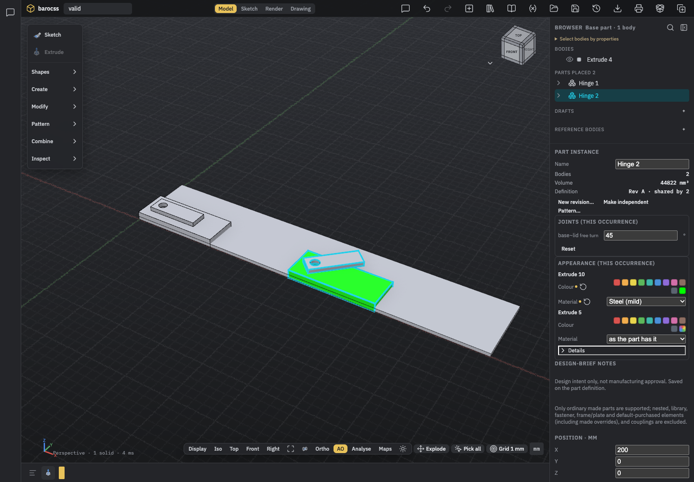
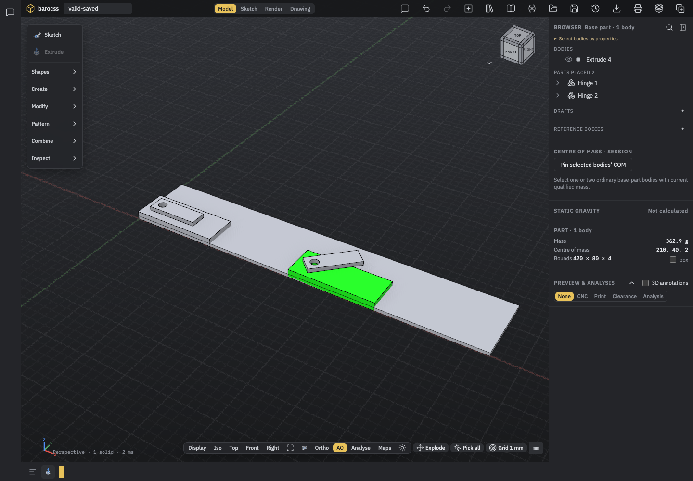
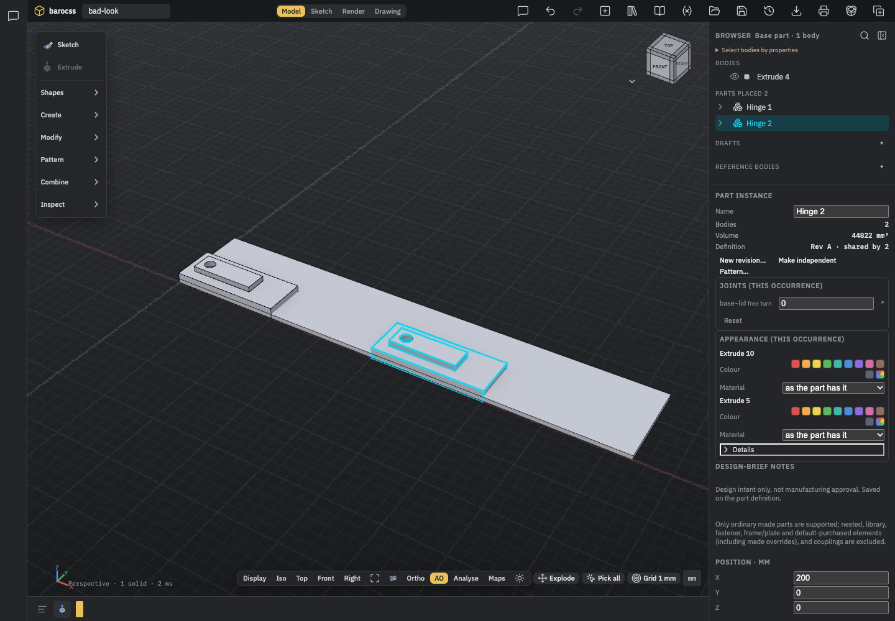

# Compound assembly placement (#660)

A single grouped `assembly` / `place` request with `joints` and `looks` previously returned from the joints branch, silently ignoring appearance (including invalid appearance). The handler now applies both immutable edits before reporting success. Any failure returns the original document, including placement and name.

## Verification
- Original implementation: focused regressions fail for omitted appearance and partial success on invalid color.
- Final focused plus flexible-subassembly / instance-looks regression: **46/46 PASS**.
- Model TypeScript and changed-file ESLint checked separately.
- Actual Chrome: dispatcher + evaluator produce valid and invalid result documents, consumed by Studio native Open. Valid Hinge 2 has 45-degree joint, green body, Steel (mild), and no held appearance. Joint Reset / Undo / Redo and native Save / fresh Open preserve the appearance. Invalid color and invalid joint preserve the original full document.
- Frozen source hashes unchanged for 1299 files; no browser errors; native roundtrip semantic equality for all three documents.
- Read-only review found no blockers.

## Fixture correction / scope
An initial fixture used output key `b2`; this was a held override, not proof of visible application. Final fixture uses the persistent body key `b1`, asserts `heldLooks` is empty, and was rerun in Chrome. An absent body key is not generally invalid under existing held-appearance policy; the negative case uses invalid color. No changes to that policy, appearance geometry, joint algorithms, or schema. This is the actual command dispatcher and document consumer path, not a malformed numeric-input UI claim. Existing unrelated PDF golden / Workspace lint limits remain outside this qualification.

