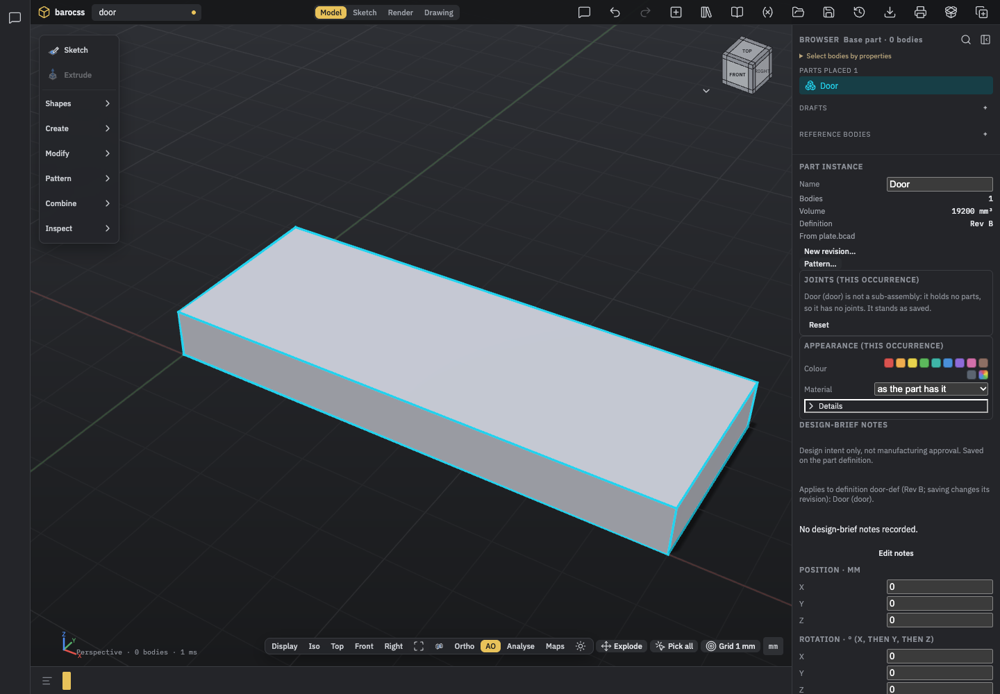
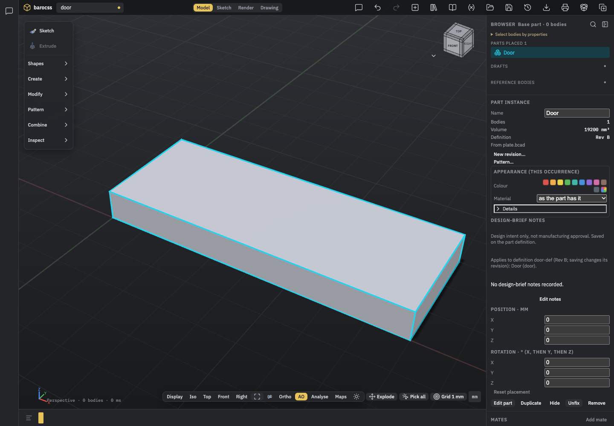

# Retained occurrence joint diagnostics in get_assembly (#692)

Baseline b3462e4a0: a hinge occurrence posed 30 degrees accepts an ordinary plate revision via actual Studio UI. Stored base~lid remains 0.523598775598 radians by design. Inspector correctly says it is no longer a sub-assembly and offers Reset (#686). Public get_assembly on that exact accepted document omitted joint_problem, despite reading the same valid document without mutation.

The one-line fix consults instanceJointsOf when stored joint state exists, not just when the current definition has nested parts and mates. It changes diagnostics only, not geometry, revision, saved state, solver, or automatic recovery.

## Verification
- Focused summary/flexible/concentric-summary tests 22/22 PASS. Normal plain, normal posed hinge, no-mates stale state, query immutability and explicit reset covered.
- Scoped lint and Studio tsc --noEmit PASS; read-only review no blocker.
- Actual Chrome baseline FAIL at missing joint_problem after real Accept Rev B.
- Fixed frozen Chrome PASS: summary agrees with Inspector, stored values remain unchanged by querying; explicit UI Reset removes only joints, summary problem disappears, Undo/Redo and native Save/fresh Open remain exact.
- Receipt changes=[]; two contexts, browser and server closed. Disk available 18 GiB.

The public summary is checked by the bundled public dispatcher against the actual UI-produced document; no claim that a live LLM executed the command. Screenshots show the unchanged Inspector contract and explicit recovery; receipt contains baseline/fixed JSON evidence. No new dynamics activation or HOLD expansion. No full-suite claim.

