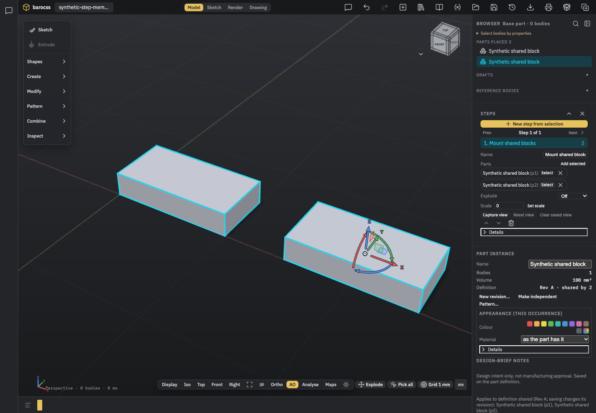

# #207: select exact occurrences from instruction-step members

Implemented bounded top-level member selection. Final actual02, focused Studio tests 24/24, Studio type check and targeted lint PASS. Commit/push/exact-commit CI are pending. **#207 remains OPEN; autoplay and other existing HOLDs are unchanged.**

## User-facing scope

Each current-step member has its occurrence ID and a separate Select button. Same-name/shared-definition occurrences stay distinguishable. Select replaces session selection with exactly that occurrence and exposes its existing Inspector; it does not Show, Fit, move parts, edit the document or change step membership. Take out remains a separate undoable action.

Admission requires the exact current step and a uniquely identified top-level member. Missing/base/nested or duplicate identities are disabled/refused. Hidden and generated pattern occurrences can be selected without changing hidden state or pattern placement. The App checks current document/session/selection/step/mode/edit/open/worker ownership before using the existing selection action. In-progress bearing-specific editing remains blocked.

Ordinary Inspector fields retain normal blur behavior. A typed Name is committed before navigation; if that commit retires the original selection callback, an explicit subsequent Select succeeds. Select no longer prevents pointer-down's normal focus/blur behavior.

## Actual evidence

Baseline03 used two same-name occurrences sharing one definition. Member labels did not select them and only Take out buttons existed. Actual outliner selection and Inspector position/rotation X values were the positive control. The accepted document and Undo/Redo availability stayed unchanged.

Final actual02 checked:
- exact p1/p2 selection, ID labels and pressed state;
- ordinary Name draft blur commit, explicit subsequent selection and Undo;
- independent Take out with Undo/Redo;
- actual native download/fresh Open, with session selection not restored;
- hidden member selection without unhiding and missing-member disabled state;
- generated pattern occurrence selection with its exact ID and existing pattern Inspector.

Receipt records zero browser errors, console errors and tracked source changes; four contexts, browser and server were closed. Stored full-document comparisons establish data preservation only, not geometric accuracy.

## First failures and corrections

1. Baseline01 failed before product qualification: the fixture looked for Assembly steps in the Inspect rail. Corrected to the existing command palette route.
2. Baseline02 failed on a strict locator: Position X and Rotation X share a label. Corrected to assert both headings, exactly two inputs and values `[positionX, 0]`, not a weakened first-match check.
3. Baseline03 PASS.
4. Actual01 all functional assertions PASS, but visual review found Select squeezed into the fixed-width icon button. Select alone changed to the existing `Button` xs/ghost style; Take out stayed unchanged.
5. Studio tests02: 23/24, one SSR assertion incorrectly interpreted a CSS class containing `disabled` as a disabled HTML attribute. Corrected the assertion to inspect the attribute. This was not a disabled-product regression.
6. Final tests03 24/24 PASS; final Studio type and targeted lint exit 0; actual02 PASS. No further test executions are implied by this record.

## Limits and privacy

Synthetic fixtures only. No raw documents, machine paths or full receipts are published. Pattern expansion was fixture setup through the existing model helper, not public pattern-authoring proof. No stale callback injection, bearing-edit interaction, asynchronous race, nested occurrence selection, camera numerical invariance, pixel-highlight or geometry/mass certification is claimed. Ordinary Name draft behavior was actually exercised and is distinct from the untested bearing-edit path. History checks cover document data, visible rows and Undo/Redo availability, not private stack internals or dirty-state certification.

No Model product/schema changes, new animation player, automatic assembly planning or manufacturing validation were introduced.

## Screenshots




Images are unchanged bytes from baseline03 and actual02, respectively. The coordinating reviewer owns final visual qualification.

## Reproduction

Use the matching frozen pre-change source capsule for baseline. From repository root:

```sh
ASSEMBLY_STEP_MEMBER_SELECTION_BASELINE_FROZEN=1 node apps/cad-studio/test/assembly-step-member-selection-baseline-browser.mjs "$OUTPUT/baseline"
ASSEMBLY_STEP_MEMBER_SELECTION_FROZEN=1 node apps/cad-studio/test/assembly-step-member-selection-browser.mjs "$OUTPUT/actual"
```

See `verification.json` for run-specific source hashes and qualification status.
