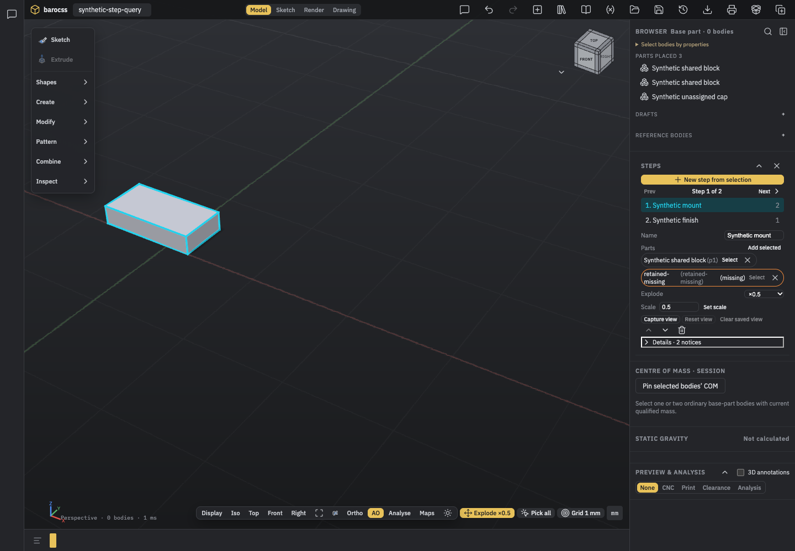
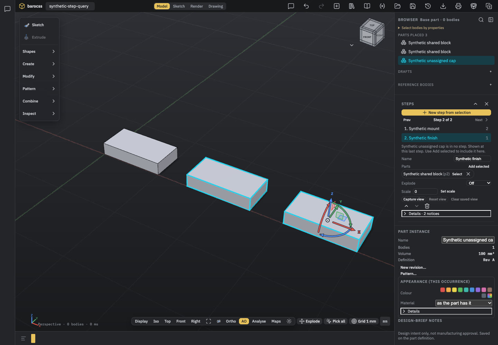

# #207: opt-in saved assembly instruction query

Baseline01 and actual01 PASS. Focused suites 31/31, regression 15/15 and final tests 17/17 PASS (overlapping suites, not a unique-test total). Final Model/Studio type checks and targeted lint PASS. Commit, push and exact-commit CI are pending. **#207 remains OPEN.** Existing HOLDs and the documentation-sync pause remain unchanged; this is task-local verification evidence.

## Contract

Public `assembly` action `get` optionally accepts `include_steps: true`. It adds `assembly_steps` with scope `saved-top-level-instructions`, saved step indices/IDs/names/exact member IDs, unassigned occurrence IDs and existing step problems. Optional zero-based `step_index` requires the opt-in and returns the existing saved-step classification: installed, active, waiting, unresolved and unassigned.

This is not the current Studio step, actual visibility, an assembly plan or physical motion. Hidden parts can be classified as active by stored membership. Missing references stay literal unresolved IDs. Notes, saved camera and explode settings are not included. Existing geometry/face summaries remain unchanged. Omitted/false opt-in retains the default response; invalid new inputs refuse before geometry evaluation. Empty steps return an empty list and all placed IDs unassigned, with no invented state.

No native document or schema change is introduced. Reading does not author steps, move the camera, change membership or accept an assembly edit. Public `runTool` policy call counting is separate from document mutation.

## Actual observations

The synthetic native fixture has same-name p1/p2 sharing a definition, unassigned p3, two saved steps and one retained missing ID. Baseline publicly called `runTool(..., 'assembly', {action:'get'}, ...)` and compared the dispatcher result. Stored steps appeared in the actual Steps panel but were absent from default output; unsupported opt-in was refused. Native download and fresh Open preserved the fixture.

Actual01 used copies of the actual Studio-accepted documents in the inspector harness. List-only and explicit indices 0/1 returned exact expected classification independently of UI navigation. Default and false responses were byte-equal, and removing the additive field from opt-in responses recovered the default summary. Five malformed requests refused. Queries and UI navigation preserved full stored documents, visible history rows and Undo/Redo availability. A real native download/fresh Open retained the steps and identical query results.

Both receipts show zero browser errors, console errors and tracked source changes, with two contexts, browser and server closed. The coordinating executor additionally compared baseline default-summary and actual ordinary-summary dictionaries: equal.

## Validation and correction history

- Focused tests: 31/31 PASS; regression: 15/15 PASS; final tests: 17/17 PASS. Seven dedicated tests cover defaults, opt-in whitelist, index classification, empty lists, refusal-before-evaluation, owner/reference examples, face compatibility and public describe/output schema.
- First Model type check FAILED with TS2339 in the new test: after the expected-shape assertion TypeScript knew the object had no `state` property. The executor changed the test to an own-property absence check; no product correction was required.
- Final Model type02, Studio type02 and lint02 exited 0. Empty logs were inspected; exit statuses were supplied by the coordinating executor.
- Tool snapshot UPDATE compatibility check PASS with zero snapshot diff, reported by the executor. The grouped tool uses a generic action/input contract; action-specific optional fields are exposed through describe. No hand-edited snapshot expansion is claimed.

## Limits and privacy

All model names, IDs and notes are synthetic. Raw receipts, full documents and machine-specific paths are not published. The harness invokes the public tool runner on accepted-document copies, **not an external MCP transport or chat UI conversation**. Dispatcher comparison is separately identified and does not substitute for session policy gates.

Hidden, manually tagged pattern and nested-reference cases are unit fixtures, not actual native/UI qualification. The nested definition fixture uses independent identity. Actual fixture has no camera value, so camera/explode non-disclosure relies on the whitelist/unit checks, not an actual camera-export test. No geometry/mass/pixel accuracy, playback, late-result race or manufacturing qualification is claimed. Document/history-availability comparisons do not certify private history-stack internals or dirty state.

## Screenshots





These images show the existing Studio Steps consumer. They do not depict an API response widget or a chat conversation; query assertions are separate evidence. Files are unchanged bytes from baseline01 and actual01.

## Reproduction entry points

Baseline01 used pre-change commit `667af963ff6c391c9aeaa622cae434b36309f4a5` with the baseline fixture added. Its negative assertions intentionally fail against the implemented product. Use that matching frozen pre-change source capsule, not current product sources, for baseline. From repository root:

```sh
ASSEMBLY_STEP_QUERY_BASELINE_FROZEN=1 node apps/cad-studio/test/assembly-step-query-baseline-browser.mjs "$OUTPUT/baseline"
ASSEMBLY_STEP_QUERY_FROZEN=1 node apps/cad-studio/test/assembly-step-query-browser.mjs "$OUTPUT/actual"
```

For the final focused 17-test selection, from `packages/barocss-cad-model`:

```sh
TEST_CONCURRENCY=1 node scripts/test.mjs assembly-step-query toolset
```

This is the focused reproduction selector, not a claim of an additional execution during evidence preparation.
