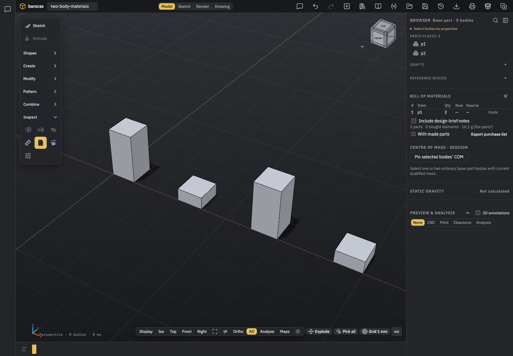
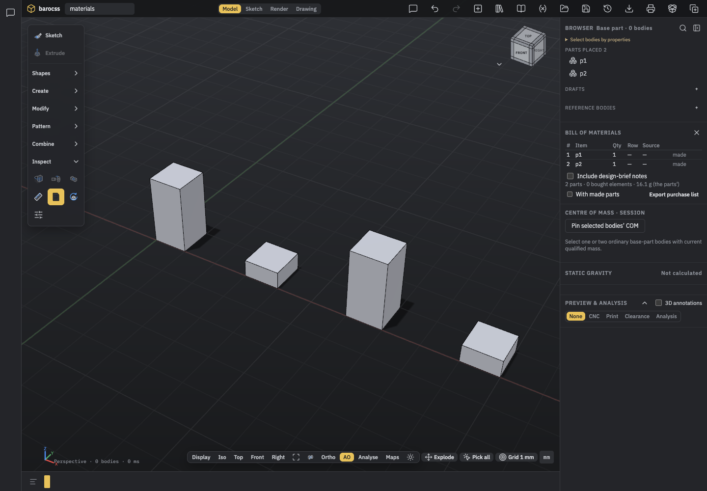

# #666 — Multi-body material identity in the BOM

## Reproduction
At main `70dff2df1`, two occurrences of one two-solid definition differ only in the second body's material. p1 is 6.75 g; p2, with the 500 mm³ body changed to steel, is 9.325 g. The old BOM merges both into one quantity-2 row (16.075 g). A focused assertion and the actual Studio BOM both reproduce the incorrect grouping.

## Change
Use the existing `partMaterial` summary: one shared material ID, else null for mixed/unassigned. Multi-body identity includes the sorted mapping of evaluated body keys to effective materials. Definition and occurrence materials use the same effective document as mass calculation. Colours and body visibility do not affect identity. Single-body fingerprint convention, geometry/cut fingerprints, nested structure, quantities and mass arithmetic remain unchanged.

This does not introduce detailed material-list UI, a new material schema or any CSV columns. The existing mixed/null convention does not claim to enumerate materials. No document data is rewritten.

## Verification
- BOM, instance-looks and assembly-cut focused regression: 113/113 PASS. Final focused material tests 5/5 PASS, including uniform steel, mixed composition, swapped ownership, colour/visibility, reset, nested parents, native roundtrip and exact CSV columns.
- Model TypeScript and changed-file ESLint PASS. Read-only review found no blocker.
- Actual Chrome frozen run PASS: two quantity-1 rows, total quantity 2/mass16.075g, actual downloaded purchase CSV equality, native Save/fresh Open document equality and two rows retained.
- Pixel review confirms baseline one row vs final two rows. Sources unchanged, browser/server cleanup complete.

