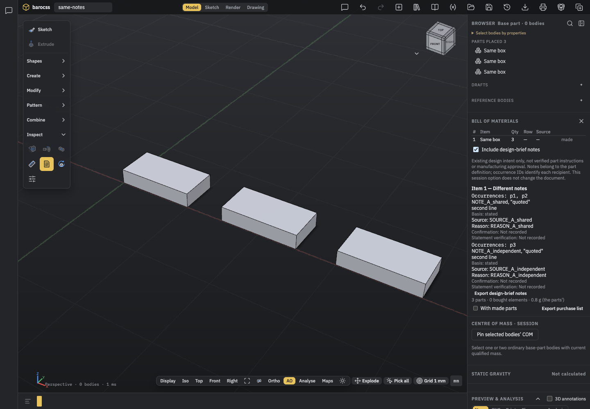
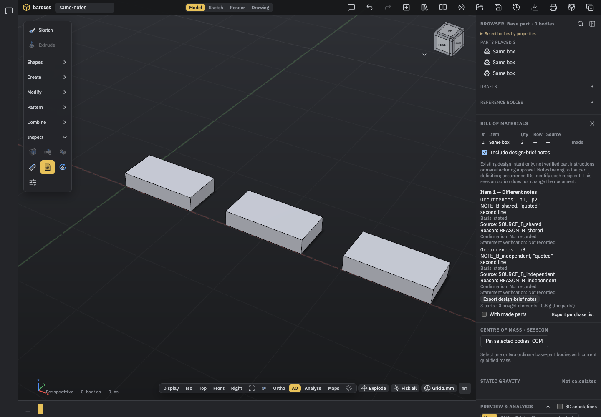

# #274: BOM notes opt-in across an already-open document replacement

Test-only addition on `ccb1565d96a54bde1af3545f8b751c71e40b12e6`. No product, schema, kernel or approval semantics changed.

The earlier delayed-response test deliberately closed A's panel before the held read. This complementary actual desktop flow leaves A's note consent open while the user opens B with the same filename, occurrence IDs and geometry.

## Verified bounded scope

- A displays its explicitly included notes before public Open B.
- B starts opted out with no note export button. Only explicit new consent permits export.
- Explicit opt-out removes note export. Re-consent restores it without changing the accepted Doc.
- Closing and reopening BOM requires fresh consent again.
- Three original Blob/anchor CSV captures are identical (530 bytes, SHA256 `e2b9912273b81dec24e9af170e3bdfe7ebad6eab24f092f4ffd2a962d7b1377b`). Independent Python csv/json parsing confirms one row, qty 3, p1/p2 versus p3 full Field mappings and no A text/source/reason.
- Actual images below were visually reviewed. Synthetic ordinary three-box parts only. They show accepted state after explicit consent, not the intermediate opted-out assertion.





## Checks and limits

One actual browser run PASS, syntax and scoped ESLint PASS. All 536 source capsule files stayed unchanged through cleanup; no page errors, console errors or watched source changes. Context, browser and Vite server closed; heavy gate released. See [receipt summary](receipt-summary.json) and independent parser results beside this note.

NOT_RUN: manually invoking retained React callbacks, delayed Worker responses (separate existing test), Save/fresh Open, project switch, older readers, geometry accuracy and full product suites. Captured CSV bytes are from the original Blob/anchor, not a browser-downloaded file. No whole #274 closure, whole CAD or manufacturing claim follows.

## Reproduce

From `apps/cad-studio`, Node 22.19.0, an isolated frozen checkout and the existing heavy gate:

```sh
PW_DIR="$HOME/.cache/barocss-playwright" \
CHROME='/Applications/Google Chrome.app/Contents/MacOS/Google Chrome' \
BOM_NOTE_OPEN_CONSENT_FROZEN=1 \
node test/bom-note-open-consent-browser.mjs /tmp/NEW-UNUSED-OUTPUT
```

No new dependency is needed. Preserve older evidence and existing WIP; this narrows only the previously untested open-consent lifecycle boundary.
