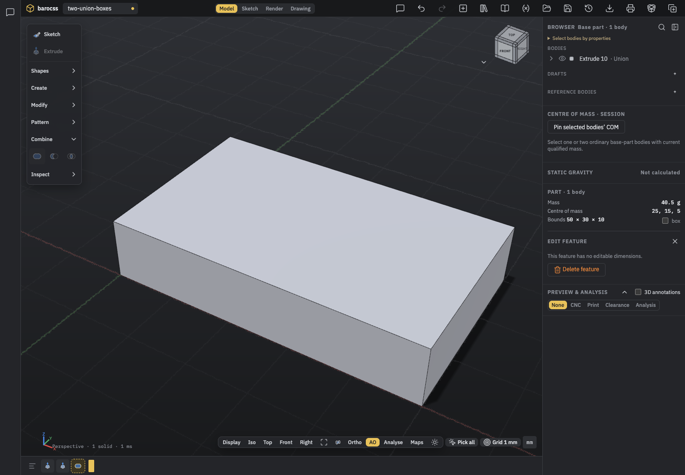
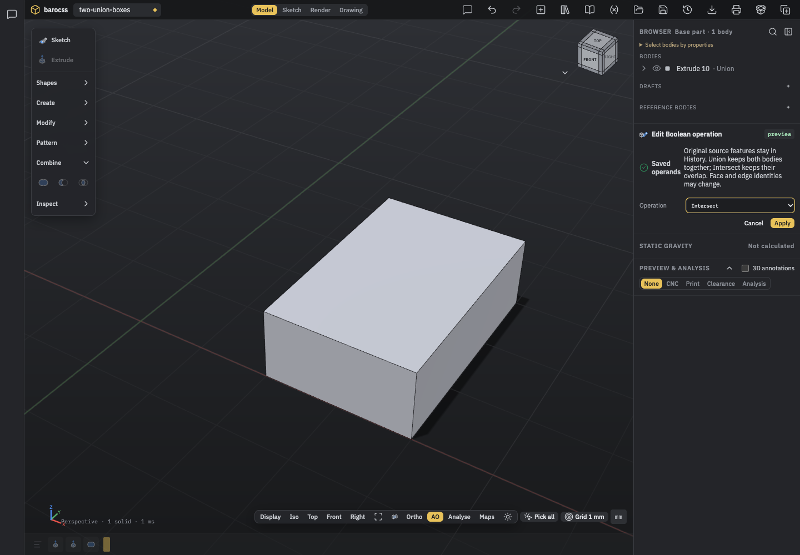
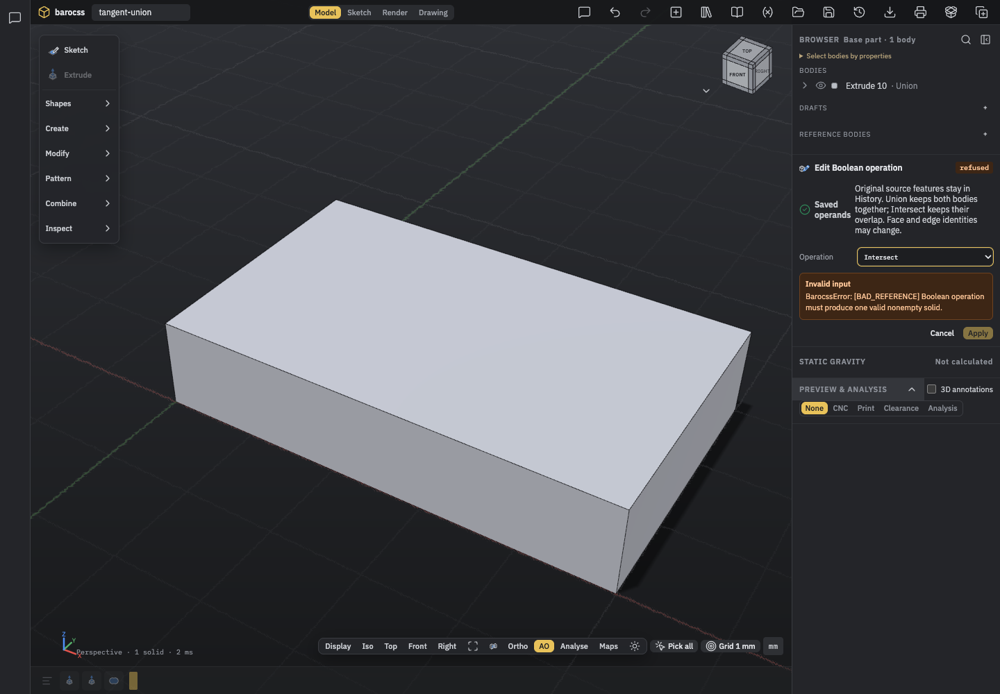

# Terminal plain-box Boolean operation editing (#730)

History now exposes **Edit Boolean operation** for exactly two independent numeric XY rectangle/extrude source pairs and their terminal Union or Intersect. Only the final node kind changes. Source geometry, IDs, operand refs, outputs and nextId stay exact. No schema/native algorithm change.

Both accepted and candidate geometry must be one strict valid nonempty solid with finite positive volume. Direct geometry, made/held/suppressed features, parameter-bound dimensions, downstream or metadata consumers are excluded. Captured document identity/revision and existing UI worker/evaluation guards remain required. Face/edge continuity is not promised.

## Evidence
- Product-unchanged actual Open → ordered Union creation → missing History editor → Undo/Redo → Save/fresh Open: PASS.
- Current fixed actual Union → Intersect → Union, Cancel, Undo/Redo, Save/fresh Open: PASS. Only kind changes in whole-document comparison.
- Independent native Union: 15000 mm³, centroid [25,15,5], 12 boundary points including the x=20 collinear seam. Intersect: 6000 mm³, centroid [30,15,5], all 8 corners.
- Tangent-box Union has 15000 mm³ and 12 points including x=40 seam. Empty intersection is refused, Apply disabled, document/history preserved; Cancel and Save/fresh Open retain native geometry.
- Existing Subtract browser regression: PASS. Focused Boolean + Subtract: 12/12. Model types, Studio types/Vite build and scoped lint: PASS.
- Initial fixture and type failures are recorded in verification.json, not hidden or treated as product successes. Baseline numeric tolerances were unchanged.
- Actual screenshots were inspected. Exact commit CI and public image render confirmation are recorded in the final issue comment.

