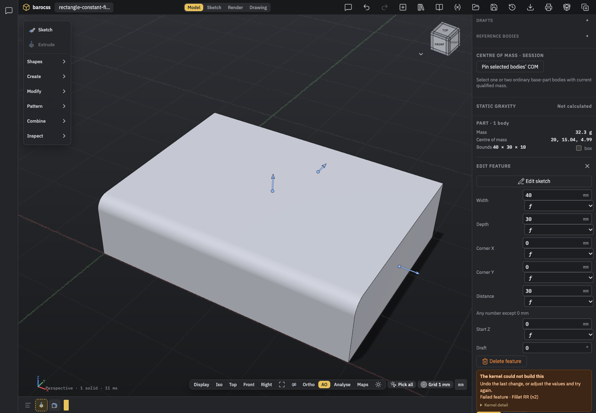
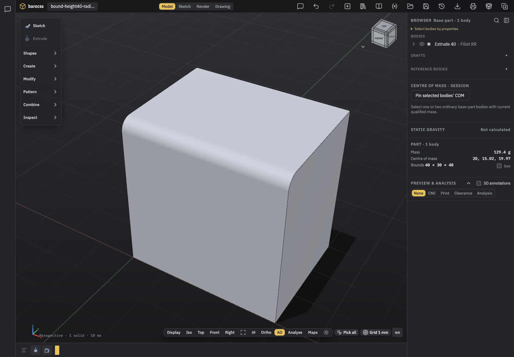
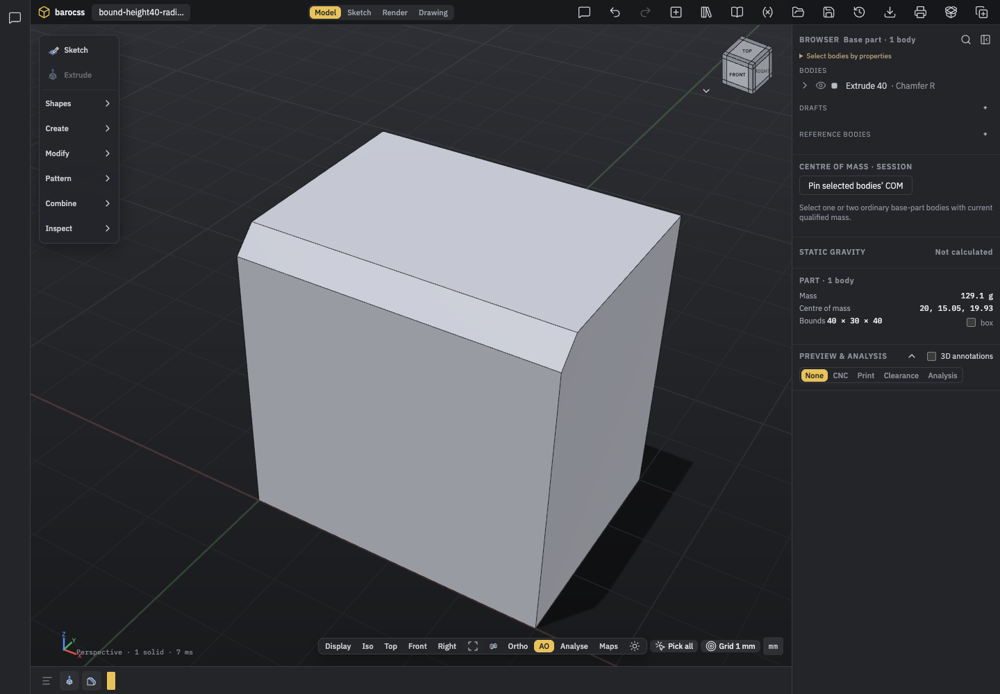

# Numeric Height with a parameter-bound terminal finish (#662)

## Scope

One plain root rectangle → positive numeric Extrude → single-edge terminal constant circular Fillet or equal-distance Chamfer. The finishing size may be a valid unchanged parameter binding. This is **not parameter-bound extrusion Height**, an endpoint varying law, combined Width/Height edits, or a general topology rematcher.

The only product admission change passes each document's parameter table into the existing `plain` check for Height. `positiveDimension`, complete metadata/parameter equality, unchanged finish binding, prior exact signature, full native cuboid topology/semantic-corner proof and full candidate evaluation remain in force. `historyFeatureApply` is unchanged, including its doc/open/worker/editor/scene ownership guards. No schema/codec, persisted parameter or kernel admission change.

## Actual baseline

Main 81dc2ec21: both Fillet and Chamfer with R=2 bound size refused Height 10→30 with `REFERENCE_MOVED`. Actual accepted document, history and native geometry remained the original Height10; Cancel also preserved them. This was safe refusal, not data loss. Both frozen baseline runs PASS as observations.

The candidate test baseline was 4/32 PASS, 28 expected FAIL before product implementation. After the admission change, related focused tests are **57/57 PASS**. The older blanket bound-finish Height refusal test now distinguishes newly admitted numeric Height alone from still-refused varying/combined edits. An unused copied test declaration was caught by review/lint and removed; final changed-file lint PASS.

## Final verification

- Actual Chrome Fillet and Chamfer flows PASS: Height10→30, first edit Undo/Redo, physical Save/fresh Open; subsequent Height14→40; invalid Height1 atomic refusal and recovery Height35 draft Cancel; actual Parameters R2→3, parameter Undo/Redo and final physical Save/fresh Open. Authored `{parameter:'R'}` remains intact throughout; no held reference region after reopening.
- Independent Python analytic volume/contact-point oracle against strict native B-rep, native blend midpoint (Fillet), and worker volume. Final 40×30×40, R3 Fillet: expected **47922.74333882308 mm³**, native **47922.74333882309**; Chamfer expected/native **47820 mm³**. Volume tolerance 1e-7 mm³; contact vertex tolerance 1e-9 mm.
- Both final frozen runs: 1,075 source files unchanged, page/console errors 0, browser/server cleanup confirmed. Actual baseline and both final screenshots viewed locally.
- 57 focused tests include native proof/parameter guards and real `createHistoryFeatureApply` with controlled replies: 3 async stages × 8 ownership changes cannot commit; the valid bound candidate commits once. These controlled tests are not real browser timing-race measurements.
- Studio build (TypeScript noEmit + Vite) PASS, Vite 6.54 s. Existing dynamic-import warnings remain nonfatal. ESLint on changed source/tests and diff check PASS. This is not the whole repository test suite.

## Refusal boundaries and limitations

Missing/inherited/malformed/nonfinite/nonpositive parameters; changed table/binding or simultaneous dimensions; bound extrusion Height; varying endpoint laws; foreign body, damaged native topology or stale prior signature remain refused. Actual browser geometry uses one top rim; other edges and adversarial ownership paths are focused-test/static scopes, not claimed as browser coverage. Existing schema/migration, manufacturing, Physics/Motion and broader fitter/HOLDs remain. Doc-sync is paused; this is task-local evidence.

