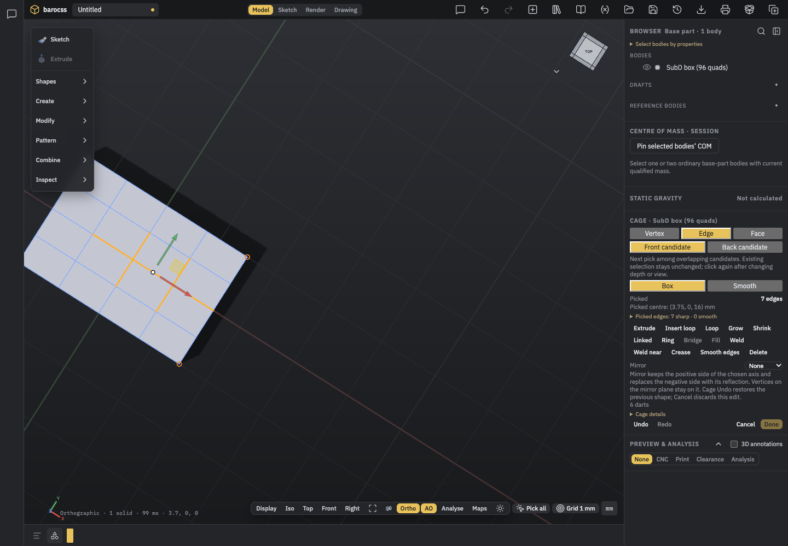

# Connected cage selection — issue #626

Parent: `ccb1565d96a54bde1af3545f8b751c71e40b12e6`. Independent worktree; existing owner's untracked drivers were not modified.

## Bounded contract

Grow, Shrink and Linked operate on the current editable cage and current pick mode. Vertex neighbours share an edge; edge neighbours share a vertex; face neighbours share an edge (not just a corner). Grow adds exactly one adjacency step. Shrink removes picked elements with an unpicked neighbour. A physical open border is not an imaginary unpicked element: a whole connected component and an isolated vertex remain selected. Linked selects the union of components containing the seeds, crossing crease edges. Geometrically overlapping disconnected cages stay disconnected.

Selection operations do not change cage positions, faces, creases, mirror, document or Undo/Redo stacks. A following geometry operation records its own single cage step and restores the expanded selection on Undo. Invalid current indices/nonedges are refused. Result order is deterministic in current topology order. No persistent reference IDs, schema change or topology repair is introduced.

This does **not** implement shortest path, crease barriers, arbitrary B-rep selection or final-surface manufacturing qualification. Issue #626 stays open. Existing HOLDs remain.

## Verification

- Focused Model: 18/18 pass (six connected-selection cases plus boundary-loop, selection-mode and crease-noop regressions).
- Model and Studio TypeScript: pass, Node 22.19.0.
- Changed TypeScript/TSX lint and browser-driver syntax: pass.
- Studio production build: pass (5.13 seconds; existing dependency directive/dynamic import warnings).
- Independent read-only review: no blocking algorithm/history defect; clarified Shrink tooltip to distinguish open-border policy from selected boundaries.
- Actual desktop Chrome/WebGPU first run: PASS at 1440×1000. Vertex Grow has the independent coordinate set (0,0,16), (±7.5,0,16), (0,±5,16). Edge Grow selects 7 edges; Face Grow selects 5 faces. Shrink restores each seed. Linked selects the single cube component (98 vertices / 192 edges / 96 faces); subsequent Shrink preserves each full component.
- Cancel leaves the accepted document unchanged. Grow→Crease records one cage step, cage Undo/Redo restores its selection and crease set, Done accepts seven creases, document Undo/Redo and actual downloaded native Save/fresh Open preserve the accepted document.
- Native file SHA256: `a3f290c528a269c4a3fa62aec9f87268d8daf7b4a7985dc6bb0455b4000ea105`. This is custody, not a surface-accuracy oracle.
- Zero page errors, console errors or watched-source changes; browser/context/server cleanup completed. Screenshot pixels inspected: controls and seven selected sharp edges are visible.
- After actual verification, fast-forwarded the disjoint #274 test/evidence-only main commit `9b3ca6ccf`; no product source changed during that integration.

Commands: `node packages/barocss-cad-model/scripts/test.mjs cage-connected-selection cage-selection-mode cage-boundary-loop cage-crease-noop`; `tsc -p packages/barocss-cad-model --noEmit`; `tsc -p apps/cad-studio --noEmit`; Studio `vite build`.

The browser matrix is finite: one 30×20×16 mm box with four quads per side, Vertex/Edge/Face Grow→Shrink→Linked, selection-only Cancel, grown-edge Crease, cage Undo/Redo, Done, document Undo/Redo and real native Save/fresh Open. Disconnected/open/invalid cases have pure exact-ID checks, not browser qualification.

## Actual screen

Actual tested synthetic box, not a concept illustration. No personal data. Surface accuracy, arbitrary cages, shortest-path and crease-boundary stops are not qualified.
