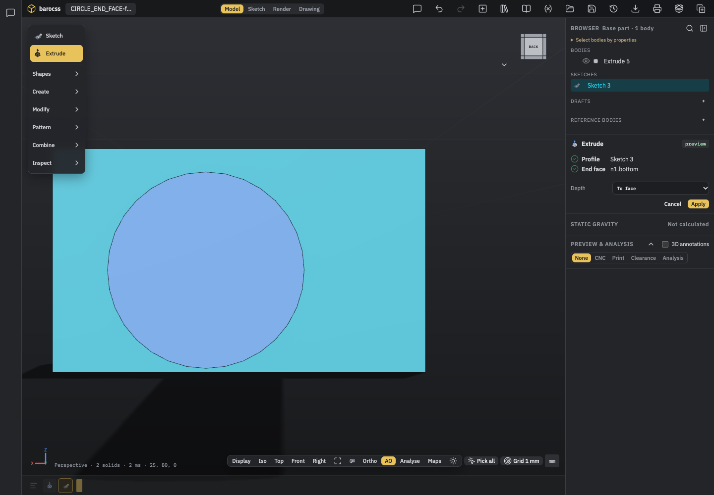
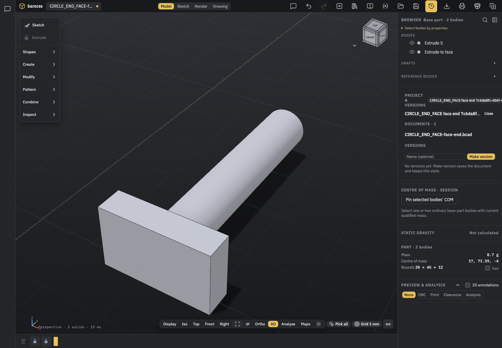

# Circular standoff to an original target face · #639 · 2026-11-17

A finite literal circle can now use the existing To face Extrude recipe on the exact XY, +X YZ and −Y Front XZ frames. The complete circle footprint must fit an earlier current exact solid's opposing rectangular planar cap. This lets a round standoff follow an upstream support plate instead of copying its distance.

Numeric center/radius only, radius at least public ExtrudedProfileLimits.minimumRadiusMM (0.01mm), local and world center±radius inside existing coordinate limits. Alternate outline, holes, regions, association/on and related metadata are refused. Existing native circle/prism, side tags, recipe and schema are unchanged. The native scale-dependent area/radius reconstruction refusals still apply: capability at the minimum radius does not promise native success at every center. Arbitrary frames, curved targets, parameters, general circle precision and Join/Cut remain outside this leaf; all HOLD boundaries remain.

## Failures and corrections

Pre-extension focused baseline was 1 PASS/3 RED at the source gate. Actual Chrome confirmed missing To face and explicit evaluation refusal for an authored circular recipe, with accepted document/Undo preserved.

First Model typecheck found optional face.name in the new oracle; optional access fixed the test. The first fixed browser then passed creation, target edits and OPFS reopen but timed out trying to edit hidden consumed sketch index2 directly. The driver now opens visible feature3 → Edit sketch → Diameter → Finish. Product behavior was not changed for this navigation failure. Static review confirmed the route and strict document expectation; actual rerun passed. Final evidence changes the camera to Iso so the plate cannot hide the standoff.

## Verification

- Focused model circle/triangle/front/face-end tests: 33/33 PASS. Scoped lint and diff check PASS.
- Model and Studio tsc PASS; Vite build 5.75s (before unrelated assembly revision guard FF).
- Actual circle and existing triangle browser workflows PASS, source freeze unchanged and cleanup complete. Final circle rerun includes latest assembly guard main.
- Four mutations killed: omitted radius bbox, local range guard, outline guard and minimum radius guard. Baselines before/after 33/33 and product source hash unchanged.
- Native unit oracles cover XY/YZ/Front, radii3/4, travel20/30, πr²h, centroid, opposed cap normals, cylinder radius/axis/center/outward flag, native vertex radial/height checks and side naming. Capability malformed input returns false without throwing.

## Actual workflow

Front origin(12,100,-7), source local center(5,3), radius3, target rectangle(-5,-3)..(15,9), thickness5. Independent world mapping is (12+u,100−t,−7+v). Pick n1.bottom, Apply To face, reject zero/reverse travel without changing accepted state, target20→30, Undo/Redo, browser-project Save/reload/Open, target40, then source Diameter6→8 via Edit sketch, Undo/Redo. Strict recipe/source identity remains unchanged except radius. Native and viewport mass and centroid, cap position, cylinder geometry and named side are checked at accepted checkpoints.

This is OPFS Save/reload/Open, not a new browser process/external download. Final target40/radius4 are not saved again. External STEP reader interoperability and broader CAD completeness are NOT_RUN. XY/YZ circle coverage is native-focused, not new browser coverage.

## Reproduce

```sh
cd packages/barocss-cad-model
node scripts/test.mjs face-end-circle face-end-triangle face-end-front face-end-extrude
cd ../../apps/cad-studio
CIRCLE_END_FACE_SOURCE_FROZEN=1 PW_DIR="$HOME/.cache/barocss-playwright" CHROME='/Applications/Google Chrome.app/Contents/MacOS/Google Chrome' node test/translated-extrude-end-face-browser.mjs /tmp/circle --front --circle
```



