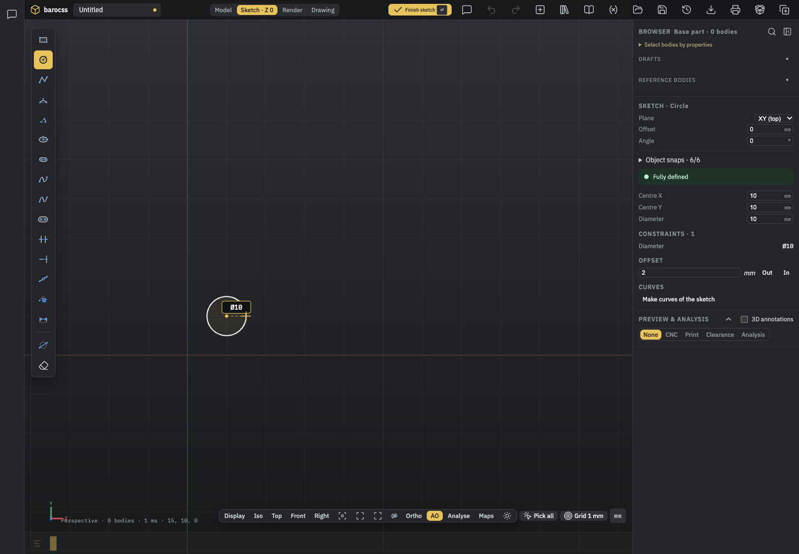
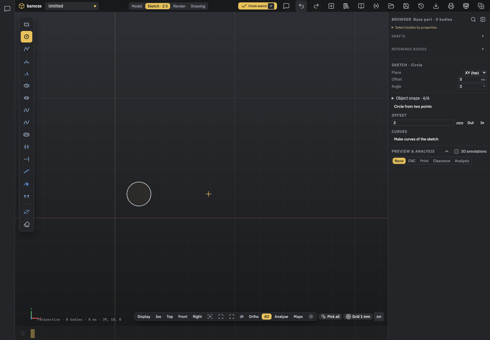
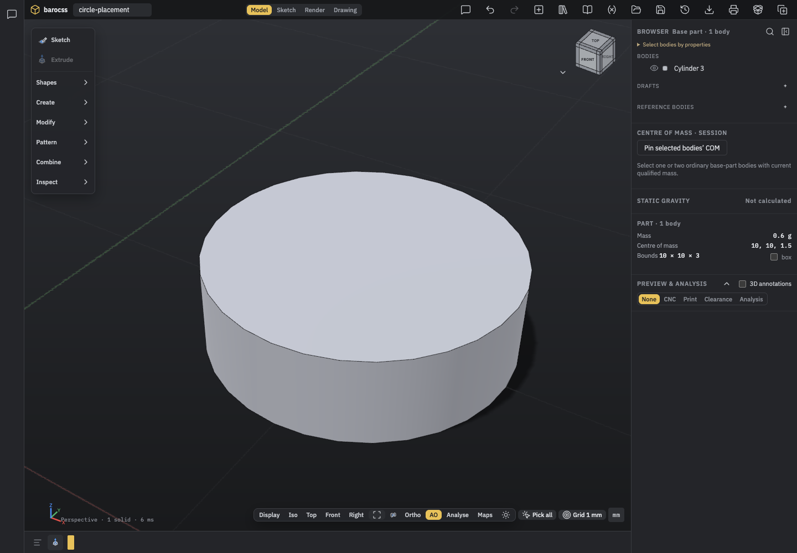

# Circle placement draft history (#664)

## Reproduced baseline and scope

Main 163e99e70: ordinary centre/radius two-click Circle visibly completes but Undo remains disabled. The accepted document is unchanged. A separate actual baseline confirms that a first-centre Ø2 preview stays parked across Rectangle→Circle tool selection; Escape preserves the accepted document. That pre-existing preview policy remains unchanged. Only completed two-click placements acquire a history entry, not each radius preview.

Explicit start/preview/finish origins now share the guarded Rectangle transaction, with kind/document/generation ownership. The final click emits even if its radius equals the last preview. Circle parking retains the exact authored object. Rectangle/Circle partitions match only ordered exact references with matching source metadata; Trim and polygon equivalence are not widened.

## Verification

- Focused Circle baseline: 6/9 PASS, 3 expected failures for cloning and mixed tool partitions. Final related tests 31/31 PASS, including Rectangle, draft selection and draft sketch history. Changed-file lint and diff check PASS.
- Actual frozen Chrome Circle PASS: empty→circle Undo/Redo, identical final preview, repeated/reselected Circle, pending Cmd-Z/Redo no-op, construction, mixed Rectangle/Circle history to empty and back, Escape, unchanged pending tool-switch policy, New part Keep with later completion and Undo, Discard from a nonempty document and a fresh-owner Circle Undo. Old draft/document is not revived.
- Native circle centre [10,10], radius5, extrusion3; Undo/Redo and physical Save/fresh Open PASS. Independent analytic volume π·5²·3 = 235.61944901923448 mm³; native 235.61944901923417 mm³, tolerance1e-7. Native vertices lie at radius5 and z0/3 (1e-8), strict B-rep valid. Worker volume also checked. Python independently recomputed the final analytic comparisons.
- Existing full Rectangle placement browser regression PASS, including Clear restoration, repeated/degenerate placements, pending keys, construction and native600mm³ Save/fresh Open.
- Final source capsules: 1,075 files unchanged, no page/console errors, browser/server cleanup confirmed. Baseline and final evidence images visually inspected.
- Studio TypeScript noEmit and Vite build PASS (Vite9.61s). Not a full repository test-suite claim.

## Retained first failure

First fixed browser passed initial atomic Undo/Redo, then its SVG polygon point-string assertion failed: active and parked Circle use different display tessellation (72 versus48 vertices). The fixture was corrected to compare 0.001px-quantized screen bounds plus exact authored centre/diameter fields; native geometry checks were retained. This display representation difference is not a native shape defect. The original failure remains recorded rather than relabeled PASS.

## Limits

Ordinary XY centre/radius Circle only. Slot, ellipse, chord-circle and attached-circle constraint editing are not newly qualified. Tool-switching a pending radius preview is not a newly undoable placement. New part Keep/Discard is browser-covered; arbitrary external timing races are not claimed. No kernel/schema/radius/snapping change. Existing manufacturing/Physics/schema/fitter/UI HOLDs remain. Doc-sync is paused; this is task-local evidence.

