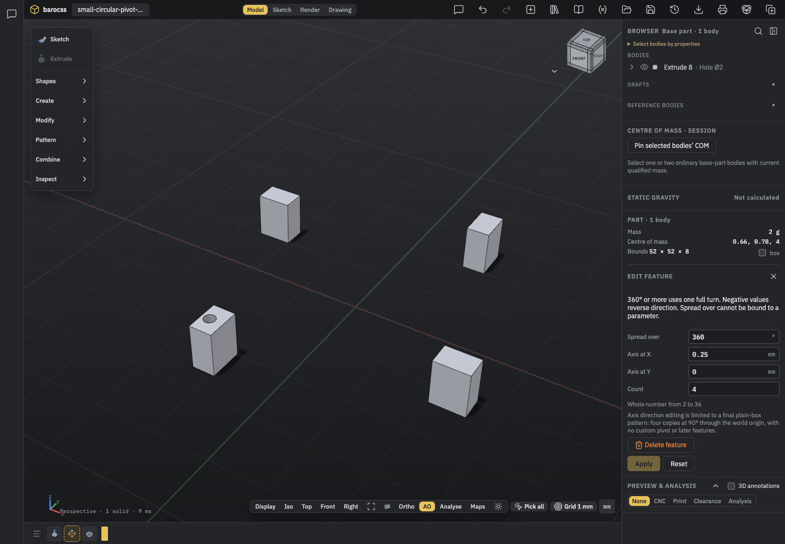
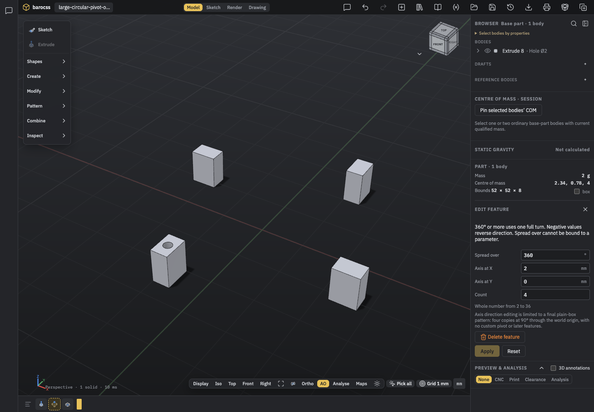

# Circular Z pivot: preserve a legacy terminal Hole's local position

Existing #20 and #25 remain OPEN. This is a bounded History correction, not general rematching or modern signature support. HOLD scopes are unchanged.

## Actual baseline and fix

A synthetic schema-3 file is opened through the real UI: rectangle `[10,20]..[14,26]`, Extrude 8, Circular Z Count4/90°/span360, and terminal through Hole radius1 at `[-12,-23]` on `n1.top@2`. Native admission verifies four bodies and the complete bore before editing. This is not actual Hole creation.

- Baseline Axis at X 0→0.25 accepted the stale world centre `[-12,-23]`, instead of `[-11.5,-23]`. Undo/Redo and Save/fresh Open retained it. Intended motion FAIL; lifecycle PASS.
- Baseline 0→2 safely refused because the old Hole missed the body. Original document/history remained intact, not silent data loss.
- Fixed 0→0.25 and 0→2 PASS: centres `[-11.5,-23]` and `[-8,-23]`. Native geometry, Undo/Redo, Save/fresh Open and reverse pivot-to-zero were checked.
- Mixed Count/pivot edits and overlapping layout refuse atomically with visible errors and unchanged document/history/Undo state.

Independent native checks cover strict BRep validity, four bodies, 32 stock corner positions, two cylindrical faces with the expected centre/radius/axis, and the second loop only on `n1.top@2`. Volume is `768-8π`; centroid subtracts the bore from stock centroid `[pivotX,pivotY,4]`. This does not claim a complete Hole-rim vertex bijection.

## Boundaries

The private `circularPatternHolePivot.ts` helper is delegated from the existing `patternHoleSpacing.ts` entry. Exactly four plain numeric nodes, a sole terminal legacy through Hole on the half-turn copy, fixed Count4/90°/Z/span360, and pivot-only changes are required. Original and new layouts must have separated rectangles and full bore clearance within coordinate policy. Only Hole centre changes by twice the XY pivot delta. Source nodes, names and IDs stay unchanged. Final native evaluation and existing transaction guards remain mandatory.

Uncertain active direct Hole references, modern signatures, mixed edits and invalid geometry refuse. Unchanged pivot, absent/inactive dependencies retain existing behavior. No native kernel, schema, renderer or App changes. Actual UI coverage is X; Y and combined XY are unit-only. General downstream topology and modern signature-bearing creation are NOT_RUN, not supported claims.

## Verification and interruption record

- New focused tests4 plus existing fixed-span7 and parameter-spacing9: **20/20 PASS**. Scoped lint, fixture syntax and diff checks PASS. Independent review completed.
- Initial focused run19/20 failed on exact native radius equality: the returned radius was `1.0000000000000002`. The test alone now uses independent `1e-12` tolerance; product code unchanged. Malformed old-pivot rejection tests were added and the full20 rerun passed.
- Fixed actual, existing Circular axis, Fixed span Hole and Linear pattern Hole browser suites: **4/4 PASS**. Receipts contain no errors or source changes and all contexts/browser/server closed.
- The initial combined session lost its connection after Model type-check started. Its type/build result is UNKNOWN, not PASS. On reconnection no related processes remained; only its verified dead owner's stale gate was removed. All four WIP source hashes matched, and browser receipts were recovered.
- A new separately logged run completed Model type-check and Studio TypeScript/Vite build: **PASS**, exit0 and gate returned. No duplicate execution or push occurred during uncertainty.
- Baseline and verified product base: `0ab84f4ff7cd9426a2ca342e0206417a27427b1d`. Latest main fetch before publication matched that base. Exact publication CI is recorded separately in the existing issues.

SHA-256: product helper `d65245586707074456b57fc88013a5cf8ae3910560ff087204df884f8c26a3f6`; integration `fa9c8c2616c4d84c953994f532dfb2a72bbb5735a03ea20ac142c2ed215495e7`; focused test `f09325f300418f5a2f07cb8a6c8e3656cf2645ff81a7c76d718e9a9dc70f93d4`; fixed browser `e0ef6f52b2e64df7d447cd597b40e2eced1c4fbae6ea574a479c2945d137c5c0`; baseline browser `b60dc9d0f2819080ec29be02a686bf7d3fdfa63aa38d5904bfbde5ff9ae79bb5`.
