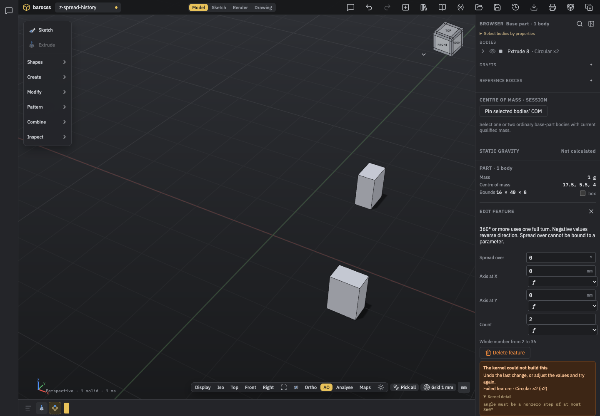
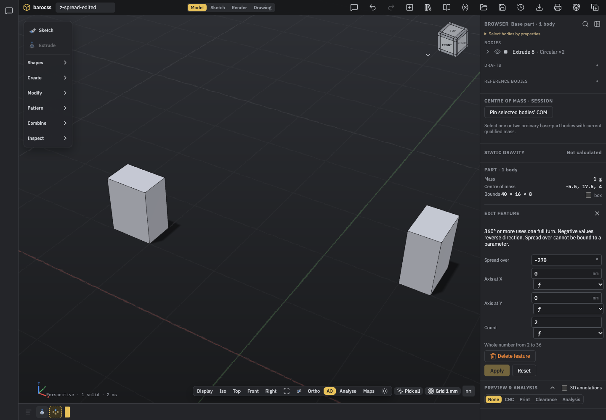

# Circular Z History: edit authored spread

Parent: `61bc58d7643c2e23ed48994b8993389fa99e38bd`. Issue #25 remains **OPEN**.

## User-visible change

History now offers **Spread over** for a Z circular body-pattern node with an explicit finite `span`. Editing it updates span and angle together, using the existing circular-pattern step calculation. Count, pivot (including parameter references and Z), parent, ID and other data are preserved. The field does not offer parameter binding because span is stored as a number, not a Dim.

This is not a new distribution algorithm or schema. Signed/large authored values are not clamped: values at least 360 use the existing full-turn step; negative values use the existing signed partial-spread calculation. Historical Count1 retains the existing 360 step, with no copies whose direction could be observed. Zero or excessive negative steps still go through existing evaluation refusal. Missing legacy span is not reconstructed from angle/count, and X/Y or Separate-copy graphs are not reinterpreted.

The prior actual [fresh History screen](../circular-z-axis-history-2026-11-17/fresh-axis-fields.png) on this parent shows Axis X/Y and Count, without Spread over. It is reused as before evidence; no new baseline run is claimed.

## Actual first run: PASS

`/tmp/cad-z-spread-after-01`, first attempt, Chrome WebGPU 1440×1000. Driver `test/circular-z-spread-history-browser.mjs` uses a saved synthetic rectangle/extrude/circular-pattern fixture.

- Close after a draft change leaves the entire accepted Doc unchanged. Blank spread disables Apply.
- 360→270 stores only the authored span delta, retaining Count4/angle90. This is an exact document/step observation, not an additional native32-corner run.
- Count2 computes angle270. An independent Python integer quarter-turn oracle checks exactly16 native vertices, key b2 and one result, with one-to-one coordinate matching at **1e-9 mm** tolerance; maximum observed residual0.
- Spread0 Apply displays `angle must be a nonzero step of at most 360°`. Accepted Doc, dirty indicator and Undo/Redo enabled states remain exact. This is the actual History evaluation rejection; the UI heading “Kernel detail” alone is not evidence of which evaluator stage executed.
- Editing the refused draft to −270 succeeds; the independent opposite quarter-turn16-vertex oracle again observes residual0. Undo/Redo restore exact positive/negative documents.
- Native Save downloads an actual `.bcad` file, parsed against the complete accepted Doc. A fresh browser context opens it with Spread−270, Count2 and the same complete document. A named parameter is present: no Spread parameter dropdown appears, while the existing Axis parameter dropdown does.
- Frozen source1043 files remain unchanged through cleanup. Initial subset3 is not the full capsule. Page errors, console errors and watched changes are all empty. Two contexts, browser and server close normally.

[Curated receipt](receipt.json) records original receipt/manifest/file hashes. [Saved file](saved.bcad), [independent oracle](independent-oracle.py), [positive result](positive-oracle.json), [negative result](negative-oracle.json).




Both screenshots were directly inspected: text is readable and synthetic, with no personal information. Geometry coordinates are established by the source oracle, not pixel measurements.

## Verification

- New5 + adjacent23 = **28/28 PASS**: spread, axis, span, count and editFields tests.
- Model and Studio TypeScript PASS.
- Targeted lint PASS: Model `src/app/editFields.ts`, new spread test; Studio `src/ui/NodeEditor.tsx` and new browser driver. No whole-repository lint claim.
- Driver syntax and git diff check PASS. Studio production build **4.68s PASS**.
- No first failure in this task. Review corrected an unsupported driver helper call before execution. Existing prior-task Count fixture failures are recorded in the linked axis note, not rerun/relabelled here.

[Logs](logs.txt) retain each original unredacted log's SHA256. Public copies remove ANSI/trailing spaces and replace the local home prefix with `<HOME>`; source/test evidence is unchanged.

## Reproduction

Use Node22, existing dependencies and the shared heavy gate before expensive commands. No new packages are required.

```sh
cd packages/barocss-cad-model
node scripts/test.mjs circular-pattern-spread-history circular-pattern-span circular-pattern-axis-history circular-pattern-count editFields
pnpm exec tsc --noEmit -p .
pnpm exec eslint src/app/editFields.ts test/circular-pattern-spread-history.test.ts
cd ../../apps/cad-studio
pnpm exec tsc --noEmit -p .
pnpm exec eslint src/ui/NodeEditor.tsx test/circular-z-spread-history-browser.mjs
node --check test/circular-z-spread-history-browser.mjs
pnpm build
PW_DIR="$HOME/.cache/barocss-playwright" \
CHROME='/Applications/Google Chrome.app/Contents/MacOS/Google Chrome' \
CIRCULAR_Z_SPREAD_FROZEN=1 node test/circular-z-spread-history-browser.mjs /tmp/cad-z-spread-after-01
```

`flow-helper.mjs` captures the source-file hash capsule before startup, after the test and after cleanup. The actual run followed completed product writes and a declared source freeze; freeze was released only after cleanup. The existing output path is evidence and should not be overwritten by a future rerun.

## Boundaries

No arbitrary-angle accuracy, full B-rep, volume or mass certification. Fresh Open checks document and field preservation, not another native oracle. Large/signed historical Count1 and malformed/stale setter boundaries are focused tests, not separate actual UI runs. Pivot bindings remain unchanged; no new span binding support. No previous-Subtract selection, new axis interpretation, Separate-copy reconstruction, schema/kernel changes or HOLD expansion. Protected WIP remains untouched.

Owned product files are Model `src/app/editFields.ts` and Studio `src/ui/NodeEditor.tsx`; new focused/browser tests and this note are the verification artifacts.
