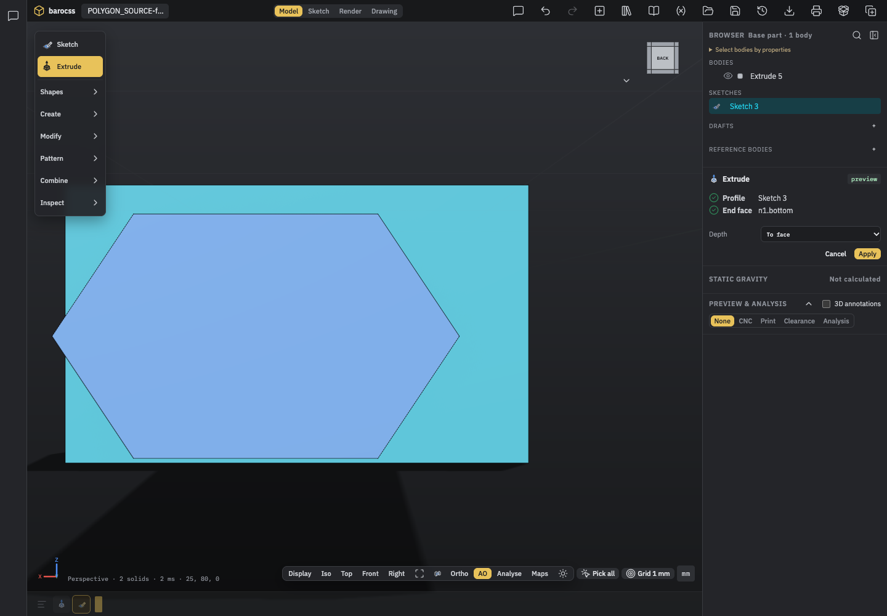
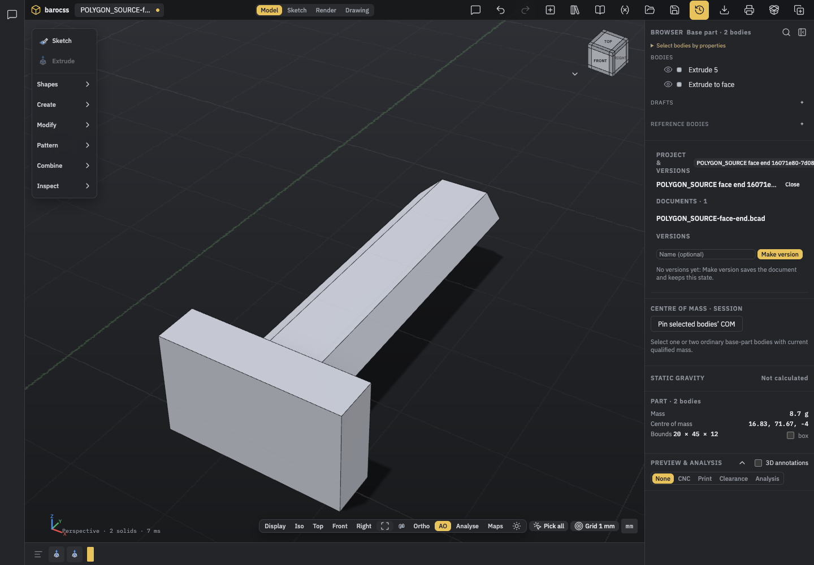

# Convex polygon source To face · #641 · 2026-11-18

Literal straight strictly convex polygons with3–8 points can use the existing To face Extrude recipe, supporting rotated quadrilateral, trapezoid and hexagonal standoffs without copying a target distance. The exact XY/+X YZ/−Y Front frames, current earlier exact target identity, opposing cap, whole-footprint containment and positive travel remain unchanged. No schema, recipe or native-kernel change.

The initial3–16 proposal was narrowed before implementation: the existing Sketch writer changes9+point outlines to `loop`, which would break the downstream polygon recipe on ordinary Edit sketch/Finish. This delivery admits only3–8. General concave/curved/holed sources,9+points, arbitrary frames and Join/Cut remain outside scope. Circle and target-cap admission remain as before.

## Geometry and metadata contract

Coordinates are finite and within the existing range. Exact integer determinants prove every vertex strictly inside every nonincident oriented edge half-plane, not merely consecutive turns. Existing minimum edge/altitude checks remain; the same proof is repeated after native-frame translation. This can conservatively reject a near-limit source when world rounding erases its local clearance. No epsilon expands admission.

The actual profile points remain the only footprint authority. Optional straight outline points must match their count, order and values; curved/alternate geometry is refused. New4–8point sources also refuse defined multi-region/dependency fields, even empty arrays. Existing triangle metadata behavior is retained. Constraints are not newly solved or silently removed by admission. Native side tags retain their physical walls in both windings.

## Verification

- Focused polygon/convex-target/circle/triangle/front/face-end suites47/47 PASS. Model/Studio tsc, scoped lint/diff PASS; production build6.01s.
- Native4/6/8point shapes, CW/CCW, all three frames, travel20/30: strict validity, independent signed-shoelace volume/centroid, cap normals, every physical named wall's vertices and document roundtrip equality.
- Repeated/collinear/concave/star/9point, short/range-invalid, stale/curved outline, alternate dependency and target-containment negatives.
- Direct world-rounding case: local altitude1.00000001e-7 is above native1e-7; adding100 rounds the height to9.999999406e-8 and admission refuses it.
- Independent static review found no blocker. In-memory esbuild mutation on three admission/refusal tests: original3/3 PASS, removing8point limit/global convex determinant/world validation each gives1FAIL/2PASS. No product files changed by mutation. This mutation run excludes native success tests.
- Actual baseline To face option absent and authored recipe refused. Baseline ran HEAD product temporarily, preserving fixed source and restoring it byte-for-byte (`5a1faa9640b1c5f45609bf67934b973bceccae92f0b0dfb176867582c4cb52b8`). Final browser source-freeze and cleanup PASS.

## Actual editable part

Front origin(12,100,-7), six-point source(0,3),(2,0),(8,0),(10,3),(8,6),(2,6), six side tags. Pick original target n1.bottom, Apply To face, reject zero/reverse travel, target20→30, UndoRedo, OPFS Save/reload/Open, target40. Then Edit sketch from the feature, change Point1 X0→−1, explicitly Finish, UndoRedo. Original source area48/centroid(5,3) becomes51/(241/51,3), so final volume2040 at travel40. All12 native corners, named physical walls and cap positions are checked, not inferred from pixels. Reopened source remains polygon with the same side IDs and outline metadata.

OPFS reload is not a fresh browser process or external download. The final target40/source edit are not saved again. Native tests cover4/8point and other frames; browser coverage is6point Front only. External STEP interoperability and broader CAD completeness are NOT_RUN. HOLDs remain.

## Failures retained

Focused baseline2PASS/3RED establishes the missing capability. First tsc found an inferred number-array in a negative fixture; adding the tuple type corrected the test. First browser passed target changes and reopen, but pressing Enter in Point1 already finished the sketch and the subsequent Finish click timed out. The observed document/native body had the expected edited point. The driver now commits the field with Tab before explicit Finish; the complete rerun passed. Product behavior was not changed for this fixture failure.

```sh
cd packages/barocss-cad-model
node scripts/test.mjs face-end-polygon face-end-convex-target face-end-circle face-end-triangle face-end-front face-end-extrude
cd ../../apps/cad-studio
POLYGON_SOURCE_SOURCE_FROZEN=1 PW_DIR="$HOME/.cache/barocss-playwright" CHROME='/Applications/Google Chrome.app/Contents/MacOS/Google Chrome' node test/translated-extrude-end-face-browser.mjs /tmp/polygon-source --front --polygon-source
```



