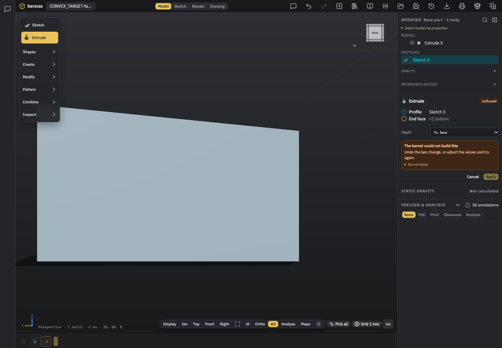
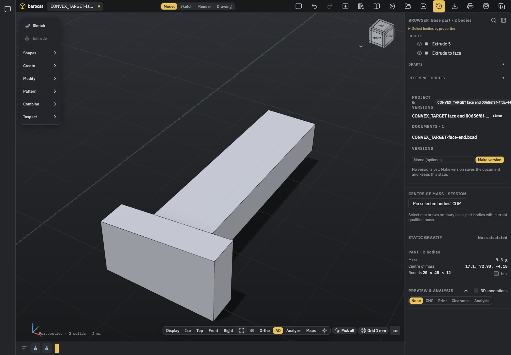

# Convex straight target cap for To face · #640 · 2026-11-17

Rectangle and triangular standoffs can now end on an earlier exact solid's triangular, sloping-quadrilateral or other strictly convex straight cap with 3–16 edges. The existing exact XY, +X YZ and −Y Front frames, opposing normal, current body/feature/face identity and positive travel remain mandatory. No recipe, schema or native-kernel change.

Every native ring vertex must be strictly inside every nonincident oriented edge half-plane. Source corners must lie inside or on all target half-planes. Binary64 coordinates are converted to exact integers before subtraction/determinants; no epsilon expands the accepted footprint. Holes, curves, collinear/concave/self-crossing rings and arbitrary frames remain unsupported. Circle sources retain the previous axis-aligned rectangular targets only: native circle radius reconstruction from rounded endpoints prevents claiming a general authored-disk proof. All HOLD boundaries remain.

## Verified

- Focused convex/circle/triangle/front/face-end model suites: 41/41 PASS.
- Model and Studio tsc PASS; scoped lint/diff PASS; Vite production build 6.23s.
- Native strict validity, volume, centroid, native vertices/cap normals, CW/CCW, three frames, travel20/30 and rectangle/triangle sources checked. Six/16-edge admission and over-budget, curved, perforated and nonconvex refusals covered.
- A sloped tangent at (8,8) on x+y=16 is accepted. One representable x step outside is rejected even when floating x+y still rounds to16. Separate axis-edge and bbox-inside/slope-outside cases are covered.
- Three in-memory mutations killed: removing projected containment, strict convexity or edge budget. Baselines before/after41/41; product source hash unchanged.
- Actual Chrome baseline reproduced refusal; final convex and existing circle workflows PASS, frozen product sources unchanged and browser/server cleanup complete.

## Actual part workflow

Front origin(12,100,-7), rectangle source(0,0)..(10,6), target outline(-5,-3),(15,-3),(15,9),(-5,7), thickness5. Pick original n1.bottom, Apply To face, reject zero/reverse travel, move target20→30, Undo/Redo, OPFS Save/reload/Open, then move target40. Independent target area220, volume1100 and centroid(175/33,83/33); source area60 and travel-based mass/centroid, cap and all eight target corners are checked. Existing circular-source regression also repeats source diameter6→8 after reopen.

OPFS reload is not external download or a new browser process. Final target40 is not saved again. Actual target-outline editing, circle-to-nonrectangle target, arbitrary frame, Join/Cut and external STEP interoperability are NOT_RUN/out of scope. XY/YZ coverage is native-focused, not new browser coverage.

## Failures retained

Pre-extension focused baseline2 PASS/4 RED and actual UI refusal establish the missing capability. First focused fixed run38/39 failed because the test expected a local ULP to survive translation by12; world rounding correctly erased it. The boundary fixture now uses origin0, and the additional sloped-ULP test exercises the exact predicate directly. First final tsc rejected a test fixture typed as pure SketchNode with Studio ids; using StudioDoc nodes corrected the test, not product code. An interrupted pre-recovery heavy invocation produced no result and was treated NOT_RUN before complete rerun.

## Reproduce

```sh
cd packages/barocss-cad-model
node scripts/test.mjs face-end-convex-target face-end-circle face-end-triangle face-end-front face-end-extrude
cd ../../apps/cad-studio
CONVEX_TARGET_SOURCE_FROZEN=1 PW_DIR="$HOME/.cache/barocss-playwright" CHROME='/Applications/Google Chrome.app/Contents/MacOS/Google Chrome' node test/translated-extrude-end-face-browser.mjs /tmp/convex --front --convex-target
```



