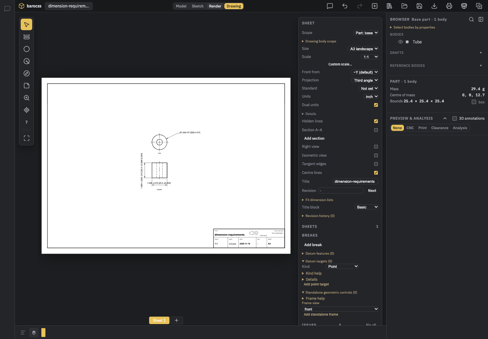
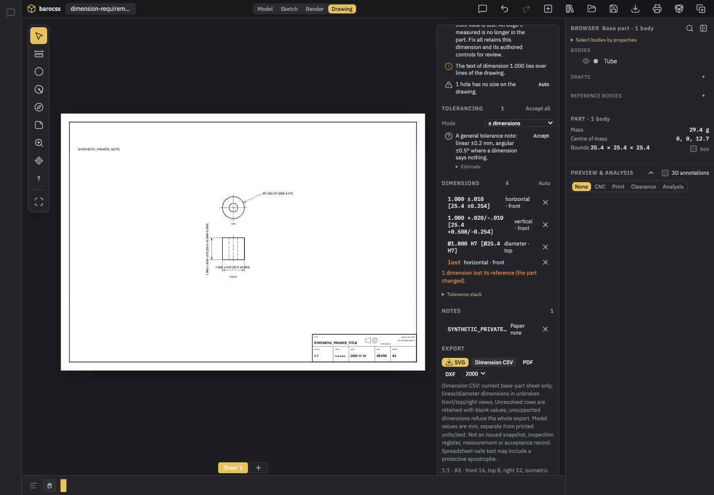
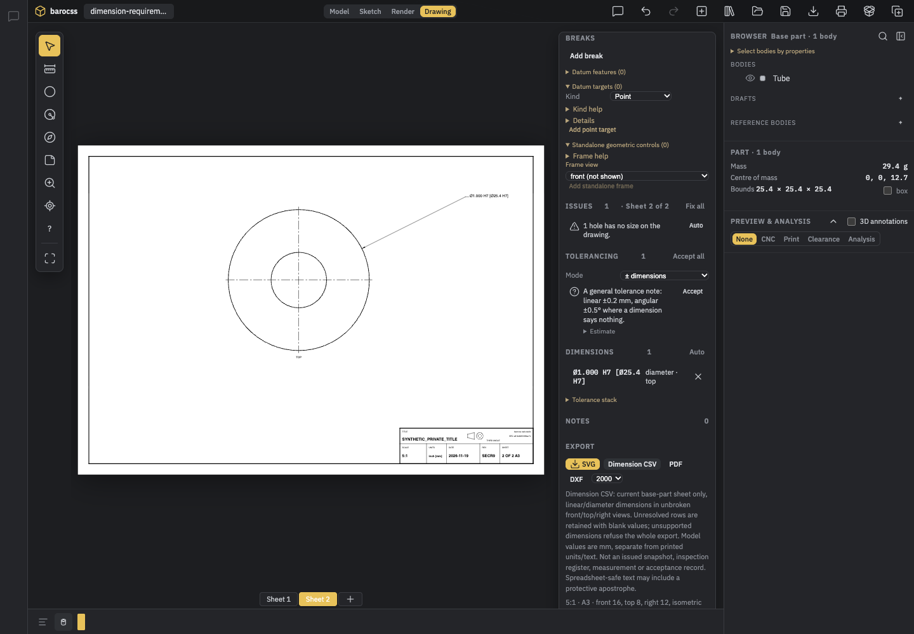

# #225: current-sheet dimension CSV

**Partial, non-issued list delivery only. #225 stays OPEN.** Validation baseline `e15e76261efb2bea5539e54a80e7db05f338f72e`, not the final integration commit; commit/push/exact-SHA CI are PENDING in this historical pre-push record. Integration base: `610a11895b43243f4778960f647f0e0dcb5b0479`.

## Supported contract

Export the current whole-base-part sheet's linear and diameter dimensions in ordinary unbroken front/top/right views. Columns separate original model mm from existing printed text/unit/dual display, retain authored symmetric/deviation/fit fields and basic/count, and keep unresolved rows with blank value/printed cells plus a reason. Fit codes are not converted into invented upper/lower limits. Unsupported current-sheet dimensions refuse the entire export, not silent omission.

Global dimension IDs must be nonempty/unique. Current sheet membership and resolved-object ownership are checked, with UI document/projection/currentness guards before synchronous delivery. CSV text uses existing spreadsheet protection. No notes, arbitrary source metadata, sheet names or revision labels are exported. No native schema or authored document mutation.

**This is not inspection-item identity/numbering, an issued-revision snapshot, a measurement log or an acceptance record.** Those core #225 requirements remain unimplemented here.

## Actual observations

- Baseline02 PASS: native synthetic tube, two linears and a diameter at 25.4 mm, inch/dual display and authored tolerances, plus a lost reference. Existing values were shown but no dimension CSV button existed.
- Actual02 PASS: four actual CSV downloads parsed independently with Python stdlib `csv`. Single-sheet and fresh-Open exports were byte-identical. Two-sheet exports contained 3 and 1 rows respectively; iso was explicitly refused. Original document, dirty indicator and Undo/Redo availability remained unchanged during export. Save/Open retained the original document.
- Raw model values were compared with synthetic expected 25.4 mm. Printed text was compared with the existing product formatter, **not** an independent rounding/standards oracle. No fit-limit inference.
- All four recorded runs had zero page/console errors and source changes, with owned context/browser/server cleanup. The two failed harness runs below remain FAIL, not qualified successes.

## Test results and retained failures

- Model focused serializer tests: **7/7 PASS**. Model and Studio TypeScript: **PASS**.
- Related Model selection: **43/44 PASS**; one existing drawing-sheets PDF golden mismatch. Exact parent HEAD replay: **26/27**, same mismatch. Its 754 repository source inputs were byte-verified against the pinned HEAD. Actual PDF hash `533e64765f48aeac1d244bc20b3aad7551feb08349b8d06ab1a69b619d5e4b66`; expected `d280596ee08f569553b20d08e72673421cb58fed919f1e0917128369a1dcd081`. This is not an all-green regression claim and this change does not alter PDF production.
- Scoped lint retained three existing Workspace unused bindings (`DrawingFix`, `_leader`, `_sheet`), matched against HEAD via stdin. New three files lint: PASS.
- **Baseline01 FAIL:** a strict `.dw-dims` locator matched two containers. Fixture locator was corrected; baseline02 passed.
- **Actual01 FAIL:** single-sheet and reopened CSV checks passed, then two-sheet `f.same` timed out on JSON key ordering despite semantic equality. The fixture normalized expected data; actual02 passed the full flow. No product behavior was changed to hide these harness failures.

## Reproduction and limits

Prerequisites: `PW_DIR` points to an existing package directory containing Playwright, and `CHROME` points to the installed Chrome executable. This fixture does not install either dependency. From the repository root, set those environment variables and supply an absolute external output directory:

```sh
export PW_DIR="$PLAYWRIGHT_PACKAGE_DIRECTORY"
export CHROME="$CHROME_EXECUTABLE"
DRAWING_DIMENSION_CSV_BASELINE_FROZEN=1 node apps/cad-studio/test/drawing-dimension-csv-baseline-browser.mjs "$OUTPUT/baseline"
DRAWING_DIMENSION_CSV_FROZEN=1 node apps/cad-studio/test/drawing-dimension-csv-browser.mjs "$OUTPUT/actual"
```

Baseline requires the pre-change parent and baseline fixture; it intentionally fails once the new CSV control exists. Source and artifact hashes are in `evidence.json`.

Hidden-view preservation uses pre-resolved unit input, not actual resolver evidence. Stale callback injection and pending-worker export races are NOT_RUN. Visible history/toolbar checks are not internal stack-identity proof. Geometry accuracy, manufacturing acceptance and full inspection-register lifecycle are not qualified. Existing HOLDs and doc-sync pause remain unchanged; this directory is task evidence only.

Only selected synthetic evidence is published. Raw documents, full receipts, source capsules, local absolute paths and account/authentication data are excluded. Screenshots show UI state; independent CSV parsing, not screenshot text, supports downloaded row assertions.




