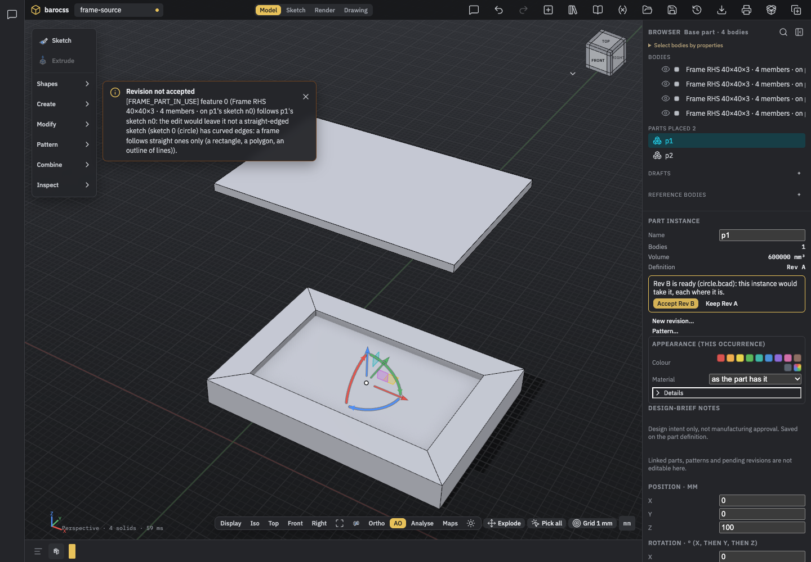
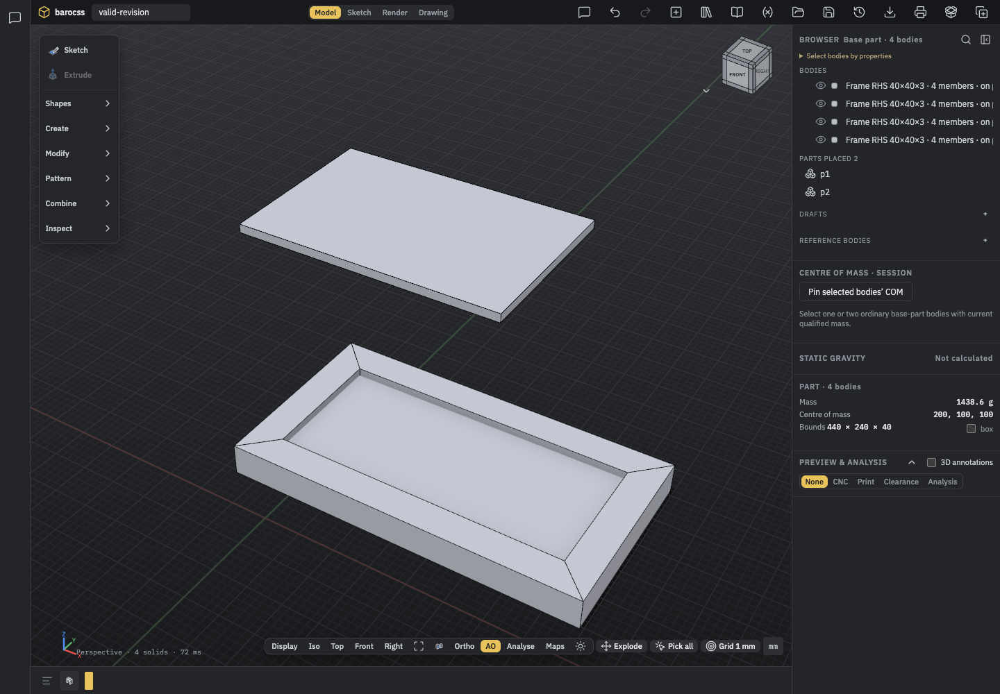

# #665 — Preserve followed frame sketches when a part definition changes

## Baseline
At main `163e99e701d87ccff3e8ac6b897e7df16a507086`, a valid standalone circle replacement was accepted by `editDefinition`, but the assembly evaluation failed. `offerRevision` → `acceptRevision` also accepted it. Actual Studio New revision → Accept Rev B replaced the followed rectangular sketch and removed the pending candidate; the unchanged-document assertion failed.

## Scope
Reuse FRf2/O125 `checkPartEdit` after expanding the proposed instances. Check every changed occurrence against the original document, including shared and unshared pattern seeds. Reject atomically from edit/accept only. Offer/pending storage, Dismiss, reference release and valid recovery remain available. No new reference schema, automatic relinking, sibling-frame support or doc-sync.

## Validation
- 21/21 focused tests: definition-frame-follow, frf2-frames, definitions, assembly-revision-admission.
- Model TypeScript and changed-file ESLint passed.
- Actual Chrome final frozen run PASS: refusal and pending unchanged; held Save/Open; Keep Rev A; valid width 300→400 acceptance; Undo/Redo; Save/fresh Open equality. 1298 source files unchanged, browser and server closed.
- The first fixed browser run timed out on a test locator (`Dismiss` instead of actual `Keep Rev A`) after refusal and held Save/Open passed. Corrected fixture re-run passed.
- Pixel review: refusal preserves Rev A, pending B and four frame members; final reopened view shows the widened frame.
- The Edit part UI was not separately driven: its shared definition operation is covered by focused core tests. Actual UI coverage is revision acceptance.

