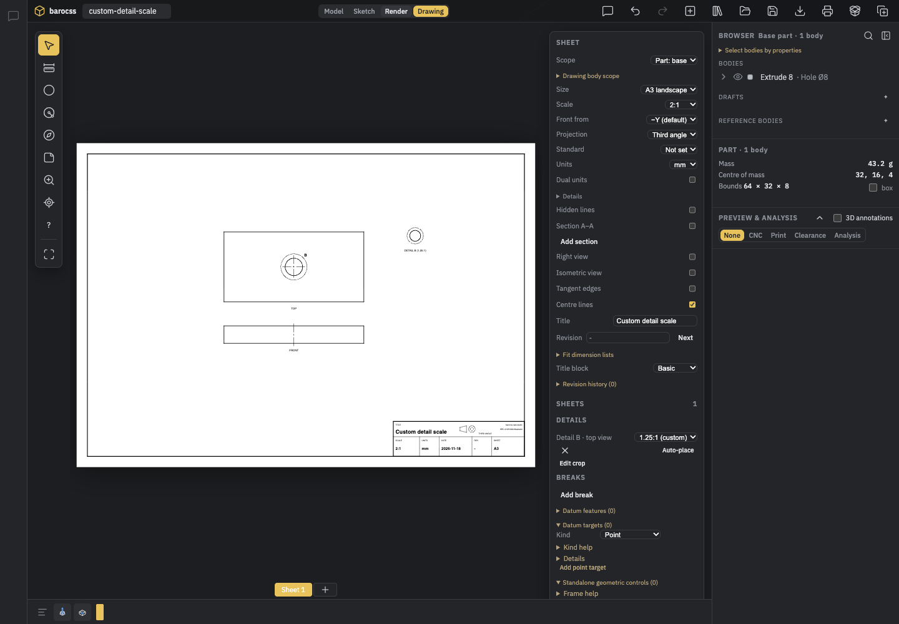

# Native custom detail scale readback

Base: `3b4fb7431b7b8d26766040289b516ed73ae2595f`. Issue #180, bounded engineering-drawing fix only.

## Defect and change

The Model accepts finite positive detail scales through 1000; the Studio selector previously contained only Auto and standard scales. A native detail with `scale: 1.25` was drawn at 1.25 but its selector displayed **Auto**. The selector now includes the exact current nonstandard scale, labelled `1.25:1 (custom)`. It does not round or change the saved value. Standard scale choices and Auto retain their existing meaning. This is faithful readback, not a new arbitrary-scale input or schema change.

## Actual verification

- Baseline 01: fixture equality helper timed out because it compares JSON property order. Corrected driver to semantic deep equality and then retained the accepted document's field order. Not a product failure.
- Baseline 02: actual Chrome assertion failed: selected value `auto`, expected `1.25`; native document still retained 1.25.
- Fixed 01: PASS. Original starter-plate fixture, one top-view detail radius 6 model mm, sheet 2:1, detail 1.25:1. Readback bounding box `[302.5,77.5,317.5,92.5]` has independently expected diameter `12 × 1.25 = 15` paper mm. Standard scale 2 produces diameter 24. Undo/Redo restore exact custom/standard scale; native Save download and fresh Open preserve 1.25 and selector; Auto explicitly removes only detail scale. Source nodes unchanged.
- Focused tests: 10/10 PASS (2 selector SSR tests, 8 crop/paper-position regressions). SSR covers custom 0.0001, 0.75, 1.25, 1.23456789 and 1000, all standard scales and Auto; each has exactly one selected option and no source mutation. Studio TypeScript, changed-file ESLint and diff whitespace checks PASS.
- Screenshot reviewed: reopened drawing and `1.25:1 (custom)` visible together. No claim about physical print, PDF or exports. No general precision or whole-CAD acceptance.

Commands (Node 22.19):

```sh
node apps/cad-studio/scripts/test.mjs detail-custom-scale detail-paper-position detail-crop-edit
node node_modules/typescript/bin/tsc --noEmit -p apps/cad-studio/tsconfig.json
node node_modules/eslint/bin/eslint.js apps/cad-studio/src/ui/drawing/DetailsList.tsx
DETAIL_CUSTOM_SCALE_FROZEN=1 PW_DIR=<existing-playwright> CHROME=<Chrome> node apps/cad-studio/test/detail-custom-scale-browser.mjs <output>
```


