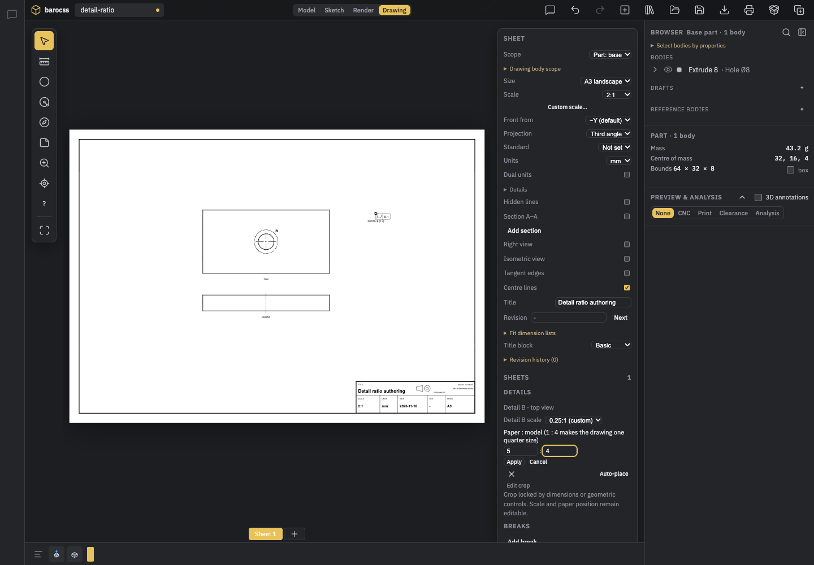
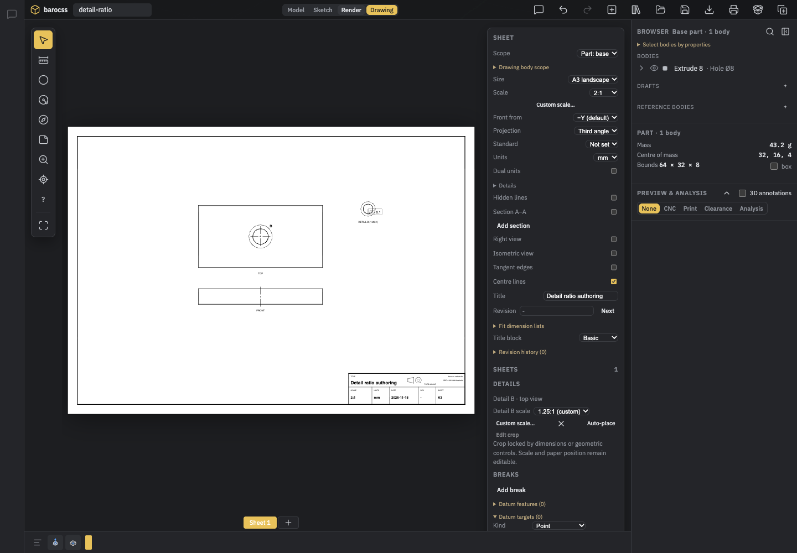

# Detail-view paper:model scale authoring

Detail views now offer Custom scale with explicit paper:model inputs, using the existing sheet ratio control and native numeric detail scale. New optional label/target props let each detail expose unique accessible fields; existing sheet defaults remain unchanged. Drafts belong to the drawing settings object and cannot transfer to a replacement document. Apply/Enter commit, Cancel/Escape discard, invalid ratios refuse. Existing Auto and preset behavior is retained. No crop, geometry, schema or chat-API changes.

## Verification

- Focused 8/8: detail exact readback/presets and new custom opener, paper-position/annotation preservation, ratio parser and sheet independence. Studio type/lint/diff PASS.
- Two actual detail Chrome runs PASS. The second adds a draft-form screenshot, without product changes. Radius6 detail: 1:4 yields paper diameter3mm, 5:4 yields15mm. Sheet scale stays2, crop/position/flatness frame/source nodes remain unchanged. Annotated crop remains locked but scale is editable as before.
- Invalid blank/zero/negative/nonfinite/too-large inputs leave the document unchanged; Cancel/Escape, Undo/Redo, actual native Save/fresh Open and document-owner isolation PASS.
- Actual SVG download contains DETAIL B (1.25:1) and retained flatness value; saved here. This is text retention, not general annotation-collision qualification.
- Existing full sheet-custom-scale browser regression PASS: independent1:4 and5:4 sheets, refusal/cancel/history/native flow and actual SVG dimensions retained.
- Draft form and reopened screenshots inspected. Source freeze and cleanup passed.

Drivers: `DETAIL_RATIO_AUTHOR_FROZEN=1 node apps/cad-studio/test/detail-ratio-author-browser.mjs <out>` and existing `SHEET_CUSTOM_SCALE_FROZEN=1 .../sheet-custom-scale-browser.mjs <out>`, with harness PW_DIR/Chrome environment.

## Limits

One top-view detail, explicit 1:4 and5:4 authoring, one flatness frame. No PDF/DXF/physical-print or general annotation layout certification. Arbitrary scale does not promise fit or collision avoidance; existing geometry/fit warnings remain. Parent epic/HOLD unchanged.

