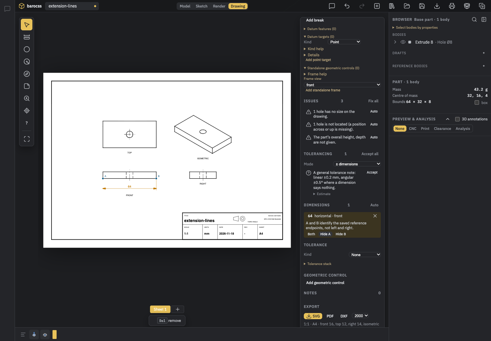
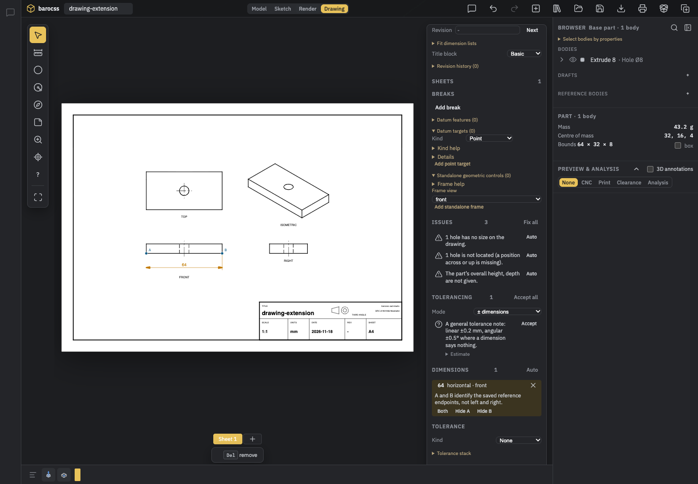

# #240: manual dimension endpoint extension visibility

Synthetic starter geometry only; no user documents or credentials. Bounded implementation, issue remains OPEN.

## Contract
Manual linear dimensions in ordinary front/top/right part views may hide extension A or B, or restore both. A/B identify persisted reference roles, not screen left/right or generated mark order. Values, references, main line, arrows and tolerances remain unchanged. A/B editing markers are not exported. A single toggle is one commit; disabled/stale ownership guards prevent unsupported edits.

Optional `hideExtension: 'a' | 'b'`; absent retains old behavior. Raw native document admission and Studio commit reject malformed or unsupported settings instead of silently dropping them. Schema3/4 retained, no migration. Lost references retain the setting; editing is disabled. Shared sheet marks also feed 3D annotations/PDF, with no separate display override.

DXF maps A/B to semantic definition points p1/p2. ACAD DSTYLE per-entity DIMSE1/2 overrides (75/76) preserve suppression through reader regeneration, as well as the supplied display block. Writer supports R12 and R2000; omitted setting leaves writer bytes unchanged.

## Verified
- Frozen Chrome actual03 PASS: Both → Hide A → Undo/Redo → Hide B → Undo/Redo → restore Both; native Save → fresh context Open → persisted A → post-Open restore/Undo/Redo. Entire synthetic document comparisons preserve source and refs; dimension remains 64.
- Six actual SVG and six actual R2000 DXF downloads saved without byte rewriting. Independent ezdxf 1.4.5 audit, original block and regenerated dimension extensions, measurement and references PASS. XML checks remove exactly the intended extension and preserve all other marks. Reader results retained alongside this note.
- Actual screenshot review confirms controls/explanation no longer overlap, and persisted A remains hidden after Open.
- Model related tests: 106/108 PASS. HEAD baseline overlay (no WIP replacement) reproduces the same two golden failures: circle DXF hash controls in drawing-linear-clearance, and plate-drawing/document.json fixture in dxf.test. All 12 circle error payload groups match; actual generated HEAD/WIP plate documents are byte-identical, SHA256 `4f14ad2bd46c1fc836d69cbc1777994ee9c4f3eb2bfa594f6edd829d90871f7c`. Goldens were not updated.
- New Model extension suite 13/13 includes horizontal/vertical/aligned, reversed reference roles, raw admission and malformed retained-reference cases. Studio commit/roundtrip 5/5; kernel extension/writer/dimstyle 21/21 PASS. Model and Studio complete tsc PASS.
- Targeted lint reports only three existing DrawingWorkspace unused names: DrawingFix, _leader, _sheet. No clean-lint claim.
- Browser errors, console errors and source changes empty; two contexts, browser and server closed. Final disk 36GiB; diff-check PASS.

## Limits / remaining acceptance
Actual UI fixture is one whole-part horizontal front dimension, created by synthetic native setup from genuine projected snap refs, not mouse authoring. Actual vertical/aligned/reversed/scoped-body/multi-dimension/multi-sheet/Auto/source-loss lifecycle, units/scale/view-change breadth and PDF/3D visual qualification remain unqualified. Existing annotations3d tests pass but do not establish new-setting visual correctness. Actual product R12 download is not qualified; R12 is covered by writer tests and separate synthetic reader probe only. No broad PDF/golden fix, schema5, UI redesign, release or deployment scope.

## Reproduce
Model: `node scripts/test.mjs drawing-extension drawing-linear-clearance drawing-basic-linear-clearance annotations3d dxf.test dxf-dimstyle dxf-local-gap` (two baseline failures above).
Studio: `node scripts/test.mjs drawing-extension-commit drawing-commit-roundtrip`; type-check both packages with their tsconfig.
Kernel: `node --test test/dxf-extension-suppression.test.mjs test/dxf-writer.test.mjs test/dxf-dimstyle.test.mjs`.
Root with PW_DIR/CHROME configured and independent ezdxf Python available: `DRAWING_EXTENSION_FROZEN=1 node apps/cad-studio/test/drawing-extension-browser.mjs <fresh-output-directory>`.

