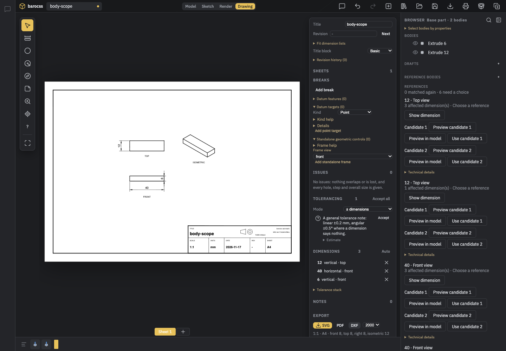

# Selected-body drawing reference recovery (#270)

## Reproduced defect and correction

On the two-box fixture after A width 30 → 40, the existing verifier offered excluded B (`n3.*`) edges among the six reference decisions, even though the drawing selected A (`b1`). The whole-part control reproduces this in the regression test. No automatic cross-body rematch is claimed by that reproduction.

The selected-body drawing now restricts signature lookup, verification and alternatives to the exact supported current body owner. Confirmation rejects a caller-supplied excluded-body target without changing the document. Missing/suppressed owners offer no fallback. Whole-part references, feature parent references and body colours retain their existing scope.

## Verification

- Model and Studio type checks: PASS. Targeted lint and diff check: PASS.
- Model focused tests: 50/50, including excluded-body verification/alternatives/confirmation refusal, explicit original-name confirmations and JSON re-open, missing/suppressed-owner refusal.
- Actual Chrome: original A-only projection → Auto → width 30→40 → save/fresh Open preserves six decisions; preview does not accept; explicitly choose each original A reference → Undo/Redo → native Save/fresh Open leaves no unresolved reference panel.
- Independent Python readback checks A volume 2880 mm³ / bounds 40×12×6 and excluded B volume 960 mm³, Worker projection and original SVG/DXF Blob visible-line/bounds. The browser driver suppresses the SVG/DXF download anchor, so this is original Blob readback, not OS filesystem download proof. Native save uses the real download path.
- No product edits occurred during the browser run; before/after/cleanup source capsules agree. Screenshots directly reviewed for content and privacy.

Six decisions remain after opening; no implicit signature refresh.

The repaired drawing retains the 40, 12 and 6 dimensions and both bodies remain in the authored source.

## Limits

Synthetic straight-edge extrude fixture only. No claim for revolve UI, imported/split outputs, concurrent Open/New/late worker races, PDF/ASME approval, or entire #270 completion. Candidate confirmation is explicit; selecting the original name here does not establish a universal automatic repair rule. Existing HOLD scopes remain unchanged.
