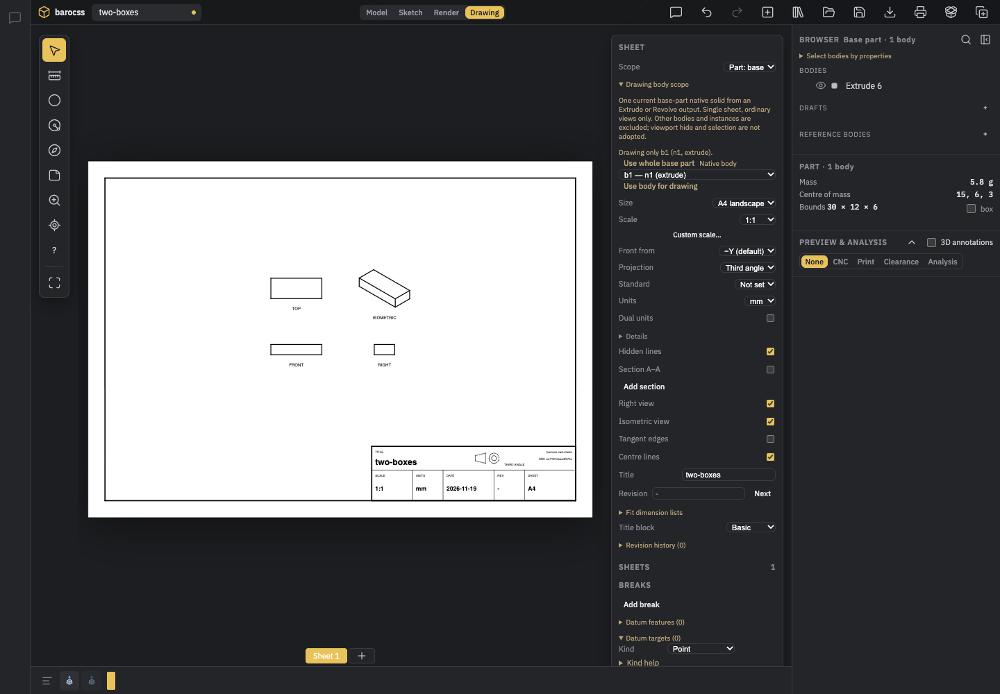

# #270: late decoded body-list outcome after suppression

PASS on `1d857f2fcb288461cb905e682200edfc76418231`, no product change. This is distinct from the earlier delayed drawing-projection response test.

## Public workflow and exact evidence
Synthetic two-box document, drawing initially scoped to A/b1. Model History: Suppress n3 → Undo, leaving public Redo available. Enter Drawing; narrowly tag the synchronous `Lanes.run("drawing-bodies")` request invocation, then defer one original `EngineClient.part(doc,revision,"read")` Promise outcome **after** original onmessage/FIFO mesh unpack completes. No Worker event interception or mutation; all requests/results remain original.

Held lane instance1/revision1: actual n3 active Extrude(sketch2,height10), outputs b1→node1/b3→node3; decoded native result b1(ref node1,solid), b3(ref node3,solid). Public Redo in the same Drawing DOM suppresses n3. Fresh result from the same lane instance, revision2, contains only b1(ref node1,solid). The exact actual node/suppression and result records are in `sanitized-summary.json`.

Current selector options are empty-placeholder and b1 only. Select b1 as an uncommitted draft. Original older decoded outcome is then delivered unchanged: b3 remains absent, current draft b1 remains selected, Use body for drawing remains enabled, accepted suppressed document remains exact. Complete drawing diagnostics and front/top SVG line attributes stay unchanged. Independent literal extents: front30×6 and top30×12 at absolute tolerance1e-7. Same Drawing DOM and lane instance are asserted.

Before releasing the old active-body result:

After releasing it, B stays absent and A draft remains usable:

Untouched individual screenshots of a synthetic document. The collapsed selector does not alone prove every absent option; exact option values and assertions are in the receipt/runner. No personal data or authentication information.

## Reproduction and limits
From repository root, with existing Chrome/PW_DIR setup: `CAD270_SUPPRESS_FROZEN=1 node apps/cad-studio/handover/notes/drawing-bodylist-suppression-currentness-2026-11-19/browser.mjs <output-directory>`. Archived runner changes only its helper import from local absolute to repository-relative; no product logic adaptation. Summary records original executed runner SHA. Original methods are restored in finally; successful run reports restoration true, context/browser/server closed, frozen source unchanged, no errors/console errors/downloads.

No Apply click, stale-Apply proof, Save/Open, exports, full SVG/right/iso comparison, independent mass reevaluation or broader native-family/HOLD claim. Native mass snapshots are observations only. This tests post-wire async delivery to the drawing hook, not raw Worker network or computation ordering.

Prior raw-hook attribution and global-scope after-wire attempts failed before holding the intended outcome. An observational normal-call pass established that actual part drawing scope is null and A/B scope-only returns the same full-part list; that observation is **not** a race PASS. This distinct run uses real public suppression and actual part node state instead. #270 remains open.
