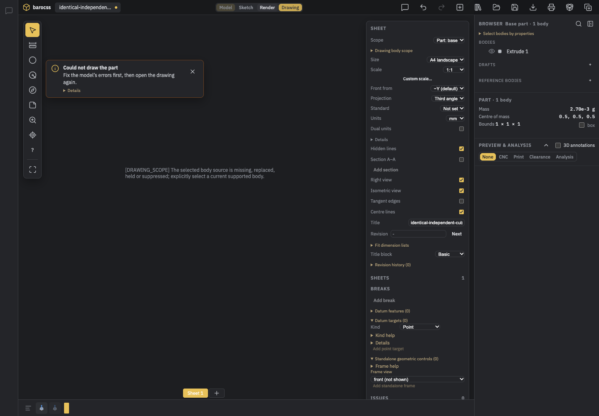

# #270 identical geometry, independent body identity

Baseline: `1d857f2fcb288461cb905e682200edfc76418231`. Evidence only; no product changes.

## Actual result: PASS

Two coincident independent 1 × 1 × 1 mm Extrudes have distinct authored owners n1/n3 and outputs b1/b3. The native inspector reports both strict-valid and volume 1 mm³ (tolerance 1e-9). Equal geometry does not identify an owner.

- Public Open followed by explicit b3 selection preserves modeling nodes. The requested selector is b3/n3/extrude; every projected edge name in front/top/right/iso belongs to n3. Front/top extents are 1 × 1 mm (tolerance 1e-7).
- Public suppression of unselected n1 preserves the b3 projection. Ordinary Undo restores the exact selected document.
- Public suppression of selected n3 retains its saved selector. Native evaluation still returns valid b1 with volume 1, but Drawing refuses with DRAWING_SCOPE, no usable sheet and disabled SVG/DXF export controls. It does not silently substitute identical b1.
- Ordinary Undo restores the exact b3 document; an explicit subsequent b1 selection produces n1-owned projected edges without other modeling changes.

## Original product screenshot

Selected n3 is suppressed. The remaining geometrically identical b1 is valid, but Drawing explicitly refuses instead of falling back.



The recovery PNG is intentionally omitted: the successful sheet retained the previous failure toast. The receipt records the actual recovery projection, not a claim that the toast cleared.

## Reproduction

Use the existing Studio test environment and installed Chrome/Playwright, from apps/cad-studio. Reserve the exclusive heavy gate and adequate disk space first. Set PW_DIR and CHROME as for other browser drivers, then run:

```sh
CAD270_IDENTITY_FROZEN=1 node handover/notes/drawing-identical-body-identity-2026-11-19/browser.mjs /tmp/cad270-identity-evidence
```

The archived runner differs only in its shared-helper import path from the executed temporary runner. It opens an in-memory synthetic fixture through the ordinary Model file input. Its passive drawing-response observer neither changes nor delays requests/results. The helper records receipts and cleans up its browser and server.

## Boundaries

This is identity evidence, distinct from previous delayed body-list and stale draft/Apply checks. No response delays, downloads, Save/Open, same-name bodies or node reordering were tested. Edge ownership only, not face ownership. This lifecycle switches Model/Drawing normally; no same-mount claim. Native validity/mass use the product inspector; analytic unit-cube dimensions and volume provide the independent expected values. No broader issue-completion claim; #270 remains open. Page/console errors, downloads and source changes were empty; browser/context/server cleanup completed.
