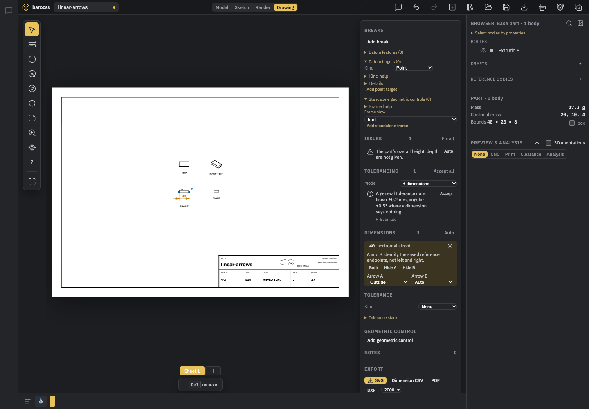
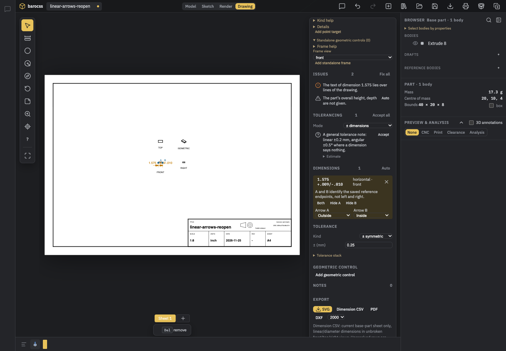

# D1999 — Per-end linear drawing arrows (#248)

Parent: `622afcb136f0cda11eddee7dd8f685df896fac54`. Scope: manually placed horizontal, vertical and aligned dimensions in unbroken orthographic part views.

- Select a dimension and set **Arrow A** and **Arrow B** to Auto, Inside or Outside. A/B are authored reference roles, not page left/right. Hover or focus a control to highlight that reference. Auto is omitted from the project field and behaves as before; explicit positions do not flip with the auto fit threshold. Unresolved references keep their existing diagnostic and are not editable.
- Only the shared display marks change: same tips on the measured stations, independent arrow directions and line tails, existing labels/clearance using actual arrow depth. A forced inward arrow that cannot fit at the current scale is retained and flagged, not silently reset. The measured geometry and a/b references remain unchanged. Schema remains 3 for this fixture, with no migration or older runtime change.
- For legacy compatibility, round-tripped the **current Chrome-saved** `.bcad` through the archived `ccb1565d96a54bde1af3545f8b751c71e40b12e6` Model reader, renderer and writer. Its sheet rendered Auto directions `[+X, -X]` at 1:8, with the correct 40 mm measurement. Changed the tolerance to ±0.375 mm in that model and re-encoded through its writer; current Open recovered both the new tolerance and `{a:'outside', b:'inside'}`, with exact original refs and nodes. This is a file/renderer check against one pinned prior version, not a claim of old UI or other releases.
- Actual Chrome: at 1:4, 40 mm projects to 10 mm; Auto/Auto points `[-X,+X]` and changing A only gives `[+X,+X]` without moving either tip. At 1:8, B Auto changes to `-X` with A fixed `+X`. Tolerance, display units, scale, Undo/Redo, Save and fresh Open, post-Open edit and reset to Auto passed. 1,239 frozen files and zero console/page errors.
- Actual SVG and DXF 2000 downloads were read separately from the Studio DOM. SVG tips `(132.3483,105.5642)`, `(137.3483,105.5642)`; both manual arrow bodies lie to the negative X side of their respective tips (directions both (+X)). DXF DIMENSION group 42 = 40, semantic paper span = 5, and both SOLIDs in `*D1` had the matching X tip/direction. DXF receiver regeneration may revert to Auto, disclosed in Studio; use SVG for appearance. External applications and PDF golden were not qualified.
- Five focused model tests pass, including reversed a/b roles, vertical and aligned geometry, crowded warning, input normalization, ASME display-path DXF blocks, and shared 3D direction/target parity. Wider lane: 130 pass and two existing goldens (linear-clearance circle DXF and single-page PDF); unmodified parent 125 pass with identical assertion payloads for both. No golden edits. Model and Studio types, Studio production build, changed-path lint and diff check passed.

Reproduce: `pnpm --filter @barocss/cad-model test drawing-linear-arrows` and `D1999_SOURCE_FROZEN=1 node apps/cad-studio/test/drawing-linear-arrows-browser.mjs <output>` with existing Playwright and Chrome setup.

