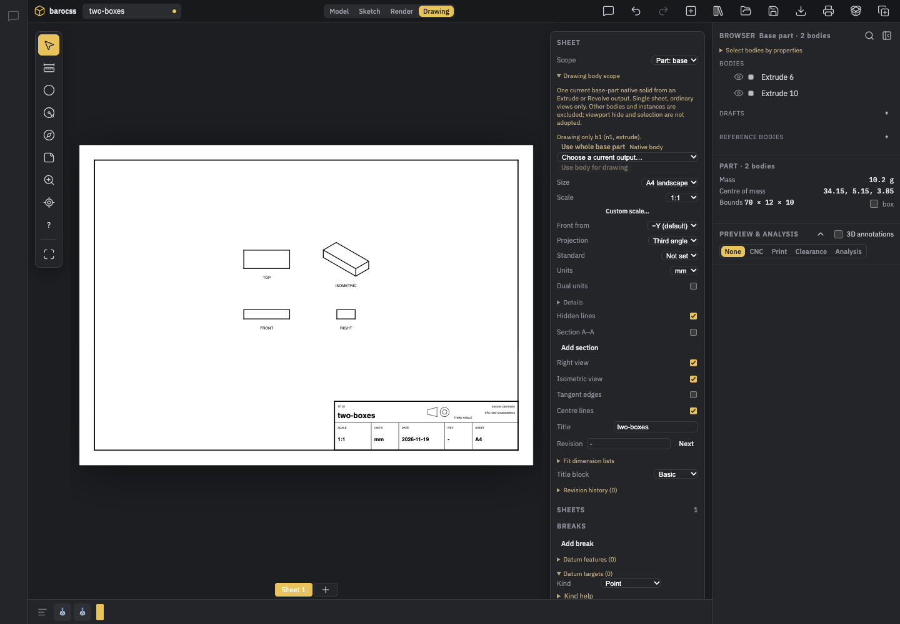

# #270 same-mounted drawing body currentness

Validation only on `1d857f2fcb288461cb905e682200edfc76418231`. Two synthetic boxes; no product/main changes. Independent read-only QA passed for the scope below.

## PASS
Public Drawing native body → Use body for drawing: A/B/A on the same Drawing DOM mount. A front/top extents are 30×6 / 30×12; B 20×10 / 20×8, tolerance 1e-7. Genuine positive reply edge owners use n1 / n3 respectively.

One actual B drawing response (id13, b3/n3) is held by original Worker identity/request id. Requests and results are unchanged; only its original MessageEvent callback delivery is deferred. After A is again selected and its live front/top geometry is ready, forwarding B leaves the accepted document, full __studioDrawing() diagnostic value and front/top SVG line attributes unchanged. This does not compare whole SVG markup or right/iso lines.

Uncommitted B selector choice followed by Undo to accepted B and Redo to accepted A ends with the draft selector blank. The modeling document outside drawing settings remains unchanged. The immediate draft assertion was self-comparison and is not evidence of noncommit at that instant; no stale Apply click or hostile callback is claimed.

Both screenshots are untouched individual product screenshots of synthetic documents, not composites. Native snapshots remain fresh/massReady: b1 volume2160, centroid≈[15,6,3]; b3 volume≈1600, centroid≈[60,4,5]. These are observations, not a separate independent mass reevaluation.

## History / limits
First attempt failed in the positive A stage because the fixture captured the Drawing DOM reference before waiting for rendering. Held-response and Undo paths were NOT_RUN. Added explicit Drawing DOM wait; also matched the existing blank draft-selector contract. Corrected full run PASS. No product defect reproduced.

No download, export, Save/Open, Worker replacement, body-read race, broader native family, solver/schema/manufacturing or HOLD expansion. This simulates response-delivery timing, not actual Worker computation duration. Post-release raw edge ownership was not separately logged. Browser/context/server closed; frozen source hashes unchanged, errors/consoleErrors/downloads empty. #270 remains open. Summary includes original observed projections and live front/top geometry; only this bounded result is qualified.
