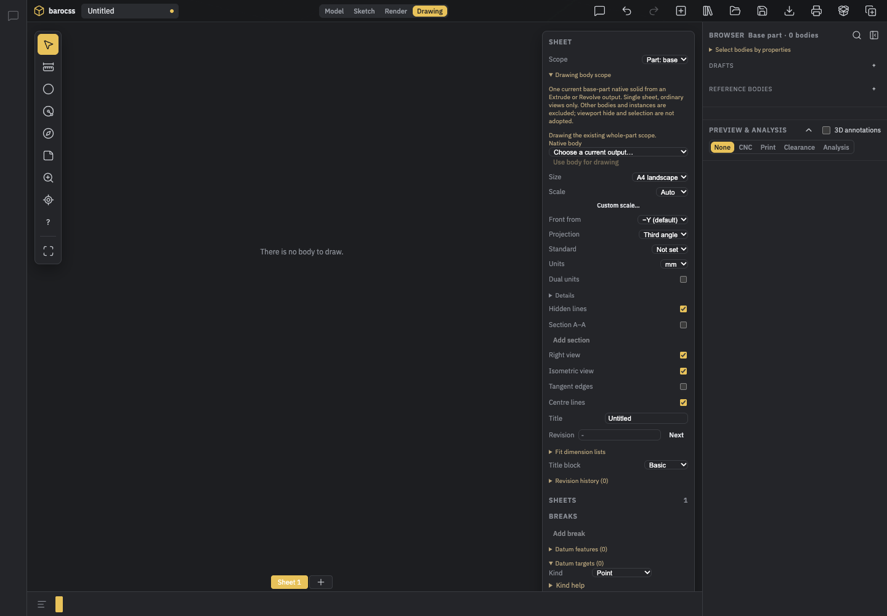
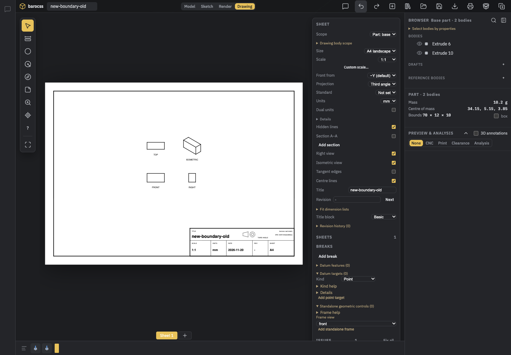

# #270 accepted New with an old successful drawing reply

Baseline `2fa66b991788073af1c25d8ae87ecfd16335d7c0`. One bounded actual browser run: PASS. Evidence only; no product change.

## Verified boundary

A synthetic two-box document has authored selected scope b3/n3/extrude. The fixture holds exactly one genuine successful drawing callback identified by the original worker and request ID; the held native front/top projections have n3 edge ownership and spans 20×10 / 20×8 (tolerance 1e-7). It never delays part/read or mesh replies and does not alter a request or result.

Public **New part** accepts the exact empty model (nodes [], outputs {}, nextId 0, no authored drawing field). A fresh empty drawing response settles before release. The new UI shows Untitled, no selected body, no drawing geometry, empty body choices and disabled SVG/DXF exports.

The original held callback is then invoked unchanged exactly once. Exact before/after observations show no change to the accepted empty document, current drawing diagnostic, selection, title, options, notices, geometry count or Undo/Redo enabled state. Ordinary Undo restores the exact original selected document and a fresh n3-owned projection with the expected dimensions.





Both PNGs are unmodified original screenshots of the synthetic fixture. The restored screenshot has its scope disclosure collapsed; exact selection is verified by the receipt/runner rather than inferred from that image.

## Reproduce

Use the established installed Studio browser-test environment with PW_DIR/CHROME, exclusive heavy gate and adequate reserve. From apps/cad-studio:

```sh
CAD270_NEW_FROZEN=1 node handover/notes/drawing-new-late-projection-2026-11-20/browser.mjs /tmp/cad270-new-evidence
```

Archived runner differs from the executed runner only in the shared-helper import path. The drawing-only instrumentation is restored in finally; browser/context/server cleanup completed. Receipt records PASS, empty errors/console errors/downloads/source changes, and equal frozen/after/after-cleanup source hashes.

## Limits

This is New/remount boundary evidence, not another same-mounted body-list race proof. One prior successful drawing response only; late failures, Close, Save/fresh Open and downloads were not exercised. Undo/Redo enabled-state equality is not full history-stack equivalence; one ordinary Undo is the positive control. Projected edge ownership only, not face ownership. No broader issue closure claim.
