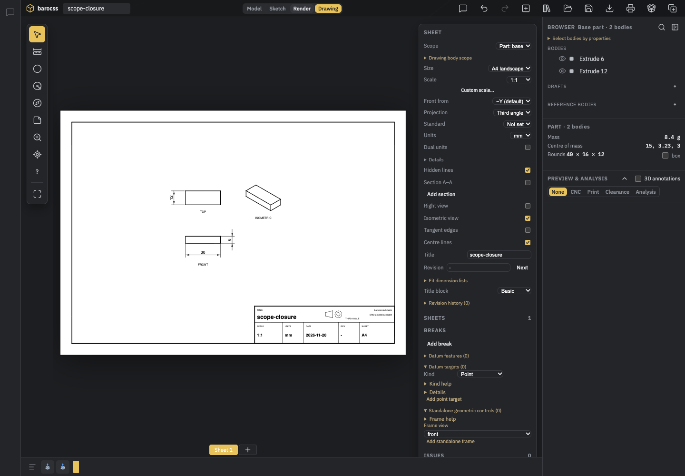

# #270 scoped project persistence and source-edit completion

Product: `2fa66b991788073af1c25d8ae87ecfd16335d7c0`. Synthetic two-box document only. Evidence-only publication; no product changes or new execution during packaging.

## Actual browser PASS
Public b1 selection and Auto dimensions at Width30 → Model (document unchanged) → Project in this browser → Save → verify actual OPFS bytes → Close project → fresh page reload → reopen project and document → exact saved document and current drawing. Ordinary History Width30→40 then retains b1/n1 scope and d1/d2/d3 IDs; live SVG text is 12/40/6. Real Worker projection: front40×6, top40×12, n1-owned edges. Independent native check: b1 volume2880, b3 volume960, strict valid, tolerance1e-7.

Both PNGs are unmodified original product screenshots of synthetic content. No downloads or browser export clicks occurred.

## Separate post-browser writer/readback PASS
After browser/server cleanup, `inspector.ts` evaluates the actual accepted `post-browser-writers-doc.bcad` using genuine Model drawingInputs/issueContext/sheetSvg/sheetDxf (AC1015). Full original JSON output, including SVG/DXF strings, is `post-browser-writers.stdout.json`. Independent Python parser checks SVG dimension groups by data-dim ID and DXF ENTITIES DIMENSION group1 text/group42 measurement. See oracle input, parser and PASS result. This proves Model writer output, **not a new browser-exported file delivery**. No Auto rerun or anchor repair in this phase.

## Reproduction and provenance
`browser.mjs` is the executed corrected external driver with only its helper import made repository-relative. Run from an isolated checkout of the pinned product with existing dependencies, supported Chrome/Playwright and flow-helper environment; pass a fresh evidence output directory. It contains the synthetic seed, public UI path, post-browser writer and oracle. `inspector.ts` is the original generated writer source; it requires the repository bundling/alias environment supplied by flow-helper. Standalone retained-output readback: `python3 drawing-project-edit-closure-oracle.py < independent-writer-readback-oracle-input.json`.

`receipt.json` retains accepted synthetic documents and exact observations while excluding machine paths and bulky source maps. Original receipt/runner hashes are included. `prior-failure.json` preserves the initial stopped fixture failure and NOT_RUN boundary; original failed receipt was not overwritten. The retry only navigated publicly to Model before the project panel, as the existing UI contract requires.

## Limits
Bounded selected-body two-box Auto-dimension example only. No arbitrary/manual dimension, assembly, schema, manufacturing or HOLD expansion. No browser download/export claim. No claim that editing Width40 was subsequently saved again. Actual OPFS fresh Open precedes the edit. Source frozen/after/cleanup unchanged; browser, context and server closed. Issue completion decision belongs to the coordinator.
