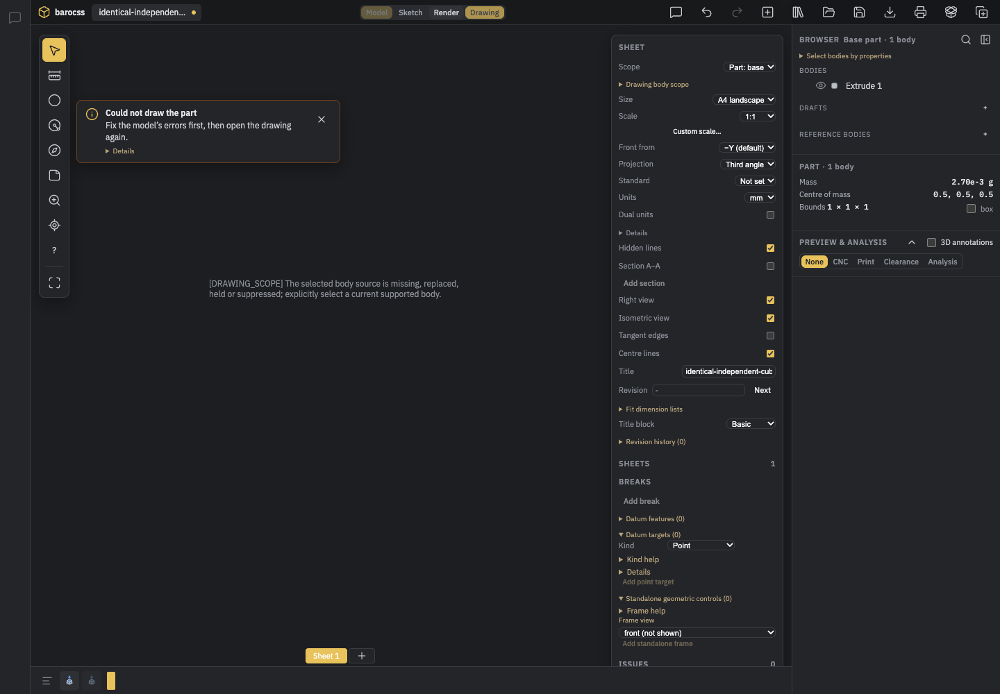
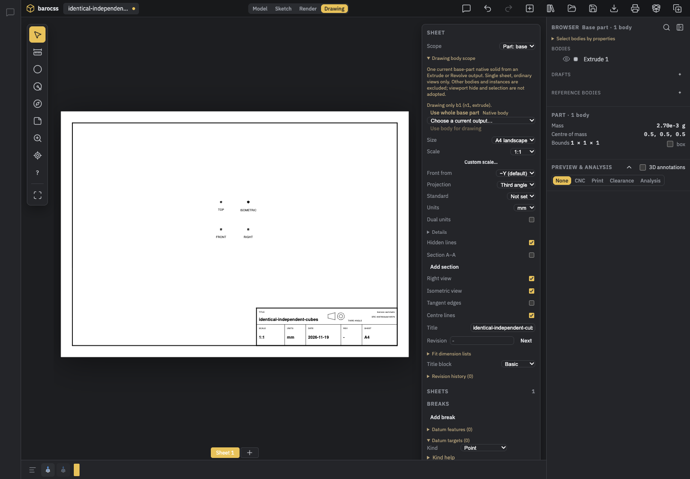

# #270 owned projection notice recovery

Verified product commit: `2fa66b991788073af1c25d8ae87ecfd16335d7c0` (parent `1d857f2fcb288461cb905e682200edfc76418231`). Evidence-only branch; these images are unmodified actual screenshots of synthetic unit cubes.

## PASS

At genuine selected n3 suppression, Drawing refuses rather than substituting valid identical b1, and the original projection alert remains visible. Explicitly selecting b1 in the **same mounted Drawing workspace** produces the valid current sheet and removes that owned alert. Modeling data remain unchanged by scope selection. Undo returns to the exact suppressed document and genuine refusal displays its alert again. Final Undo and explicit selection also pass.





The unit geometry is intentionally tiny at 1:1. Evidence relies on exact authored selector plus native projected edge owners and front/top 1×1 extents, not image similarity. The receipt retains the actual native and projection observations.

## Change and validation

DrawingWorkspace retires only its exact emitted notice object when the error/empty effect changes or unmounts. App uses a stable callback and functional updater; a newer unrelated or identical-text notice is not dismissed. No busy or unstable document-wrapper dependency was introduced.

Focused retirement-helper tests 4/4 PASS; actual browser PASS; Studio TypeScript and Vite build PASS. Independent code and original-image privacy/accuracy reviews passed. Initial validation invoked a missing app-local tsc binary, leaving type/build NOT_RUN; the corrected established root-bin invocation passed without product changes. Context, browser and server cleanup completed; no downloads, page/console errors or source changes during actual execution.

Reproducible runner: `apps/cad-studio/test/drawing-projection-notice-browser.mjs` at the product commit. Use the existing installed browser-test environment with PW_DIR/CHROME and exclusive heavy gate, then from apps/cad-studio:

```sh
CAD270_NOTICE_FROZEN=1 node test/drawing-projection-notice-browser.mjs /tmp/cad270-notice-evidence
```

## Limits

No downloads, Save/Open, same-name bodies, node reordering or delayed responses. Projected edge ownership only, not face ownership. General unrelated/newer notice races were not exercised in the browser; their identity guard is covered by pure helper tests, not a full React effect integration suite. No broader #270 completion claim.
