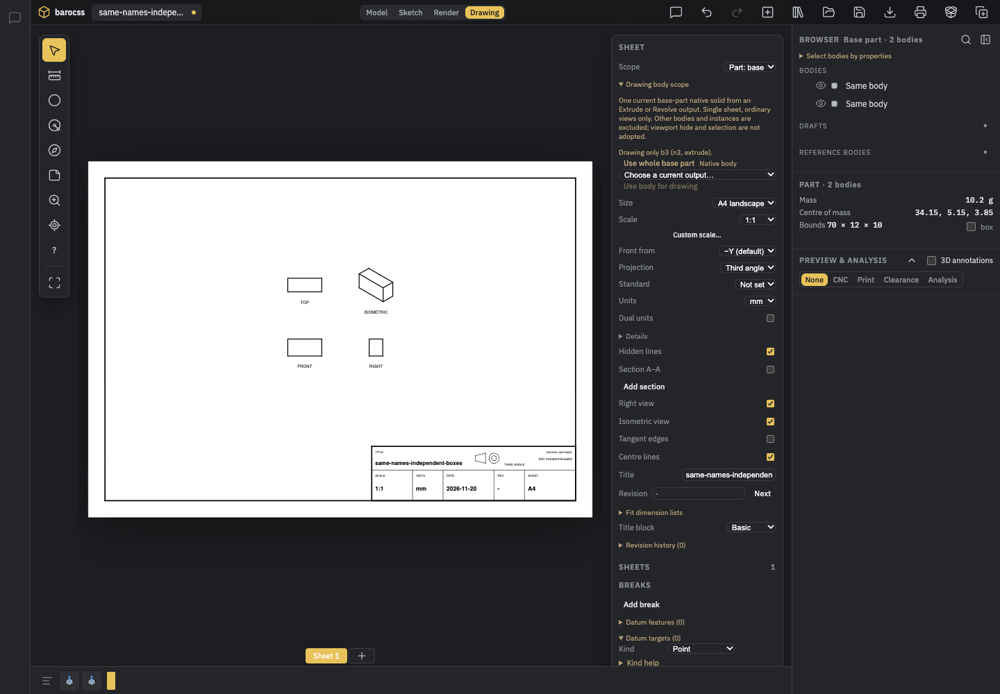
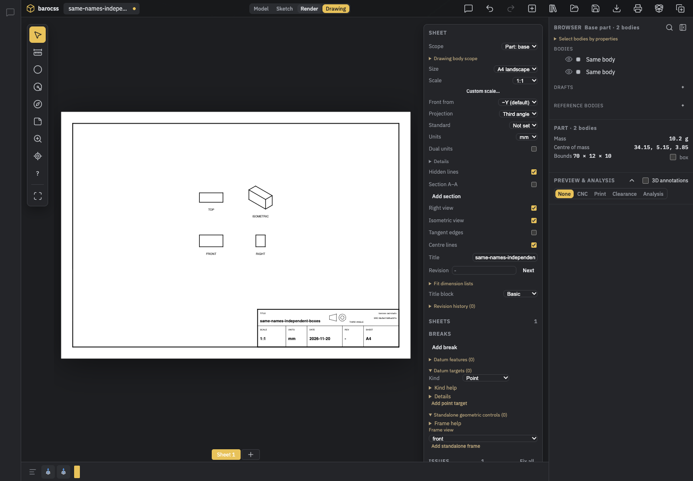

# #270 same display names and public feature reorder

Actual baseline `2fa66b991788073af1c25d8ae87ecfd16335d7c0`; one bounded run, PASS. Evidence only, no product change.

## Observed result

Synthetic Open supplies two independent Extrudes with saved `BodyLook.name` equal to `Same body`. Both actual browser labels were checked before and after reorder and Undo/Redo. This is not a public rename test.

Explicit b3 selection stores exactly `{key: b3, feature: n3, kind: extrude}`. One public History **Move earlier** on n3 moves its owned sketch+Extrude group: `[n0,n1,n2,n3]` becomes `[n2,n3,n0,n1]`, with valid remapped sketch references. Exact document comparison verifies that drawing settings and body names remain unchanged.

Observed output mapping changes from b1→node1/b3→node3 to b3→node1/b1→node3. Actual worker enumeration also changes from b1,b3 to b3,b1. Nevertheless, the selected body stays b3/n3; every native projected edge in front/top/right/iso retains n3 ownership. Front spans 20×10 and top 20×8 (absolute tolerance 1e-7). Native strict-valid keyed volumes remain b1=2160 and b3=1600 (tolerance 1e-7), checked against the independent rectangular-box expectations. Ordinary Undo/Redo restore exact expected documents and the same projection identity.

## Original screenshots

Before: both browser body names are identical; drawing explicitly selects b3/n3.



After the public group move: same two visible names and selected body's drawing geometry. The body-scope disclosure is collapsed in this original screenshot; precise stored selector/edge owners and reordered indices are verified in the receipt, not inferred from pixels.



## Reproduce

Use the established installed Studio browser-test environment, exclusive heavy gate and disk reserve. Set PW_DIR and CHROME as in other drivers. From apps/cad-studio:

```sh
CAD270_REORDER_FROZEN=1 node handover/notes/drawing-same-name-reorder-2026-11-20/browser.mjs /tmp/cad270-reorder-evidence
```

Archived runner differs from the executed runner only by the shared-helper import path. Its passive observer does not delay or modify requests/results. No hidden state mutation, downloads, errors, console errors or changed product sources were recorded; browser/context/server cleanup completed.

## Limits

No public rename, Save/fresh Open, delayed reply, deletion/recreation, face ownership, assembly, or arbitrary reorder qualification. It switches Model/Drawing normally; no same-mount assertion. Native geometry uses the product inspector and analytic expected volumes/spans, not a second CAD kernel. Existing #270 remains open pending its wider acceptance.
