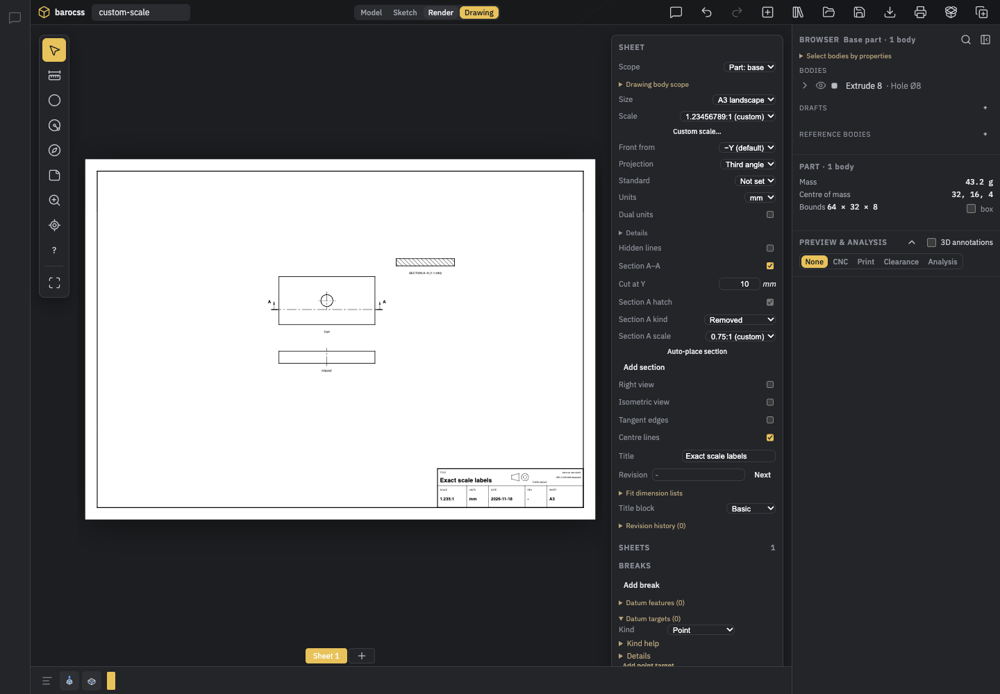
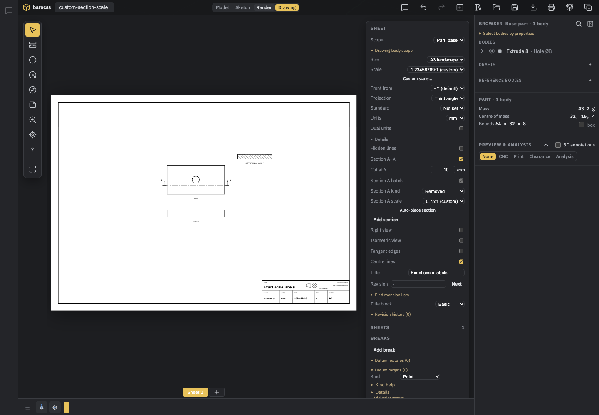

# Exact drawing scale labels

`scaleLabel` previously rounded to 3 decimals, converting actual scale 1.23456789 into the incorrect label 1.235:1 and 0.75 into 1:1.333. The shared drawing formatter now preserves the stored numeric ratio. Conventional `1:n` remains when n is a safe integer and `1/n` round-trips exactly; otherwise use the exact stored `s:1` string. Standard preset labels are unchanged. Geometry, source values, native schema and scale acceptance are unchanged.

Consumers inspected: title block, detail/removed-section labels, room diagnostics and chat drawing reports. These share the formatter; nonstandard label text intentionally changes, not numerical scale. The exact represented number is preserved, not a claim of mathematical precision beyond JavaScript numbers. Scientific notation is possible for extreme scales; no reciprocal Infinity label for a positive subnormal.

## Verification

- Model baseline: 2/3 FAIL (ratio round-trip and SVG title label); standard notation PASS.
- Chrome baseline: visible title 1.235:1 and section 1:1.333 despite exact native values.
- Model focused+adjacent drawing consumers: 39/39 PASS. New tests cover 3 exact-ratio/SVG/preset cases, including extreme values at formatter-only scope. Existing drawing/chat consumers also passed.
- Final actual Chrome PASS: sheet1.23456789, removed section0.75 (48×6mm), preset section2 (128×16mm), Undo/Redo, actual native Save/fresh Open and explicit inherited scale. Initial and reopened actual SVG downloads contain exact title `1.23456789:1` and `SECTION A–A (0.75:1)`; exported SVG preserved here.
- Before/reopened screenshots inspected; source-frozen browser cleanup passed.

Driver: `DRAWING_SCALE_LABEL_FROZEN=1 node apps/cad-studio/test/drawing-scale-label-browser.mjs <output>` using harness Chrome/PW_DIR environment.

## Limits

No PDF/DXF/physical print qualification, no general long-label fitting guarantee, no arbitrary-scale authoring or geometry precision change. Small/extreme formatter cases do not imply browser layout qualification. HOLD and epic scope unchanged.

