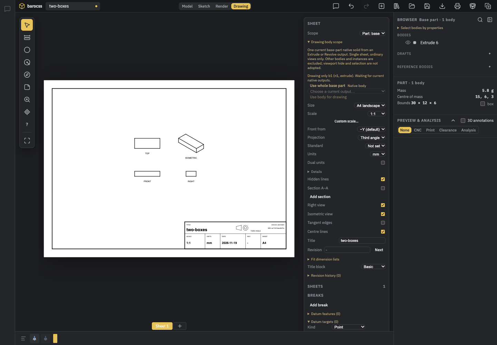

# #270 public stale draft disabled/no commit

Distinct single-run PASS on `1d857f2fcb288461cb905e682200edfc76418231`, no product change. Unlike the earlier late-body-list PASS, this tests a publicly selected B draft becoming invalid after a real model-history change, and a subsequent explicit positive Apply path.

## Verified public flow
Synthetic two-box document with accepted A/b1 drawing scope. Model History Suppress n3 → Undo arms Redo before entering Drawing. Let the active body list finish, then publicly select b3 as a draft: Apply enabled, accepted document unchanged.

Public Redo suppresses n3. To observe the pending UI, one genuine decoded drawing-bodies/read Promise outcome is briefly held after EngineClient FIFO wire processing. Actual n3 argument is suppressed; revision2/lane instance1 result contains b1(ref node1,solid) only. No Worker event/request/result mutation. Same Drawing DOM and lane instance maintained.

While current list delivery is pending, draft is blank, selector and Apply disabled. An ordinary mouse click at the visibly disabled button leaves the accepted **post-Redo** document and Undo=true/Redo=false button availability unchanged. After release, current options are placeholder/b1; draft stays blank and Apply disabled.

Public Undo restores b3 availability but does not revive the old draft: selector remains blank and Apply disabled. Explicitly select b3 again, then actual public Apply succeeds. Accepted scope becomes b3 while modeling data is unchanged. Front/top line extents are20×10 /20×8; A earlier is30×6 /30×12, absolute tolerance1e-7.

These are untouched individual product screenshots of synthetic documents, not composite imagery. They show UI states; the full state-transition assertions and exact native body-list logs are in summary/runner.

## Reproduce / boundaries
From repo root with existing Chrome/PW_DIR environment: `CAD270_DRAFT_FROZEN=1 node apps/cad-studio/handover/notes/drawing-stale-draft-apply-2026-11-19/browser.mjs <output-directory>`. Archived runner only adapts helper import to repository-relative. Original runner SHA recorded in summary. All source hashes unchanged; methods restored; context/browser/server closed; errors, console errors and downloads empty.

This is public disabled/no-commit protection, **not execution of a hidden stale closure**. Hidden closure is NOT_RUN; raw runner field NOT_REACHABLE means only that it was not invoked through this public path, not proof of global unreachability. Undo/Redo enabled-state preservation is not independent whole-history-stack equality. No full SVG/right/iso/native-mass independent verification, Save/Open, export, manufacturing/schema/solver/HOLD expansion. #270 stays open.
