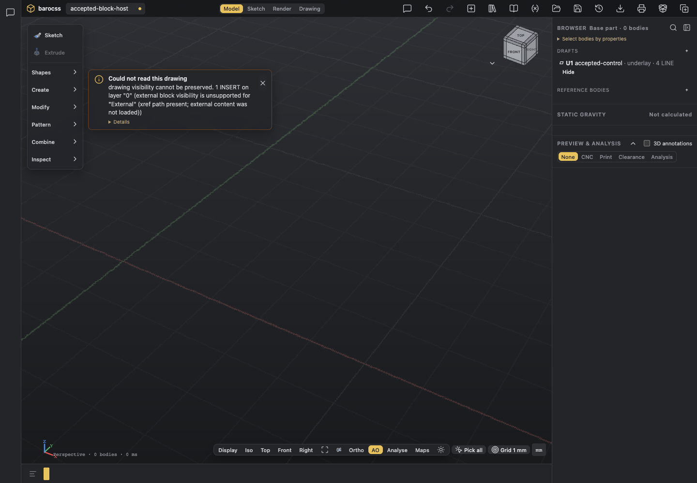
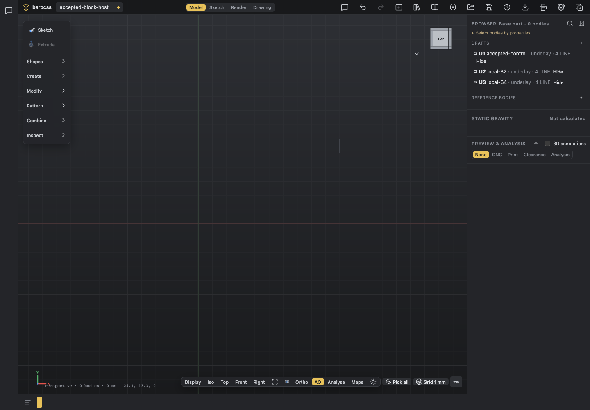

# #217 DXF BLOCK external-reference diagnostics — 2026-11-17

Clean dependency: `17a5d042c6fcfce0b587aad1c667f5e87dea0bd0`.

## Policy and actual defect

The old silent-loss path described in the issue was already conservatively refused by the current reader. The reproduced remaining defect was **over-refusing local included geometry when BLOCK group70 had only input-ignored status bits32/64**. Baseline visibility suite: 7/8, the new32 fixture alone failed. This is not a claim that the old historical silent-loss case still occurred on this dependency.

[Autodesk BLOCK specification](https://help.autodesk.com/cloudhelp/2024/ENU/AutoCAD-DXF/files/GUID-66D32572-005A-4E23-8B8B-8726E8C14302.htm) distinguishes4 direct external reference,8 overlay,16 externally dependent, and input-ignored32/64. The existing path-presence metadata is retained, never resolved. The new diagnostics distinguish those four actual external evidence categories and explicitly say external content was not loaded. Neither16 nor32 is classified as a direct XRef or proof geometry is absent. Included snapshots of real external dependencies are conservatively refused, not advertised as complete. A nonempty external block does not bypass this policy.

The whole drawing is refused before an accepted document is committed. No partial draft, persisted warning, XRef loader/reload/bind, SDK, schema or migration was introduced. Local blocks with only32/64 follow the existing geometry path. Block LINEs remain underlay, not new closed regions/solids.

### Counts and scope

Only reachable supported INSERT visits are audited, not unused definitions. The count is **INSERT refusal-check visits**, not unknown external entity count or necessarily final array placement count. A direct external3×2 MINSERT is refused before expansion and counts1; an accepted3×2 outer array visiting its nested external child counts6. Normal empty blocks remain empty, undefined blocks remain malformed, and unsafe paths are omitted from diagnostics.

## Evidence

- Initial targeted Model tests25/25 PASS. Final supplemental inch/count selection: **27/27 PASS**, Model type-check and targeted lint PASS. Inch fixtures independently verify `[127,25.4]→[177.8,25.4]` mm for flags0/32/64/96; count fixtures verify direct1 and nested6.
- Existing dxf-underlay tests include nested transform, mirrored/scaled/rotated blocks and MINSERT compared with existing independent ezdxf evidence. No new package or download.
- Actual browser first01: harness incorrectly expected closed BLOCK LINEs to create a region. Inspector correctly returned4 underlay lines; no product regression. Preserved as FAIL, no product promotion to regions was added.
- Corrected actual02: PASS. Public Add drawing rejects direct/overlay/dependent/URL-path/UNC-path cases. Each preserves accepted Doc, filename, dirty=true, available Undo/Redo state and selection exactly. Model `import_drawing` returns the identical refusal without a replacement Doc.
- Normal32/64 imports: exact independent4LINE endpoints `[100,50]→[120,50]→[120,60]→[100,60]→[100,50]`, identical to flag0. Existing underlay remains. Fixture hashes and observations: [observations.json](observations.json).
- Browser requests for synthetic references0, external route attempts0. Fonts fulfilled locally. Source inspection finds no external file/network resolver in the reader; synthetic relative/absolute/UNC/URL paths have Model refusal tests. **OS-wide filesystem auditing NOT_RUN**; this is not a forensic assertion about every process.
- Source frozen throughout actual02:1031 entries unchanged, browser errors/downloads0, cleanup complete. Root inspected both original PNGs; only synthetic fixture data, no personal/authentication data.
- Studio type-check and production build PASS.

Commands, from the respective package directory:

```sh
node scripts/test.mjs dxf-visibility dxf-underlay drafts
node ../../node_modules/typescript/bin/tsc --noEmit
node ../../node_modules/eslint/bin/eslint.js src/sketch/dxfVisibility.ts test/dxf-visibility.test.ts
# Studio, installed local Playwright and Chrome, shared heavy gate, all sources frozen:
DXF_BLOCK_REFERENCE_FROZEN=1 node test/dxf-block-reference-browser.mjs /tmp/cad-dxf-block-reference-02
node ../../node_modules/vite/bin/vite.js build
```

## Actual screenshots, not concept images



The URL path is deliberately not displayed. The current underlay remains listed; this view is not framed to show its remote coordinates.



The three coincident4LINE underlays are listed separately and share the same visible rectangle. No region/solid claim.

Existing #126 eight-file WIP and all HOLDs remain untouched. No manufacturing qualification, full DWG/XRef compatibility, general losslessness, native-folder access, GPU or deployment change.
