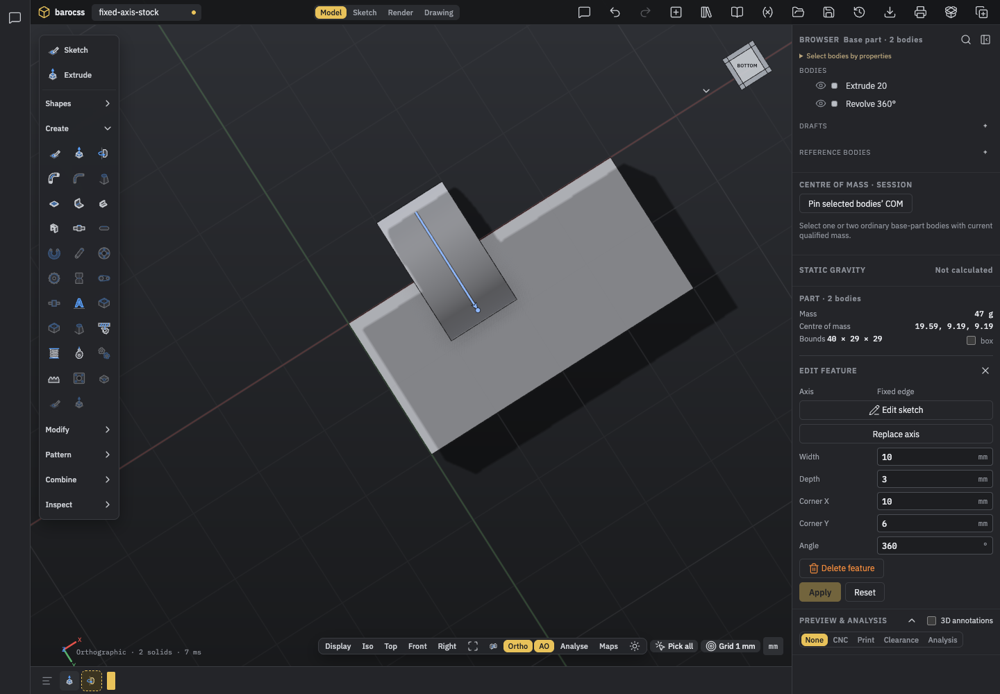
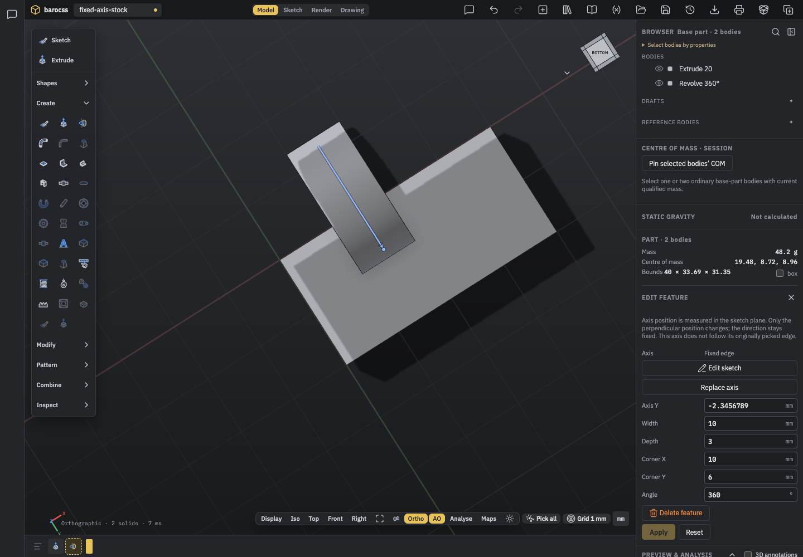
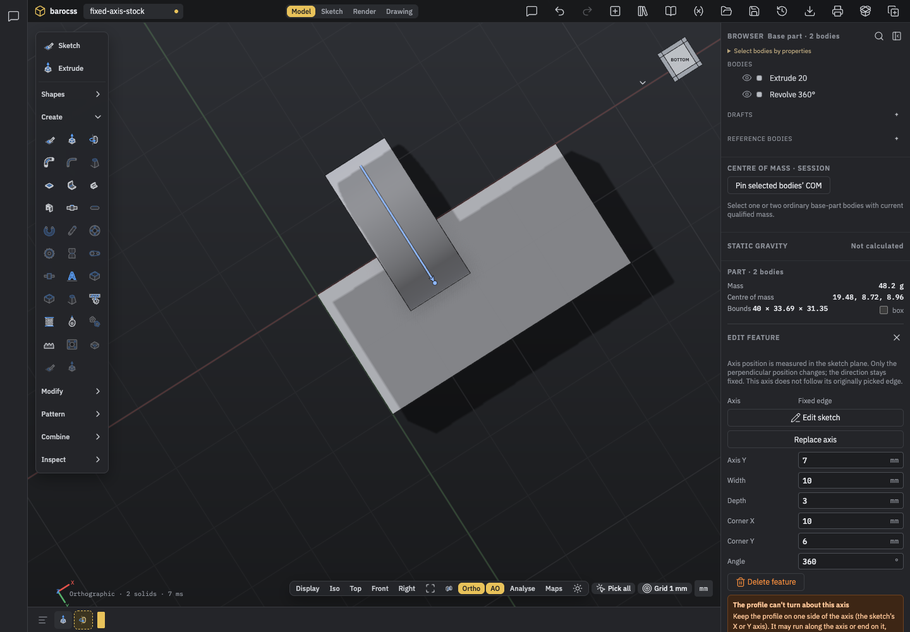

# Fixed Revolve axis position (#702)

Qualification base: `dc7b1f40d15eb392a567e180f658f3211f830473`. Unrelated #703 was fast-forward integrated before publication through `0da73d7a3`; focused tests were repeated after integration. Final local type/build and actual browser qualification preceded that nonoverlapping integration. Exact published CI is recorded on the issue.

## Bounded contract

A terminal Revolve of an independent plain XY rectangle may edit its fixed cardinal axis position. Axis Y moves an X-directed axis; Axis X moves a Y-directed axis. The parallel origin component, direction including sign, angle, profile and source bodies remain unchanged. This does not link the axis back to its originally picked edge.

Eligibility requires numeric finite origin, cardinal unit direction, a valid numeric angle, unique feature identities and plain profile metadata. Linked axes, explicit sketch planes, associations, downstream features, made/held/suppressed/rematched nodes, direct geometry and assembly instances are excluded. No new parameter-binding or drag-HUD path is exposed. Captured setters recheck current node eligibility. Native evaluation remains the authority for impossible geometry; no schema, kernel or tolerance change is made. #259 diameter constraints and all existing HOLDs remain separate.

## Actual baseline

The real Create→Revolve flow picks the original bottom edge of a 40×20×20 stock at Z0 from Bottom view. Unlike the supported top-edge linked path, it stores `origin:[0,0]`, `dir:[1,0]`, no `axisRef`. An independent rectangle [10,6]–[20,9] produces a ring along X with radii 6 and 9, length 10, volume450π. Source stock volume stays16000. History displays Fixed edge but offers no axis position field. Existing Angle360→180, Undo/Redo and Save/fresh Open pass.

Baseline01 FAIL was a fixture palette shortcut timeout after History Close, before Revolve was entered. The corrected actual rail helper produced baseline02 PASS without product changes. The older linked-axis regression received one focus-blur line before its palette command for the same established fixture boundary; numeric/product assertions were unchanged.

## Fixed actual verification

The same real creation path then edits Axis Y0→−1→−2.3456789. Full-document comparison permits only origin Y to change. Each step checks independent native cylinder radii `(6−Y,9−Y)`, axis centre/direction, stock preservation, strict B-rep and annular volume `10π((9−Y)^2−(6−Y)^2)`. Native radial vertices and UI body quantities are also checked. Existing tolerances remain1e−7 mm/mm³ for this matrix.

Axis Y7 crosses the profile and is refused; document, history and original native geometry remain intact. Reset restores the accepted coordinate, and a later valid draft can be cancelled. At the edited axis, Angle180 produces half volume; Undo/Redo returns the full turn. Save/fresh Open preserves the exact numeric coordinate and fixed-axis identity with no parameter selector.

## Verification results

- Model focused **27/27 PASS**: 11 new tests plus existing linked-axis, Sketch X/Y and angle-binding coverage. Initial new-test baseline was2 PASS/9 RED at the missing-field assertions; all native/roundtrip assertions subsequently ran successfully.
- Actual fixed browser **PASS**; existing Sketch X/Y and linked-axis browser regressions **PASS**. Zero runtime/console errors and complete context/browser/server cleanup for each run.
- Final Model typecheck, Studio typecheck + Vite build **PASS** (4.76 seconds).
- Changed-file lint, browser syntax and diff checks **PASS**. Independent source review found no blocker.
- Actual browser covers the +X-directed fixed axis and Axis Y. ±X/±Y native geometry and partial-angle preservation are additionally covered in Model tests, not claimed as four actual UI flows.
- Full repository suite **NOT_RUN**. General profiles/planes/arbitrary directions or downstream rematching are not claimed.
- Exact commit CI and public image delivery are finalized on the issue.

Disk free space stayed about13.94→13.88 GiB during fixed/regression/type/build checks, above the2 GiB floor. No cleanup or unrelated process/file changes were performed. Retained models and native results are synthetic. Task-local evidence only; broad doc-sync stays paused.
