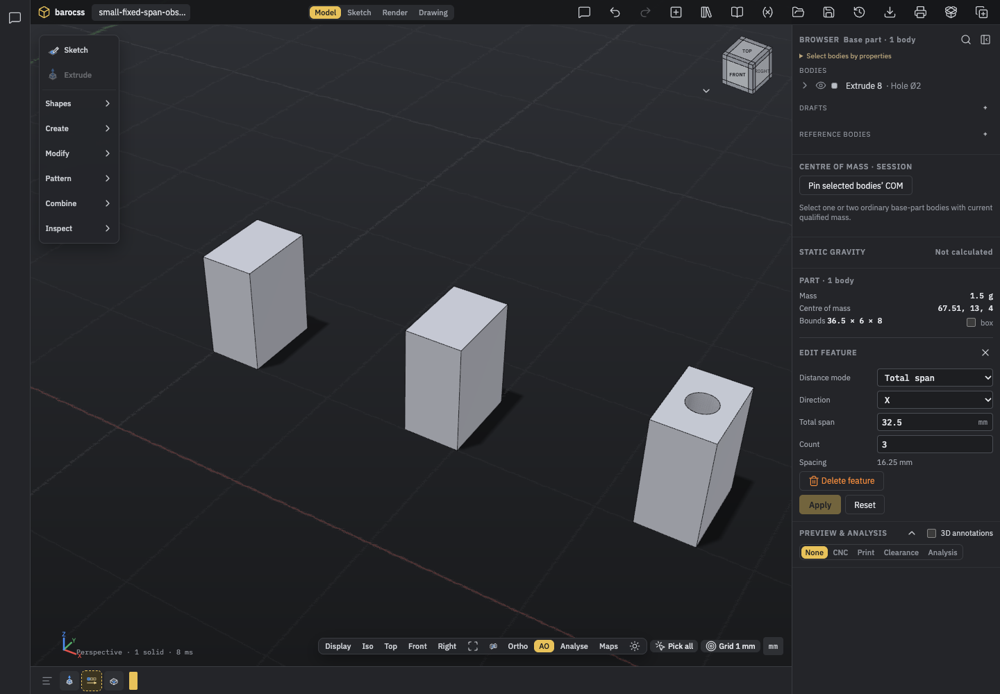
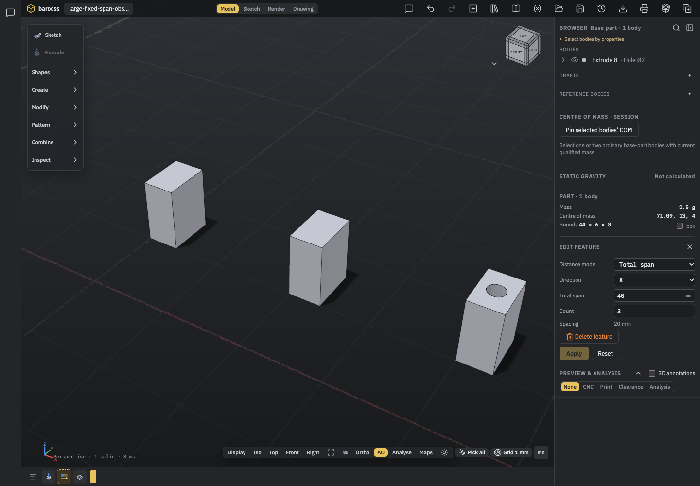

# Fixed-span pattern: preserve the terminal Hole's local position

Existing issues: #20 and #25, both remain OPEN. This is a bounded History repair, not general reference rematching. Existing HOLD scopes are unchanged. Main push and exact-commit CI are pending at evidence preparation.

## Reproduction and result

The real file UI opens a schema-3 legacy four-node model: rectangle `[50,10]..[54,16]`, Extrude 8 mm, X fixed-span pattern (Count 3, Total span 32 mm), and a terminal through Hole of radius 1 at `[84,13]` on `n1.top@2`. The Hole has no stored signatures.

| Actual run | Result |
| --- | --- |
| baseline-01, span 32 → 32.5 | Lifecycle PASS, intended motion FAIL: accepted Hole X stayed 84 instead of 84.5. Native geometry, Undo/Redo and Save/fresh Open preserved that stale world position. |
| baseline-01, span 32 → 40 | Safe atomic refusal: the old Hole at X84 misses the body. Original document/history remained intact. This was not silent Hole loss. |
| fixed-02, span 32 → 32.5 | PASS: Hole X84.5; correct native geometry and Undo/Redo/Save/fresh Open. |
| fixed-02, span 32 → 40 | PASS: Hole X92; correct native geometry and Undo/Redo/Save/fresh Open. |
| fixed-02, distance mode | PASS: span32 → spacing16 → span32 changes representation only, preserving the Hole; native, Undo/Redo and Save/fresh Open checked. |
| fixed-02, overlap and mixed edit | PASS: span4 and span32.5 plus Count4 refuse atomically with visible errors and unchanged document/history/Undo state. Save/fresh Open retains the original. |

Native checks include strict BRep validity, three bodies in one output, two cylindrical Hole faces (centre/radius/axis), and a second loop only on the numbered top face. The independent material volume is `576 - 8π` mm³. With span S and Hole centre X, the X centroid is `(576*(52+S/2) - 8π*X)/(576-8π)`; Y=13, Z=4. Equal volume alone cannot distinguish the stale and correct bore locations.

## Implementation and boundaries

`apps/cad-studio/src/app/patternHoleSpacing.ts` intercepts only a Total span change between two fixed-span nodes. A private admission requires exactly four plain numeric nodes, a fixed Count/axis/parent, one terminal legacy through Hole on the last copy, and otherwise unchanged node data. Both spans pass the existing `linearSpanPatternInput` contract. Temporary numeric-spacing proof nodes reuse the established gap, coordinate-range and complete-bore clearance checks. Only the authored Hole centre changes; face names, IDs, source nodes and fixed-span representation remain unchanged.

Unsupported active direct Hole dependencies, including uncertain face metadata or signature-bearing recipes, refuse rather than silently retaining stale coordinates. Inactive Hole handling and absence of a direct Hole retain the prior ordinary-edit behavior. Existing fixed-spacing and Count-only paths remain separate. This does not rewrite stored files on Open or change the native kernel/schema.

Actual coverage is X direction for this legacy fixture. Y direction and negative source-origin coordinates are unit-only. Negative Total span is invalid and tested as refusal, not supported motion. Modern signature-bearing creation and general downstream topology are NOT_RUN and are not claimed supported.

## Verification and review history

- New focused tests 7/7 plus existing parameter-spacing tests 9/9: **16/16 PASS**; scoped lint PASS.
- Actual existing Count-only, numeric-spacing and parameter-spacing regressions: count-02, spacing-02, parameter-02 all **PASS**. Their receipts retain their original bounded assertions; they are not claims of expanded support.
- Model and Studio type checks and Vite build **PASS**, build 4.15 s (coordinator-run evidence).
- Browser and type/build checks ran on the changes above baseline main `f0fb21a2b`. After fast-forward integration of unrelated #220 named-inspection changes at `e15e76261`, the coordinator reran the focused suite: **16/16 PASS**. This is a post-integration unit rerun, not a claim of a second browser/type run.
- Source review narrowed the entry guard to preserve the existing distance-mode conversion and added direct old/new native span-input validation. The mode unit uses `convertLinearPatternDistance`, not a malformed node retaining both span and spacing.
- fixed-01 was **FAIL**, not discarded as a product pass: small/large motion had passed, then the mode-return wait timed out because JSON key ordering differed (`count/span` versus `span/count`) despite deep-equal parsed documents. The fixture now first asserts independent deep equality and then uses the verified accepted document for order-sensitive waits. Product code was unchanged for this correction. fixed-02 passed the full sequence.
- Successful receipts contain no recorded errors and include context/browser/server cleanup. No extra browser run was performed while preparing this note.

## Source identities

Baseline main: `f0fb21a2bab84232bd99a391dbb0aeb89b4de736`.

SHA-256:

- Baseline fixture: `20a1bd4979bf53b21c01e130f75389e81d4436f5961abdd0f160438716a491d9`
- fixed-01 fixture: `21fa305842ebe7f3151138d148585b53beefb8b07dbde36f62dc2fa9f5e6fd8d`
- fixed-02 fixture: `27fa2059c6d7bed4525178b959887381db25aa915544ec0de69597e118a2fc14`
- Product `patternHoleSpacing.ts`: `1adaf0b16e27f9a2b091b94daf70323af3d4e86de3fbb6b6a931d4ea6214f9a3`
- Focused `fixed-span-hole-spacing.test.ts`: `e0fea865878e10800b31585f94a17e9cdc115043d389522cf0963b6b14572e70`
