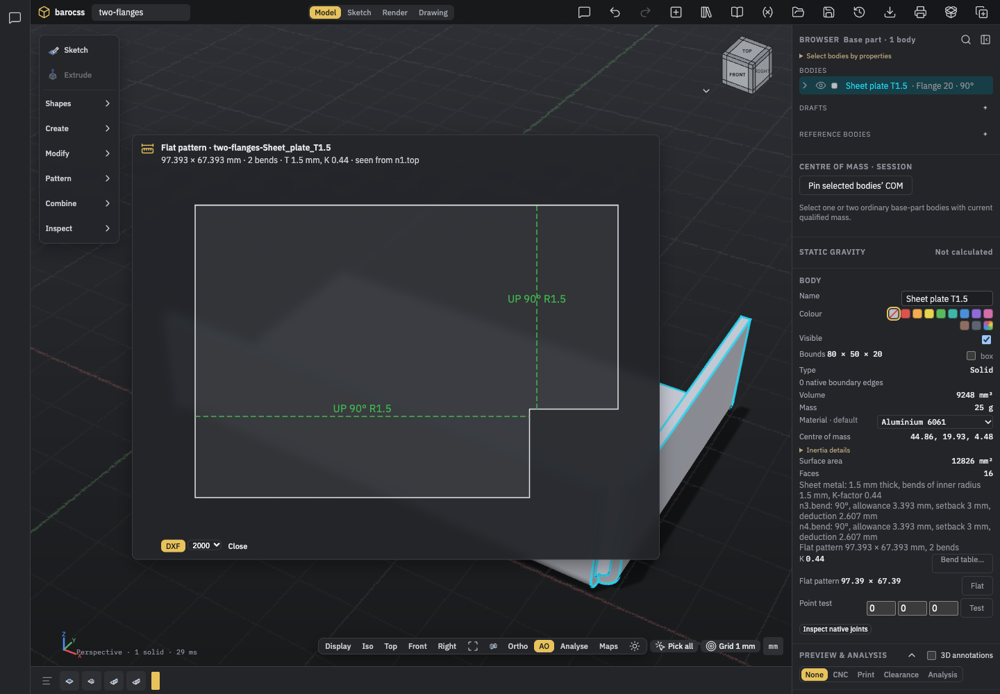
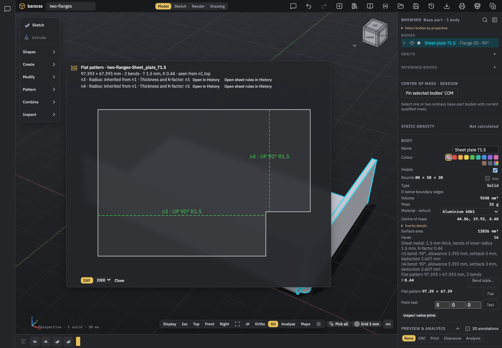

# #27 exact two-Flange bend owner navigation

Baseline `2fa66b991788073af1c25d8ae87ecfd16335d7c0`; verified product `e4359b68450ca1a93775c629641295974c393acf`. Synthetic D122 document only. These are original unmodified browser screenshots, not composites.

## Bounded result
Actual public Open of rectangle → sheet-base → corner-relief → two Flanges; n3/n4 developed faces correspond uniquely to typed native authored provenance. Each Open in History reaches its exact feature, and Open sheet rules reaches the base. Closing each editor leaves the authored document unchanged. Existing multi-chain radius controls remain absent. A new same-key Open retires the old dialog and shows own versus inherited radius correctly; public New also retires it.

The admitted structure is exact, but IDs and dimensions are not hardcoded. Names/array order alone are not authority. Native provenance is ephemeral, recomputed outside the flat geometry cache. Split/pipe aliases, duplicate/mixed faces, transformed ownership, unknown ancestry, stale document/open/worker/generation and deferred ownership fail closed. Existing terminal-contour Shared rules behavior remains unchanged.

## Reproduction and receipts
The executed final browser runner is `apps/cad-studio/test/flange-bend-owners-browser.mjs` at the product commit. It differs from the external executed copy only by a repository-relative helper import. `baseline-browser.mjs` similarly preserves the original baseline runner with portable import. Use existing repository dependencies, Node22, supported Chrome/Playwright and the flow-helper environment (`PW_DIR`, `CHROME`, `CAD27_OWNER_FROZEN=1`) with a fresh output directory and an exclusive validation slot.

`baseline-receipt.json` and `actual-receipt.json` preserve exact observations and accepted synthetic documents, source-freeze equality and original receipt hashes; machine/source-map provenance was omitted. `validation.json` records commands, pass counts, the two prior type failures and their NOT_RUN stages. Raw failed runs were not overwritten. Native5 plus existing sheet9 tests passed; Studio13 plus existing Shared rules11 passed; Model/Studio types, Vite and scoped lint passed. Final source narrowing only made the already validated stable ID type explicit.

## Limits
History navigation and source explanation, not new individual-radius or upstream/downstream editing support. No file downloads/exports, new Save persistence test, solver/schema or manufacturing/equipment expansion. Native strict geometry was checked; total volume was observed, not independently derived. Deferred stale closure protection has focused unit evidence, not a forced hidden browser callback. Issue #27 remains open for broader remaining scope.
