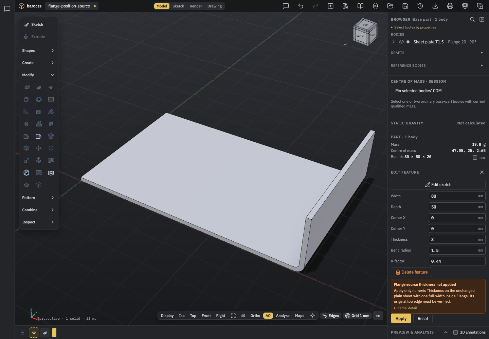
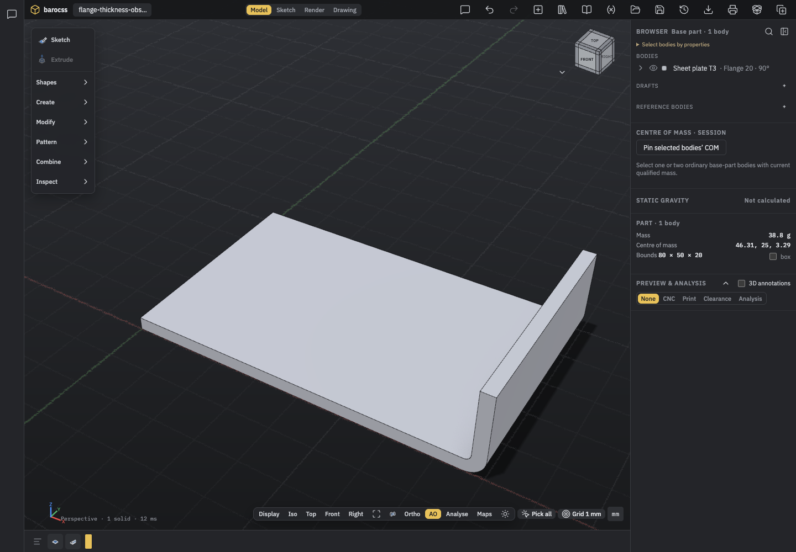

# Inherited-radius Flange source Thickness (#27, bounded unit)

Baseline and verification base: `f5b572e386d1a42349e1a4f36a0f81581623d03c`. Latest main was checked before publication. This extends only the previously excluded inherited-radius recipe of the proved source-Thickness adapter; #27 remains OPEN.

## Baseline: safe refusal
Actual viewport creation used a plain XY 80×50 sheet, T1.5/default R1.5/K0.44, selected x=80 top rim, default Flange radius0 (stored override key omitted), L20/90°/inside/Outer. Native radius1.5, original singleton signature and folded volume7315.071880146629 were independently checked. Source Thickness1.5→3 was refused with “Flange source thickness not applied”. Original document, History/Undo state, native geometry and Save/fresh Open were preserved. Subsequent editing was NOT_RUN. This was a bounded editability gap, not lost data or an unsafe accepted reference.

## Minimal change
Metadata admission now reuses the existing radius-source factory, allowing an omitted radius as well as the previously supported positive own radius. The exact terminal three-node restriction, Thickness-only document comparison, complete old/new parent topology, unique top rim, exact original signature, equal XY endpoints, full native evaluation and three-await ownership/revision guards are unchanged. Only the proved new parent signature is updated. The override stays omitted and parent radius stays unchanged.

Mixed parent-radius/source-mode/Length changes, bound or invalid values, unsupported geometry, downstream operations and uncertain references remain excluded. Native geometry failure keeps the original document. No schema, kernel geometry, manufacturing HOLD or general reference matching changes.

## Verification
- Fixed actual default-radius Flange Thickness1.5→3 accepted; new signature matches independent native parent evidence, override omission and parent R1.5 retained. Native strict BRep, folded volume/bounds/section/cylinders and flat-loop/bend-allowance oracle PASS. Undo/Redo and Save/fresh Open PASS.
- Thickness3→1.5 restores the entire original document including signature and omission; native geometry, Undo/Redo and another Save/fresh Open PASS.
- Existing own-radius source-Thickness and Radius source browser regressions PASS. Three runs have empty error/source-change lists and complete context/browser/server cleanup.
- New independent inherited tests41/41 plus existing own-radius Thickness tests41/41 PASS. Tests cover omission, numerical volume, exact signature, mixed/invalid/foreign-owner/topology counterexamples, three-await stale state/revision and real T19 `BEND_DOES_NOT_FIT` original preservation. Strict BRep/flat/file checks are actual-fixture evidence, not claims about the unit suite itself.
- Model TypeScript and Studio TypeScript/Vite build PASS; lint/syntax/diff checks PASS. Independent product/fixture and test reviews found no blocker. All writers stopped before actual runs. No failed test/browser/type/build stage in this unit.
- Baseline fixture SHA `f44881b5e6bfe182df447fd7347ce8cd6b563f820845281bf17d0648cff66d71`; fixed SHA `58e7b19165286e89d6602359f9158c6e1baa1eb9e4ca4bab22b24e0ac8413074`.

The separate Own→Sheet→Thickness sequence and subsequent Inner editing are NOT_RUN, not newly qualified workflows. Images are synthetic and individually reviewed. Exact commit CI and public rendering are recorded separately in #27.

