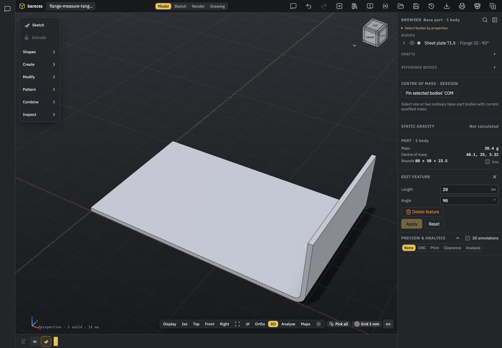
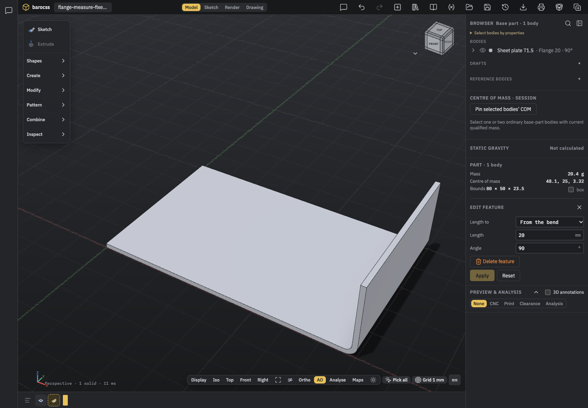
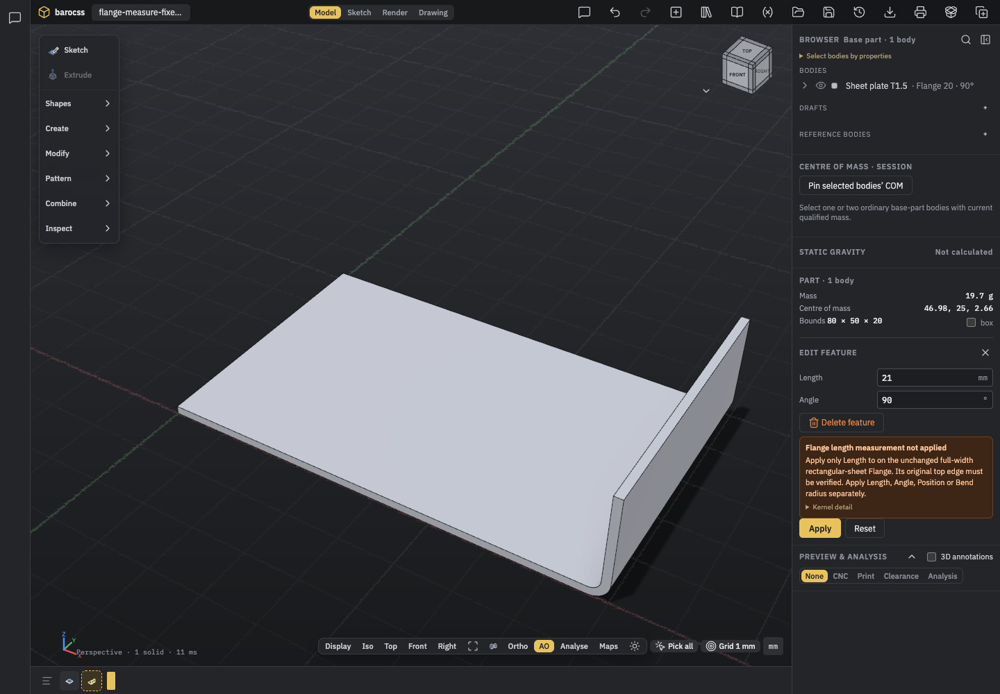

# Flange History Length to (#27, bounded unit)

Base: `92fd1a8b4ef5ede81c7fde2b8ad29e403f91dd64`. Latest remote main matched this base before publication; no integration conflict or unrelated WIP.

## Scope and meaning
History now exposes the existing **Length to** choice: Outer sharp, Inner sharp, From the bend. Only a terminal three-node plain XY rectangle → numeric sheet-base → full-width 90° Flange with explicit numeric bend radius and Material inside is admitted. The original parent topology and named top-edge signature must be independently proved before evaluating the candidate. Source nodes, IDs, original signature, numeric Length, Angle, radius and sheet rules are preserved. Mixed edits, downstream, offsets, bend tables, unsupported sources and stale owners/revisions are excluded.

Changing Length to while retaining numeric Length intentionally changes the straight flange leg, volume and flat length. It is not a geometry-preserving display toggle. Outer subtracts `(R+T)tan(angle/2)`, Inner subtracts `R tan(angle/2)`, and From the bend uses Length directly. The existing native calculation and saved measure schema are reused. Existing Radius/Position History controls remain outer-only; this does not extend their support after an Inner/Tangent selection. No manufacturing calibration or HOLD is changed.

## Product-before-change baseline
Three independent actual creation flows selected the same x=80 top rim using the viewport, then selected each existing HUD measure. All three created correctly and passed native solid/flat checks, document Undo/Redo and Save/fresh Open. History had no measurement choice in all six observations before/after reopening. This was a History editability gap, not broken creation or lost data.

Synthetic plate: 80×50, T1.5, base R1.5, K0.44. Flange: L20, explicit R2, 90°, Material inside. Independent expected values:

| Measure | Straight | Tip Z | Volume | Flat length |
|---|---:|---:|---:|---:|
| Outer | 16.5 | 20 | 7298.9767424014 | 97.1783182293 |
| Inner | 18 | 21.5 | 7411.4767424014 | 98.6783182293 |
| Tangent | 20 | 23.5 | 7561.4767424014 | 100.6783182293 |

The oracle uses `V=50*1.5*(76.5+straight+pi/2*2.75)` and `flatLength=76.5+straight+pi/2*2.66`. Flat area times thickness is deliberately not substituted for folded volume. Strict B-rep validity, bend radius/angle/allowance, rectangular flat loop, bounds, section vertices, cylinders and unchanged bend centre/axis are checked separately.

## Fixed validation
- Actual History Outer→Inner→Tangent→Outer cycle PASS. Every transition checks whole-document equality, native geometry, Undo/Redo and Save/fresh Open. Final document equals the original.
- Cancel leaves the original unchanged. Mixed Length/Angle changes are refused with original document, history and native geometry preserved.
- Existing Position and explicit Radius browser regressions PASS (3/3 browsers including new actual).
- Independent Model tests 4/4; Studio proof/async owner tests 28/28 PASS. Includes real native valid Tangent L3→Outer `BEND_DOES_NOT_FIT` refusal with original preservation. That short-leg boundary is a native/unit check, not claimed as browser-certified.
- Model type-check, Studio TypeScript/Vite build, scoped lint, syntax and diff checks PASS.
- All browser receipts have empty errors/source-change lists and closed contexts/browser/server. No failed actual or type run occurred in this unit.
- Two independent reviews found no blocker. Writers ended before frozen actual runs. Baseline fixture SHA `52814deb5cb044a35d9e0ba005720443fdb19dce9ed8d4116107f8fc543dd915`; fixed fixture SHA `0a08690eea2795b4a31bb824a9e112652cc0a44a18e90b138272bf3f2f760767`.

Exact commit CI and public image rendering are recorded in #27 after push. #27 remains OPEN for remaining scope.

All images depict synthetic fixtures and were individually inspected before publication.
