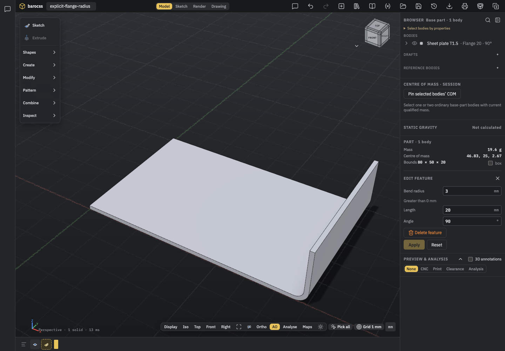
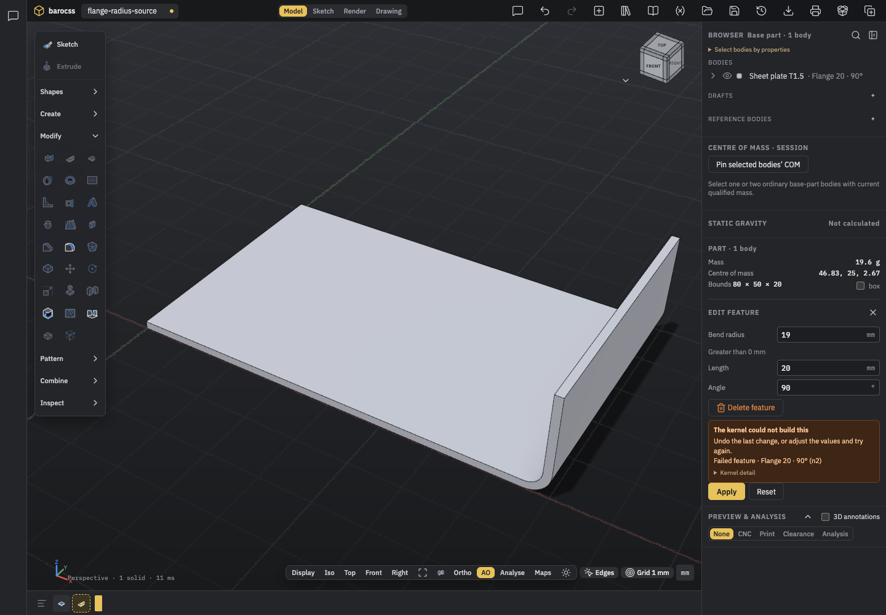

# #27: explicit Flange bend radius in History

Limited completion unit; #27 remains open. No manufacturing calibration or document synchronization work.

## Baseline and scope
Actual UI opened an 80×50 sheet, T1.5, default R1.5/K0.44, selected the x=80 skin edge and created a full-width Flange with explicit R2, outer length20 and 90° material-inside. Native volume and developed geometry were correct, but History exposed only Length/Angle, including after Save/Open. No baseline data loss.

History now exposes the existing positive numeric own radius for this terminal three-node rectangular-sheet case. It does not turn inheritance into an override. Bound radius, bend tables, offsets/relief, other angles/positions, downstream/multiple flanges and compound documents remain excluded. Existing Length/Angle edits are unchanged. Native geometry evaluation still rejects impossible bends atomically.

Independent review caught and corrected two boundaries before actual verification: nonpositive input must be blocked before the strict setter; a radius change followed by an ordinary Length/Angle change must be rechecked at Apply. The latter is refused without native evaluation. No kernel/schema change.

## Verification
- Model focused own-radius + existing sheet: 15/15 PASS.
- Studio numeric validation + Apply guard + existing History: 19/19 PASS.
- Actual Chrome: R2→R3, independent native folded volume/cylinder radii and flat allowance/length, Undo/Redo, zero disabled, mixed R+Angle/R+Length refusal, R19 BEND_DOES_NOT_FIT with original retained, R2.5 draft cancellation, Save/fresh Open R3: PASS.
- Existing sheet-path History actual browser: PASS.
- Model TypeScript and Studio TypeScript/Vite production build: PASS (existing bundler warnings).
- Frozen source watcher changes=[], errors=[], browser/context/server cleanup complete.

Independent x=80-edge oracle, width50, run80, outer length20, thickness1.5:
volume = 50×1.5×(100−2×(R+1.5)+π/2×(R+0.75)).
Developed length = 100−2×(R+1.5)+π/2×(R+0.44×1.5).
Sheet default radius remains1.5; only the own bend radius changes.

Run `FLANGE_RADIUS_HISTORY_SOURCE_FROZEN=1 node apps/cad-studio/test/flange-radius-history-browser.mjs OUTPUT`; add `--baseline` only against the original product. Existing regression: `SHEET_PATH_SOURCE_FROZEN=1 node apps/cad-studio/test/sheet-path-edit-browser.mjs OUTPUT`.

