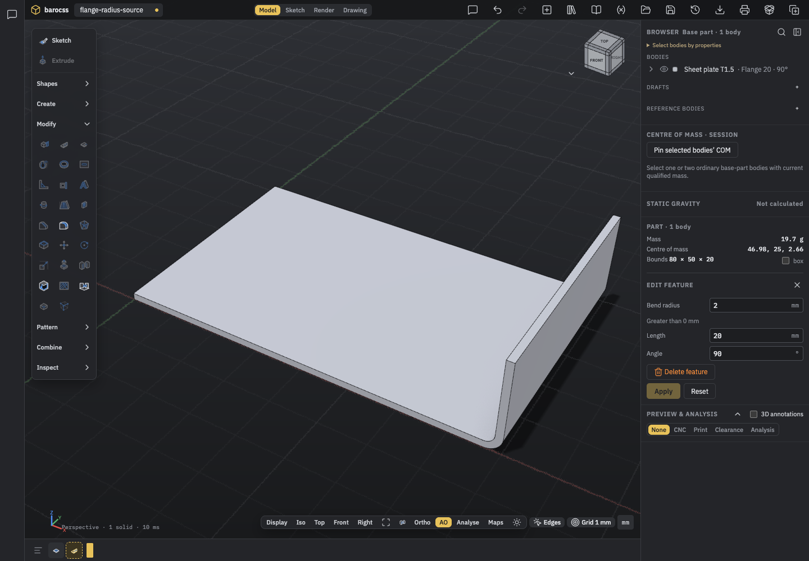
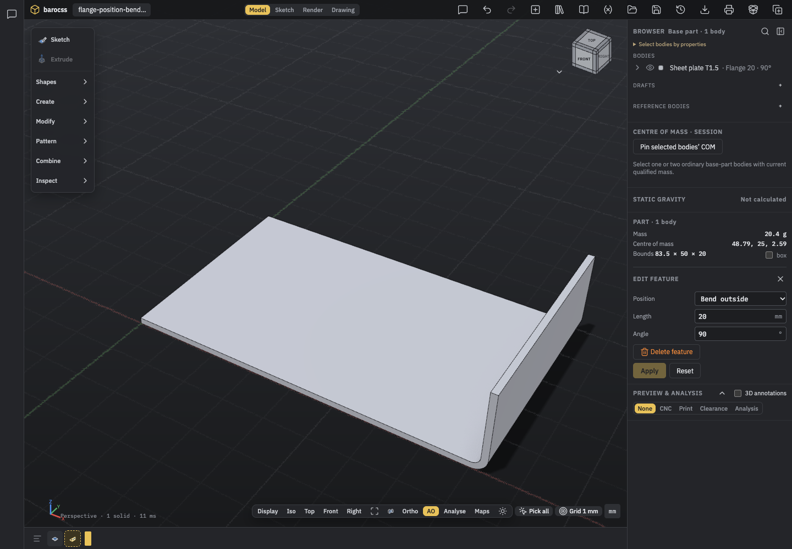
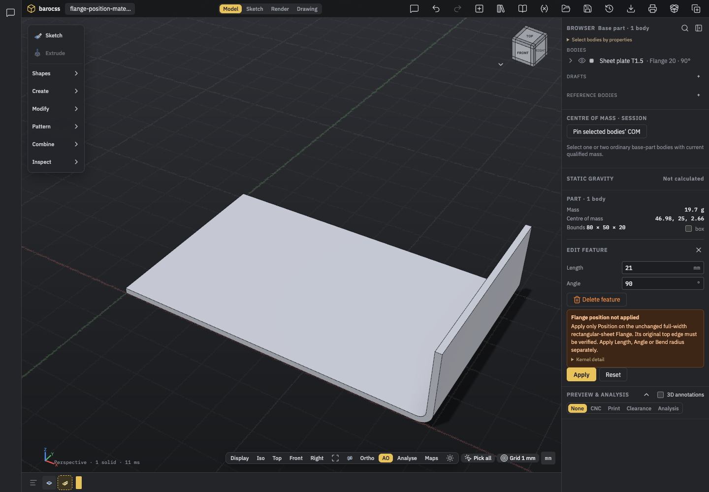

# Flange History Position (#27)

## Baseline and limited implementation

On `699af2fa5`, actual edge selection and Flange creation on an 80 × 50 × 1.5 mm rectangular sheet, with explicit radius 2 mm, length 20 mm and 90° angle, created a valid Material inside flange. History exposed Length, Angle and Bend radius, but no Position. Native folded/flat geometry, Undo/Redo and physical Save/fresh Open preserved this state. This is an editing gap, not data loss.

History now offers Material inside / Material outside / Bend outside for a plain numeric XY rectangle → Sheet base → single terminal full-width Flange, with an explicit numeric radius, 90° angle and outer length. Only Position may change in that Apply. The original source nodes, selected edge/signature, length, radius, angle, IDs, outputs and sheet rules remain unchanged. Returning to default Inside removes the optional position key. A no-op preserves the nodes and default omission (the returned array is copied).

Apply proves the unchanged native parent with the existing complete rectangular topology contract, its top-rim native line and exact original signature. A temporary Extrude description is used only to check topology; it is never evaluated or saved. Missing/ambiguous evidence fails closed. Prefix and final response revisions and document/draft ownership are checked, including in-place mutations during awaits. Existing radius editing remains Inside-only. Mixed Position plus Length, Angle or Radius changes are refused rather than silently changing other design values.

## Verification

- New Model tests 3/3: native folded volume and flat area for all positions, file roundtrip, exact source preservation, default no-op, foreign/mutated ownership, invalid choices and unsupported/mixed drafts.
- New Studio tests 27/27: actual native prefix and full success; missing/stale signature, damaged topology and foreign body; prefix/full owner changes, same-object source/draft mutations and revision mismatch; native failure response handling. The last case feeds a real invalid-length native error into the coordinator; it does not claim a Position-only UI change causes that invalid length.
- Existing Model radius tests 6/6 and Studio radius Apply tests 9/9 PASS.
- Actual Chrome: Inside → Material outside → Bend outside → Inside, independent folded volume, flat boundary/allowance, bend-cylinder radius/centre and section vertices, visible volume, Undo/Redo and physical Save/fresh Open after every transition. Cancel and mixed Length/Angle refusal preserve document history and original native geometry. Exact refusal title checked.
- Folded volumes: 7298.976742401413 / 7411.476742401424 / 7561.476742401448 mm³. Maximum X: 80 / 81.5 / 83.5 mm; maximum Z stays 20 mm. Original sheet default radius stays 1.5 mm, explicit bend radius stays 2 mm. Flat lengths use neutral radius R + K×T (K=.44), not volume divided by thickness.
- Existing actual Flange radius browser regression PASS. Both browser receipts have no console/page errors or frozen-source changes and confirm contexts, browser and server closed.
- Initial Studio focused run was 26/27 because a test directly modified cached native mesh. Cloning the response before damage isolated the negative control; 27/27 passed thereafter.
- Initial Model type check failed on a test's un-narrowed EditField union; explicit choice narrowing fixed it and 3/3 retested. Subsequent Studio type check failed on optional nextId in a mutation test; explicit fallback preserved the fixture's 3→4 mutation and 27/27 retested. Product and actual fixture were unchanged by both type fixes. Each skipped later build stage was NOT_RUN at that time.
- Final Model type check, Studio type check and Vite production build PASS (4.39 seconds). Existing bundler warnings are non-fatal. Heavy slots released; final free space about 45.7 GiB.

## Reproduction

With Node 22, workspace dependencies, PW_DIR and CHROME configured:

```sh
(cd apps/cad-studio && FLANGE_POSITION_HISTORY_SOURCE_FROZEN=1 node test/flange-position-history-browser.mjs /tmp/flange-position-proof)
(cd apps/cad-studio && FLANGE_RADIUS_HISTORY_SOURCE_FROZEN=1 node test/flange-radius-history-browser.mjs /tmp/flange-radius-proof)
pnpm --filter @barocss/cad-model test flange-position-edit flange-radius-edit
pnpm --filter @barocss/cad-studio-app test flange-position-history-apply flange-radius-history-apply
pnpm --filter @barocss/cad-model type-check
(cd apps/cad-studio && pnpm build)
```

The browser fixture's `--baseline` mode is for the original baseline commit.

## Limits

Actual coverage is the specified single x=80 top-rim flange and three positions. Adversarial async/revision/signature checks are unit tests, not new browser coverage. No-op Apply is not a separate browser scenario. Inherited/bound radius, arbitrary planes/profiles, offsets/relief, bend tables, multi-flange/downstream references and manufacturing qualification are excluded. No general topology repair or format change. Existing HOLDs remain; #27 stays OPEN.

All images and models are synthetic, without private data or credentials.




