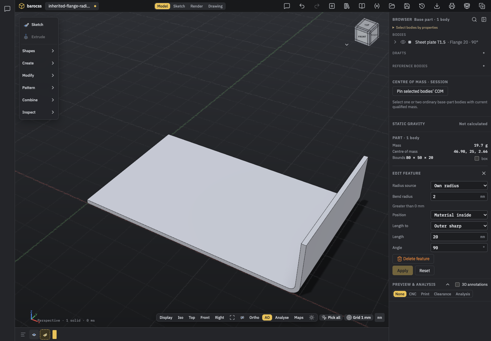
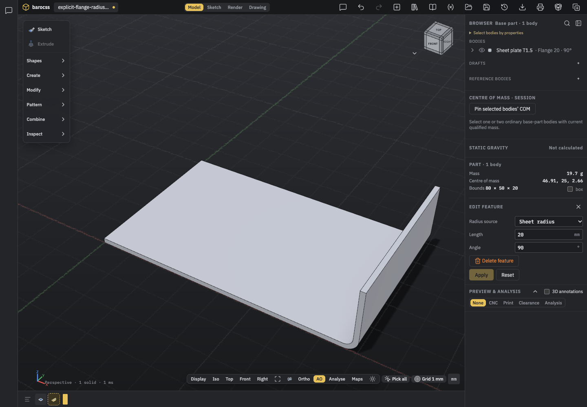

# Flange History radius source (#27, bounded unit)

Verification base: `8edbd7d15eb759643ac83a63d58297eee17a9f60`. Before publication, unrelated assembly #207 `ae7a35dd5` was fast-forward integrated without conflicts or touching other WIP. Integrated focused tests passed. Exact commit CI is recorded in #27; the umbrella issue remains OPEN.

## Baseline
Actual viewport-created 80×50 plain XY sheet, T1.5/default R1.5/K0.44, x=80 top rim, full-width inside/Outer Flange L20/90°. Creation with radius0 omits `bendRadius` and inherits the sheet radius. Changing the parent radius to2 correctly updates native geometry; Undo/Redo and Save/fresh Open preserve that intent. However History has no radius source control or own radius field for this inherited feature. A separate explicit-R2 flange correctly keeps R2 after the parent changes to2.5. This is a bounded editing gap, not lost data or broken inheritance.

## Change and limits
Adds **Radius source: Sheet radius / Own radius** only for the proved terminal three-node plain numeric XY rectangle → sheet-base → full-width inside/Outer 90° Flange. Sheet→Own copies the current parent radius. Own→Sheet deletes the override key. Viewing, selecting the current mode, or cancelling does not convert inheritance. An inherited flange's numeric radius field becomes available only after applying Own and reopening History; this does not expand the old numeric radius admission.

Only source-mode changes are accepted: no simultaneous numeric override or unrelated edit. The complete native parent topology, unique straight top rim and original singleton signature must prove ownership. Prefix and final evaluations recheck document/draft/owner/open/scope/worker/revision state. Unsupported geometry, ambiguous references, downstream operations and failed native evaluation preserve the original document. No schema, manufacturing HOLD or general reference-matching policy changes.

## Verification
- Actual inherited→Own at current R2 and explicit R2→Sheet at current parent R2.5: exact authored document changes, independent native folded volume/bounds/section/cylinders/flat-loop/bend-allowance checks, Undo/Redo and Save/fresh Open PASS. Reverse-choice cancellation preserves the accepted document.
- Existing own-radius, Length-to and source-Thickness browser regressions PASS. Four browser receipts have empty errors/source-change lists and all contexts/browser/server closed.
- Independent focused tests **35/35 PASS** (model6, Studio29): omission/no-op identity, exact current parent initialization, mixed edits and unsupported metadata, topology/signature/foreign-body rejection, stale two-await owner/revision boundaries, real native `BEND_DOES_NOT_FIT` original preservation. Invalid-fit refusal is native/unit verified, not browser-certified.
- Model TypeScript and Studio TypeScript/Vite build PASS. Scoped lint, syntax and diff checks PASS. Independent product, test, fixture and public-information reviews found no blocker.
- A fixture assumption that an inherited→Own draft immediately exposes the numeric field was corrected before execution to reflect apply/reopen behavior; product unchanged.
- Connection interruption after browser verification left the original session unavailable. Receipts, no remaining related processes, empty gate and frozen source hashes were checked after reconnection. Missing type/build logs were recorded **NOT_RUN**, then Model/Studio type/build were run in a new allocated session and passed. No duplicate browser run or uncertain push occurred.
- Baseline fixture SHA `c8553fa0a96bf6df7d44223fa9f7639a09dc8a5c0023ba438638169f20c3f978`; fixed SHA `5c4f16055d5529fea62febdf3657b427d6b8d90292e565eb67b681274a8007a8`.

Images contain synthetic fixtures and were individually inspected before publication. Public rendering and exact CI are verified separately in #27.

