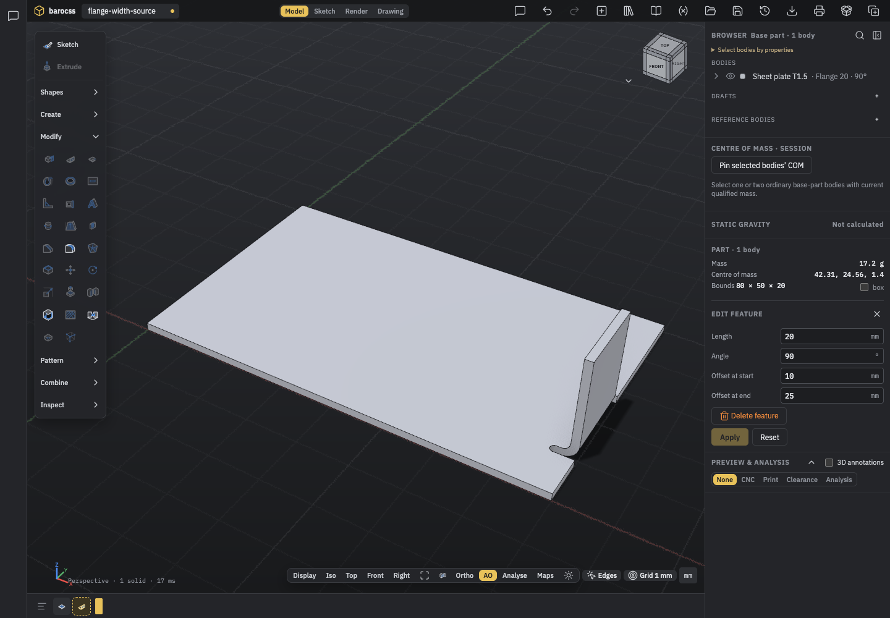
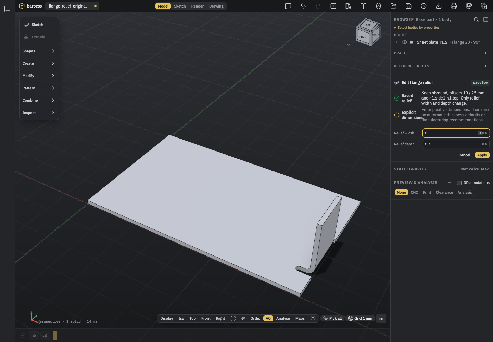
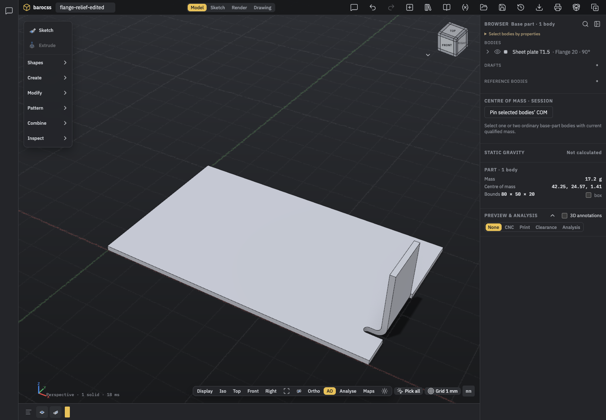

# Partial Flange relief dimensions in History

## Result and scope

Existing issue #27: a saved partial Flange can now expose **Edit flange relief** to edit its existing numeric relief width and depth. The relief kind, offsets, Length, Angle, source geometry, IDs and parent-edge signature remain unchanged. This is not a relief-kind switch or a general sheet-metal editor.

Admission is deliberately narrow: exactly three nodes, a plain numeric XY rectangle and sheet base, followed by one terminal Flange with inherited sheet radius, 90° material-inside/outer-length semantics, the x-max top rim, two positive offsets, and an existing numeric rectangular or obround relief. Bindings, downstream consumers and unsupported metadata/recipes are excluded. Original native parent topology and the exact stored signature are proved before original/candidate solid and flat evaluation. Uncertainty refuses without replacing the accepted document.

Actual browser evidence is **obround only**. Rectangular relief and existing parameter-bound relief native/codec support are covered by unit tests, not by this browser run. Bound relief remains excluded from the new numeric editor; its existing storage/native support is unchanged. Manufacturing and other HOLD scopes are unchanged; #27 is not closed by this bounded result.

## Baseline and positive creation control

Both baseline receipts passed their observation contracts. The original History editor exposed Length, Angle and offsets, but no relief-dimension fields or new saved command. Dimension editing was therefore **NOT_RUN**, not an unsuccessful geometry operation. Opening and closing that editor is not a no-op Apply test.

The synthetic source is an 80 × 50 × 1.5 mm sheet, sheet radius 1.5 mm, K-factor 0.44, Flange Length 20 mm, offsets 10/25 mm. Native edge direction was independently inspected as [80, 0, 1.5] → [80, 50, 1.5], giving the active Y interval [10, 25].

- Baseline creation: obround width/depth 1.5/1.5 mm, native validation and Undo/Redo/Save/fresh Open passed.
- Separate positive creation control: width/depth 2/2.5 mm, native validation and the same persistence lifecycle passed. This was creation, not History editing.



## Fixed actual workflow

The fixed run passed:

1. Original creation and persistence checks.
2. Explicit saved-command no-op Apply and preview Cancel, preserving the original document.
3. Native refusal of width 11 mm and obround depth 0.5 mm, with the accepted document preserved; recovery to valid values.
4. Width-only change 1.5 → 2 mm, followed by depth-only change 1.5 → 2.5 mm in a new command.
5. Two Undo operations and two Redo operations, with native checks at the restored states.
6. Save/fresh Open, exact expected saved-document checks, native validation, and reopened command values 2/2.5 mm.

The fixed receipt still contains `dimensionEdit: NOT_RUN` in its initial `history()` observations. That scanner checks the old inline fields only. It does **not** describe the later **Edit flange relief** command, whose actual Apply, refusal, Undo/Redo and persistence checks passed.





## Independent native oracle

For these obround cases, let `w` and `d` be relief width/depth, `r = w/2`, and the area removed by each end relief be:

```text
Q = w × (3 + d − r) + πr²/2
V = 1.5 × [4000 − 45 − 2Q + 15 × (17 + 2.25π/2)]
Aflat = 4000 − 45 − 2Q + 15 × (17 + 2.16π/2)
```

The 3 mm trim, 17 mm straight leg, 15 mm active width, physical bend mean radius 2.25 mm and neutral radius 2.16 mm are derived from the unchanged sheet/Flange recipe. Volume and flat area are distinct checks, not an assumption that `V = T × Aflat`.

| Width / depth (mm) | Expected volume (mm³) | Native volume (mm³) | Expected flat area (mm²) | Native flat area (mm²) |
| --- | ---: | ---: | ---: | ---: |
| 1.5 / 1.5 | 6374.995845242525 | 6374.99584524258 | 4247.876655120511 | 4247.876655120492 |
| 2 / 1.5 | 6368.809175063608 | 6368.809175063658 | 4243.752208334565 | 4243.7522083346 |
| 2 / 2.5 | 6362.809175063608 | 6362.809175063621 | 4239.752208334565 | 4239.752208334597 |

The inspector also checks strict BRep validity, one solid/output, parent signature, folded bounds, bend cylinders, and two Z-axis relief-cap cylinders with independently derived radii and centres. Expected accepted documents are checked separately before using their relief values in the geometry oracle. The stored parent signature remains `line`, midpoint [80, 25, 1.5], direction [0, 1, 0], length 50.

## Validation and provenance

- Baseline and positive creation browser receipts: PASS, no recorded errors or source changes; contexts/browser/server closed.
- Fixed browser receipt: PASS, no recorded errors or source changes; all three contexts/browser/server closed.
- New focused Model tests: **7/7 PASS**; new Studio owner tests: **21/21 PASS**; scoped lint PASS.
- Existing width and radius actual browser regressions: PASS (coordinator verification).
- Model type checks and Studio type/build checks: PASS (coordinator verification).
- Tests include no-op identity, width/depth independence, invalid geometry, unknown/mixed inputs, original signature, cloned/stale owner, same-object mutation, unsupported/downstream scope, source preservation and codec roundtrips. Owner tests are a component/command harness, not an extra browser run.

Baseline and fixed actual runs used base commit `438b7072ba39b278b0d9334f9f7c88c2b2f17422`; fixed ran with the feature changes on that base. After integrating `176511cc52f2fc7325768f3c01b74808572042d3`, a fresh actual run and Studio TypeScript/Vite build also passed. Its error/source-change lists are empty and all contexts/browser/server closed. Exact final-commit CI and public-image rendering are recorded separately in #27.

SHA-256 source pins:

- Baseline/positive fixture: `64db6d5efa048b39cade162de656025bd661cd15118bd93fdf89a32c0e505a58`.
- Fixed fixture: `ae4f2093b3c3cd983276cb473036187f46fea3fb20f14e12053f096a892bd9fb`.
- Fixed Model helper: `80d3efc4e1ea211695d83cd383ad766dca8986badeb564bba686122f4becf56d`.

The helper's final pre-validation change captured width/depth while TypeScript's relief union was narrowed; it did not relax runtime admission or geometry proof.

## Source and reproduction

- `packages/barocss-cad-model/src/app/flangeReliefDimensionsHistoryEdit.ts`
- `apps/cad-studio/src/ui/HistoryFeatureEditor.tsx`
- `packages/barocss-cad-model/test/flange-relief-dimensions-history.test.ts`
- `apps/cad-studio/test/flange-relief-dimensions-history-owner.test.ts`
- `apps/cad-studio/test/flange-relief-dimensions-history-browser.mjs`

Use the repository's browser-runner prerequisites, including configured `PW_DIR` and `CHROME`, and a fresh output directory. From `apps/cad-studio`:

```sh
node test/flange-relief-dimensions-history-browser.mjs "$OUTPUT_DIR"
```

The historical baseline used the frozen baseline fixture above on the original product, with `--baseline`; the positive creation control also added `--positive`. Running `--baseline` on fixed code does not reproduce the original missing-command state. Screenshots here contain only synthetic CAD geometry.
