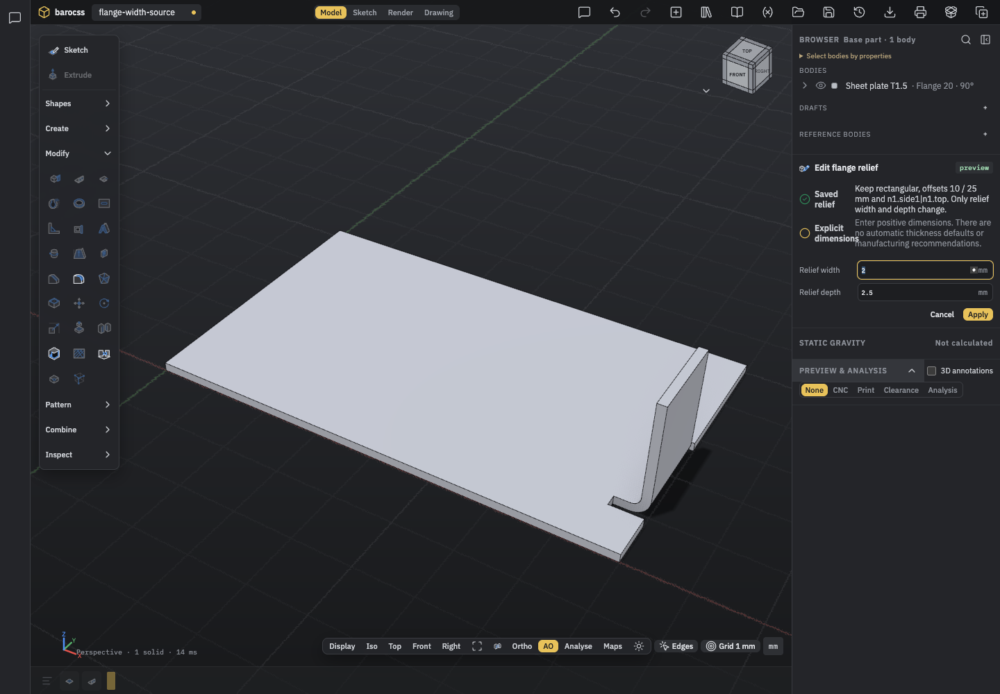
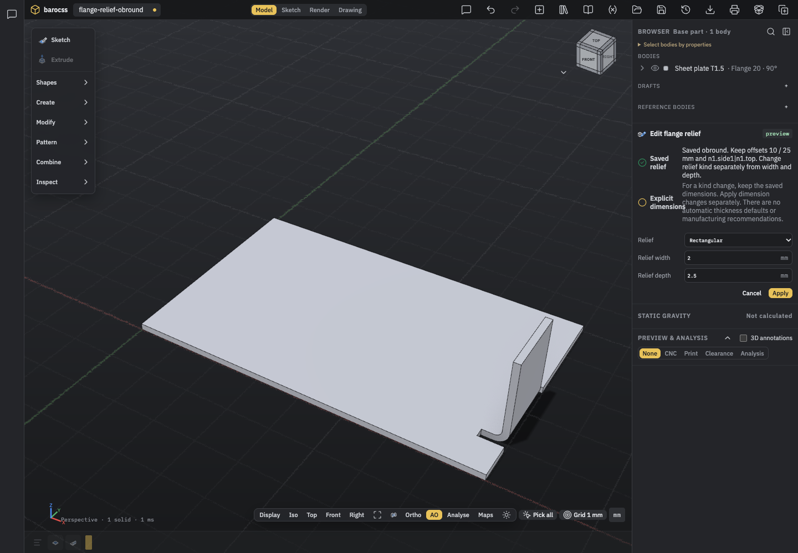

# Partial Flange relief-kind History editing (#27)

Base: `4d31a90b3aa2c56674b2c53a342a2267e678d6a9`. This is a bounded partial implementation; #27 remains OPEN.

## Baseline

Two independent actual creations used an 80×50 XY sheet, T1.5/R1.5/K0.44, one terminal x-max top-rim Flange, Length20/90°/inside/Outer, inherited radius, offsets10/25 and explicit relief width2/depth2.5. Rectangular and Obround each passed strict native geometry, volume, flat area, original parent signature, creation Undo/Redo and Save/fresh Open. Existing Edit flange relief offered only width/depth, before and after reopening. Kind transitions were NOT_RUN, not existing data loss. Opening and cancelling the command was not a no-op Apply test.

## Restricted addition

The existing Edit flange relief command now offers Rectangular and Obround. A kind change requires unchanged saved width/depth; mixed kind-and-dimension changes are rejected atomically. Same-kind dimension editing and numeric-only command callers remain compatible. No-op returns the exact original document. None conversion and bound dimensions remain outside this numeric editor; existing native Dim support and codec behavior are independently preserved.

Admission remains exactly three nodes: numeric XY rectangle, numeric sheet rules, one terminal inherited-radius partial Flange with two positive offsets on the x-max top rim, 90° inside/Outer, and explicit numeric rectangular/obround relief. The complete original parent topology, exact original signature, original and candidate strict native solid/flat validity, captured document identity and canonical revision are checked. Unknown values, unsupported ownership, downstream features and uncertain geometry remain excluded. No native/schema, manufacturing, general sheet or other HOLD expansion.

## Verification

- Model 11/11 PASS: existing numeric edits, two-way kind-only authored-data preservation and codec/native roundtrip, no-op identity, unknown/None/mixed refusals, original signature/native validity, stale document/revision, unsupported recipes, and independent native Dim preservation. A valid shallow Rectangular width4/depth1 is proven first, then the impossible same-dimension Obround candidate is refused and the original native result rechecked.
- Studio owner 21/21 PASS. Existing entry/session/document/geometry guards are unchanged; expected command defaults now include the saved kind.
- Two fixed actual runs PASS: Rectangular→Obround→Rectangular and Obround→Rectangular→Obround. Each checks no-op Apply, preview Cancel, mixed width2.25 refusal with unchanged document, recovery at original width2, exact kind-only document change, native geometry, Undo/Redo, Save/fresh Open at each kind and reopened defaults.
- Existing relief width/depth and partial own-radius actual regressions PASS. All four receipts have empty errors/console-errors/source-change lists and completed context/browser/server cleanup.
- Model TypeScript, Studio TypeScript/Vite, scoped lint, syntax and independent reviews PASS. No failing actual or type run occurred in this unit. Heavy slot returned after process cleanup.
- Actual scope is only the stated x-max numeric inherited-radius recipe. Other directions, bound-dimension UI editing, downstream consumers, None conversion and general manufacturing validity are not claimed.

## Independent geometry

With active width15, trim3, straight17, relief width `w`, depth `d`, `r=w/2`:

```text
Qrect = w × (3 + d)
Qobround = w × (3 + d − r) + π × r²/2
V = 1.5 × [4000 − 3×15 − 2Q + 15×(17 + π/2×2.25)]
Aflat = 4000 − 3×15 − 2Q + 15×(17 + π/2×2.16)
```

At w2/d2.5, Rectangular native volume6361.521564044006 matches oracle6361.521564043991; Obround native6362.809175063621 matches oracle6362.809175063608. Relief-cap count0/2, Obround radius1, centresX75.5/Y9,26, bend radii1.5/3, flange vertices and exact original parent signature are checked independently.

## Provenance

- Historical baseline fixture SHA: `f7af555f5431ed1a8a65aed2aed17c66eb171ff1bbf9a8ad7c876b8e4e9e2eb4`.
- Fixed fixture SHA: `455f336b8af4c397234d4523be31e16eb9776dd52376fe2193817d03122edf21`.
- Product helper SHA: `b6dacd1cc080a3a6af6bc3dfd5feed04fc66295f8d25d516111ade150f01eb4c`.
- Model tests SHA: `a34bba4922ff450be85b9e3514c031821518700c92d909fe113a9e9fb07a4432`.
- Runner: `apps/cad-studio/test/flange-relief-kind-history-browser.mjs`, configured browser prerequisites and fresh output. Historical observation mode used `--baseline`, Obround added `--positive`. Fixed mode omits `--baseline`; `--positive` reverses its starting kind. Running observation mode on changed product does not recreate the historical missing-choice baseline.

Exact final-commit CI and public-image rendering are recorded separately in #27. Images contain synthetic models only.




