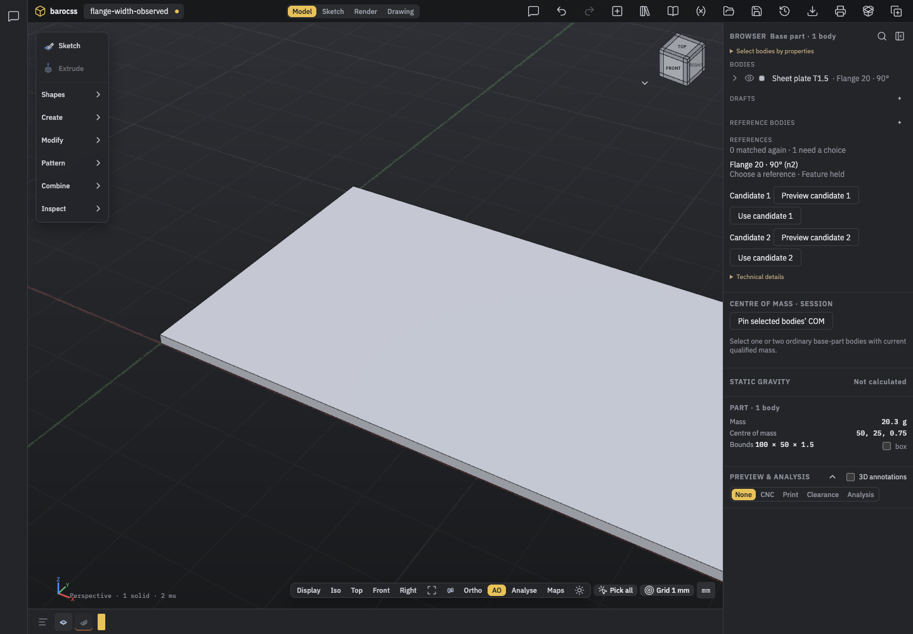
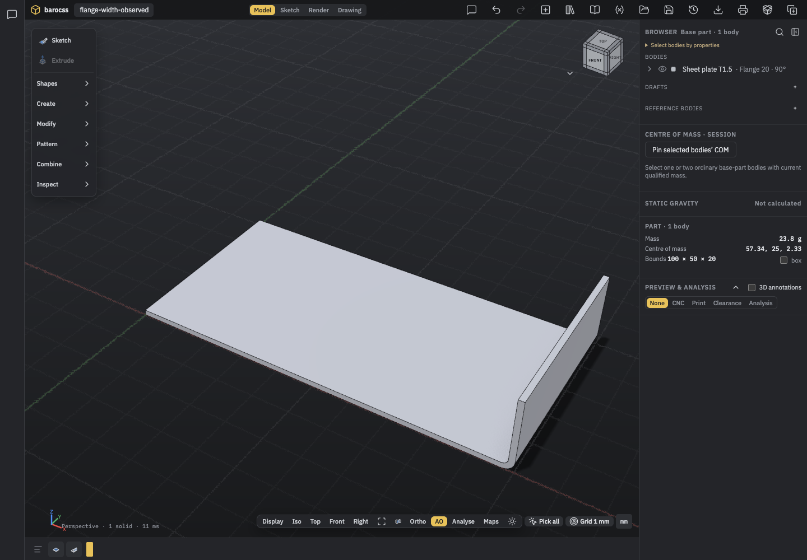
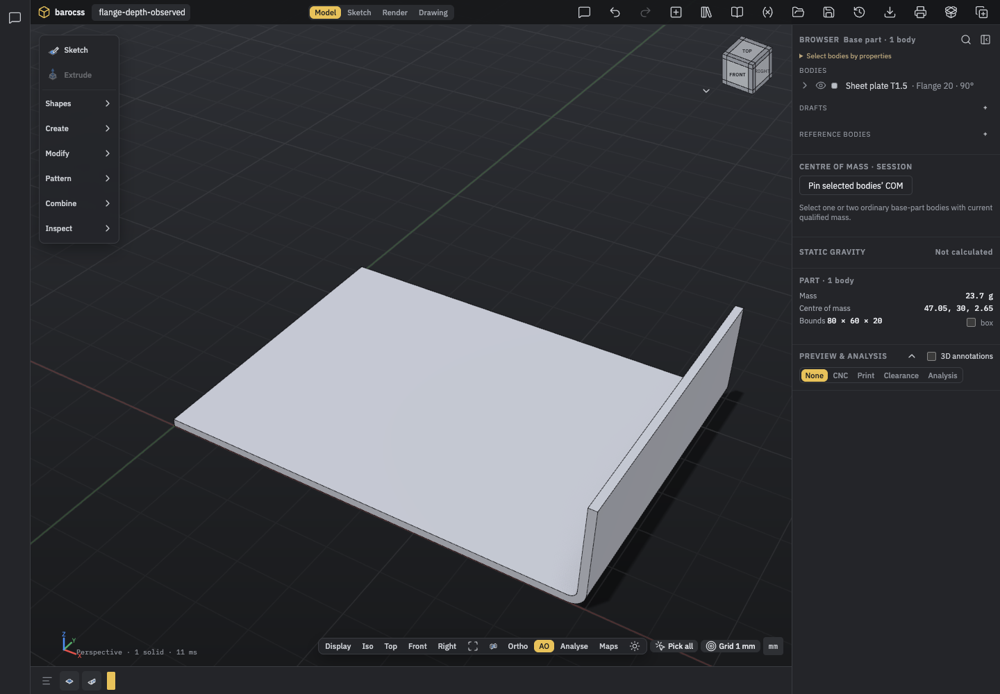

# Sheet source size and inherited Flange references (#20 / #27)

Base: `eebcf60c4c70d6d90226a4462adfbbcb951d7cd2`. This is a bounded persistence fix, not completion of either umbrella issue. Both remain OPEN.

## Before the change
Actual viewport creation: XY rectangle80×50, Sheet T1.5/default R1.5/K0.44, x-max top rim, default-radius Flange (override omitted), L20/90°/inside/Outer. Width80→100 and Depth50→60 were accepted and native geometry plus Undo/Redo passed. However, the original signature remained `[80,25,1.5]`, length50. Save/fresh Open safely held the Flange with two reference candidates. The feature remained stored: this was not deletion. Subsequent Flange editing was NOT_RUN. Both baseline runs passed as observations, not as successful persistence.

## Restricted repair
Only one numeric source extent changes in the terminal rectangle → Sheet → inherited Flange three-node recipe. Corner/min coordinates, other source or feature data, bindings, downstream nodes, mixed changes and unsupported recipes are excluded. Both old/new complete rectangular parent topologies, unique singleton named top edge, semantic side and exact original native signature must be proved. Only then is the new signature recorded. Full native evaluation and owner/revision checks across three awaits remain mandatory. Uncertainty or native failure preserves the original document atomically. No general rematch, schema, kernel or manufacturing-HOLD changes.

## Evidence and limits
- Fixed Width80→100 and Depth50→60 actual runs PASS. Native signatures respectively `[100,25,1.5]`/length50 and `[80,30,1.5]`/length60 match the saved document.
- Independent strict BRep, folded volume, vertices/cylinders, bend centre, flat-loop dimensions and bend allowance checks PASS. Width volume8815.071880146646; Depth volume8778.08625617599.
- Undo/Redo, Save/fresh Open, reverse extent restoring the complete original document, reverse Undo/Redo and second Save/fresh Open PASS. Radius override stays omitted; sheet radius remains1.5.
- Actual browser evidence covers the x-max top rim only. All four semantic sides have unit/native tests, not four-direction browser qualification. Subsequent Flange editing and arbitrary metadata-edit callers are not qualified here.
- Independent new tests43/43 and existing source/inherited Thickness plus radius-source History tests111/111 PASS. Counterexamples include corrupt topology/signatures, two extents, Corner, mixed/rule/radius/Length edits, bindings/downstream, stale owner/revision and real Width2 native `BEND_DOES_NOT_FIT` refusal. Unit volume checks do not substitute for actual strict BRep/flat/file checks.
- Fixed actual2 and existing inherited/own source Thickness browser regressions2 all PASS, empty error/source-change lists, complete context/browser/server cleanup. Model type-check and Studio TypeScript/Vite build PASS. Independent product/fixture/test reviews and lint/syntax/diff checks PASS. No failed fixed verification stage.
- Baseline fixture SHA `2b2650e1d0afee1902fd80789cdc54364b9b7c486b5b8f7cab7b99a92b1d63b2`; fixed fixture SHA `cac185f8b1e0882616587c5ccbeb352c2a04d8b819291d1e97bf22bed39f9707`.

Images contain synthetic models only. Exact commit CI and public-image rendering are recorded separately in the existing issues.

