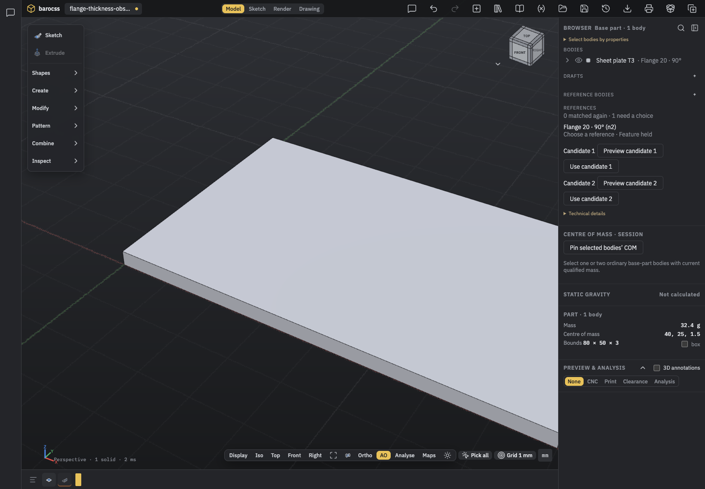
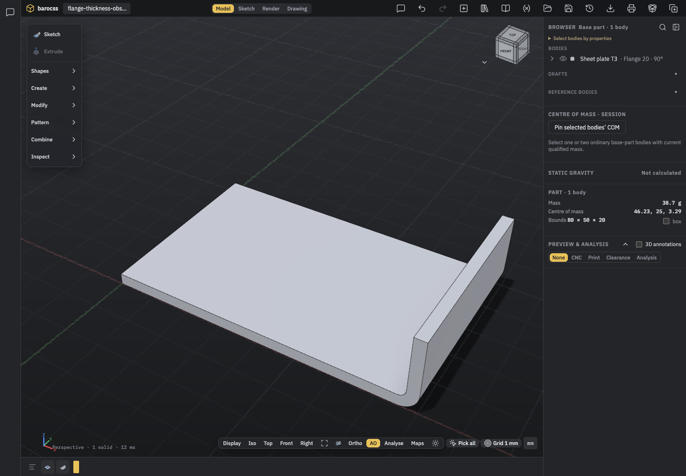
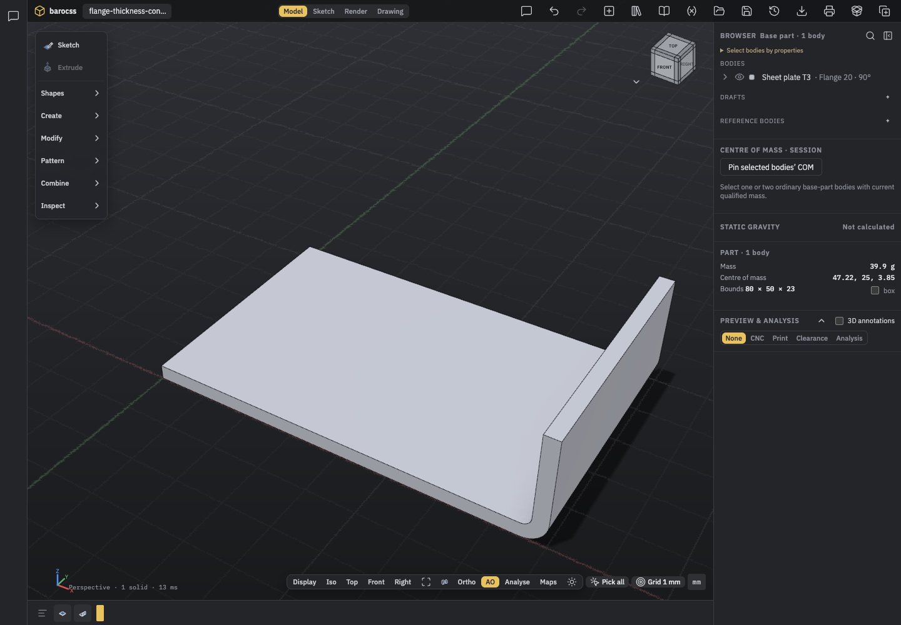

# Flange source Thickness History continuation (#27, bounded unit)

Baseline and full verification base: `6ef910eac525d88c72cf04787c7aeaa4def7e7b4`. Before publication, fast-forward integrated unrelated #202 `cda583b39` drawing chat changes without conflict or touching other WIP. Integrated focused tests and lint passed. Exact commit CI is recorded in #27; the umbrella issue stays OPEN.

## Baseline: safe hold, not data loss
Actual viewport creation on an 80×50 plain XY sheet, T1.5, default R1.5/K0.44, selected x=80 top rim. Full-width inside Flange L20, explicit R2, 90°, Outer sharp. Its original stored/native signature matched at [80,25,1.5].

History Thickness 1.5→3 was accepted and folded/flat native geometry plus Undo/Redo passed. However the stored signature remained at Z1.5 while the independently measured parent top rim was at Z3. Save/fresh Open safely held the ambiguous Flange and offered reference choices. The authored feature was not deleted. Reopened document equality failed as an observed baseline condition; subsequent Inner History editing was **NOT_RUN**, not reported as rejected or supported. Baseline receipt PASS means the observation completed, not that this continuation worked.

## Limited fix
Only numeric source Thickness on an unchanged terminal three-node plain rectangle → sheet-base → full-width 90° inside/Outer Flange with explicit numeric radius is admitted. Both old/new parent bodies must prove the complete rectangle topology, unique native straight top rim, equal XY endpoints and exact original singleton signature. Only that signature is refreshed before full native evaluation and commit. No general matching tolerance, existing held-document repair, inherited-radius recipe, downstream operation or manufacturing HOLD is changed. Uncertain or unsupported active dependent Flange changes are atomically refused. An unrelated independent sheet does not enter this adapter.

Two reference evaluations and the final evaluation each validate document/draft canonical state, owner/open/worker/scope, evaluated state and reply revision. Native failure preserves the original document.

## Verification
- Fixed actual Thickness 1.5→3: acceptance, independently derived signature equality, strict B-rep/volume/flat geometry, Undo/Redo, Save/fresh Open whole-document equality PASS.
- Reopened Flange Length to Inner is offered and accepted; native geometry, Undo/Redo and Save/fresh Open PASS. Inner→Outer restores the thick document. Thickness 3→1.5 restores the entire original document/signature; Undo/Redo and fresh Open PASS. The last Undo tests Thickness reversal, not a separate Inner→Outer Undo.
- Geometry oracle independently checks section vertices, cylinders, bend centre/axis, bounds, radii, bend allowance and rectangular flat loop. For width50/run80/R2/L20/T3, Outer straight15/tipZ20 and Inner straight18/tipZ23. Folded volume is `50*T*(80-(R+T)+straight+pi/2*(R+T/2))`; flat length uses `pi/2*(R+K*T)` rather than equating flat area×thickness with folded volume.
- Existing Measure and Position actual browser regressions PASS: three browser runs total, errors/source changes empty; all contexts/browser/server closed.
- Independent focused tests **41/41 PASS**: both Thickness directions, native signature/topology counterexamples, mixed/metadata/binding/downstream refusal, unrelated sheet, three-await owner/revision guards and real native Thickness19 `BEND_DOES_NOT_FIT` original preservation. That invalid-fit boundary is native/unit verified, not browser-certified.
- Initial focused run 40/41 had a test-only wrong expectation that metadata admission rejects missing/wrong signatures. Moved that assertion to the native proof rejection boundary; product unchanged, rerun 41/41. No browser or type/build failure occurred in this unit.
- Model TypeScript and Studio TypeScript/Vite build PASS; scoped lint/syntax/diff checks PASS. Independent product and fixture reviews found no blocker. All writers stopped before frozen runs.
- Baseline fixture SHA `97d5e8f5629959cb8084030693353adac66c98317f5f27d4420bd8f21c326811`; fixed SHA `b413adb449d23b42a0b9e2db6d8c39f356f6d0383afdbda2c9e185cdf5979293`.

Images are synthetic fixtures, individually inspected before publication. Public rendering and exact CI are recorded separately in #27.

