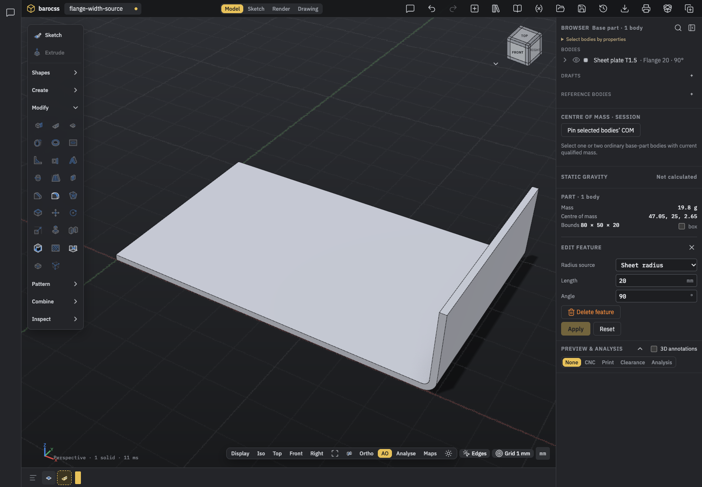
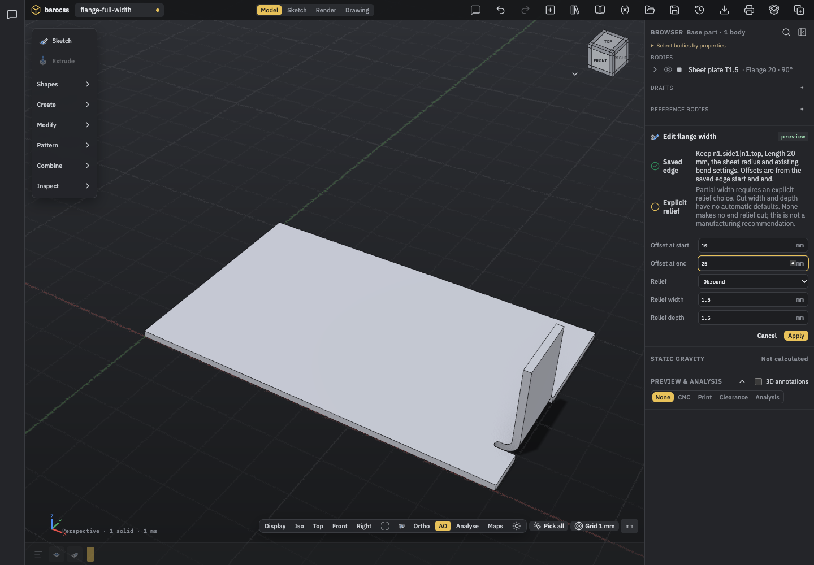
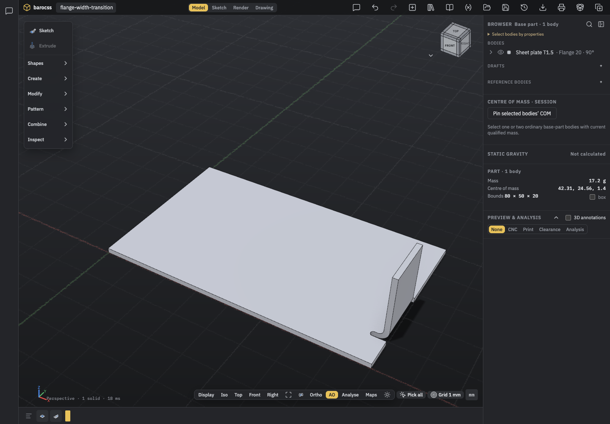

# Explicit full-to-partial Flange width History (#27)

Base: `53ece86076d9e6b965ed74adc9a90d567345a0e4`. A limited editing addition, not completion of #27; the umbrella issue remains OPEN.

## Baseline
Actual XY rectangle80×50 → Sheet T1.5/R1.5/K0.44 → inherited-radius Flange L20/90°/inside/Outer on the x-max top rim. Full-width creation omits offsets and relief. History had no width transition input; opening/closing History, creation Undo/Redo and Save/fresh Open preserved the original. The full-to-partial transition was NOT_RUN, not data loss. A separately created partial Flange with offsets10/25 and explicit obround relief1.5×1.5 passed native and persistence checks.

## Restricted addition
History offers Edit flange width only for the original full-width terminal three-node inherited-radius recipe above. The saved edge, exact original signature, complete rectangular parent topology, native original solid and flat result must be proved. Unsupported recipes, downstream nodes, bindings, own-radius overrides and uncertain references remain excluded. No schema, kernel or manufacturing-HOLD changes.

Start/end offsets follow the saved native edge direction. Zero/zero Apply returns the original document identity and preserves absent keys. Partial width requires an explicit relief choice. Rectangular/obround cut dimensions start empty, with no automatic thickness defaults. None is explicit and is not a manufacturing recommendation. Only offsets and relief change after native validation. Invalid width, missing/invalid relief, stale document or owner preserve the original atomically.

## Verification and limits
- New independent Model tests6/6 and Studio owner/session tests21/21 PASS. Model/native coverage includes None, Rectangular and Obround, invalid and mixed inputs, original signature/topology guards, foreign/mutated document and codec roundtrip.
- Fixed actual browser PASS: dirty History disables entry, zero/zero no-op, missing relief, empty cut dimensions, valid preview Cancel, impossible width refusal, valid explicit obround Apply, native geometry, Undo/Redo and Save/fresh Open.
- Actual partial folded volume6374.99584524258 matches independent oracle6374.995845242525. Strict BRep, bend radii/centres, relief cap radii, flange interval, tip height, flat area and bend allowance also pass. Undo restores original full-width volume7315.071880146629.
- Existing partial-generation browser and radius-source History browser regressions PASS. All three runs have empty error/source-change lists and completed context/browser/server cleanup.
- Model type-check and Studio TypeScript/Vite build PASS. Focused lint, syntax, diff and independent reviews PASS. A registered-error-code correction was made before heavy verification; no failed fixed actual/type/build stage occurred.
- Actual UI qualification is the x-max top rim and explicit Obround only. None/Rectangular have unit/native evidence, not actual UI qualification. Existing partial-width History is unchanged; general transition support, other directions and downstream references are not claimed.
- Baseline fixture SHA `23f23aeff69828f68c2effeb394b23b1205bedc6db1d95b4a512f9981b446c55`; fixed fixture SHA `2f9289cbbc1eebd6db23a689afcc11959aecae9d842db7150550a7ef4c5810de`.

Images contain synthetic models only. Exact commit CI and public-image rendering are recorded separately in #27.

