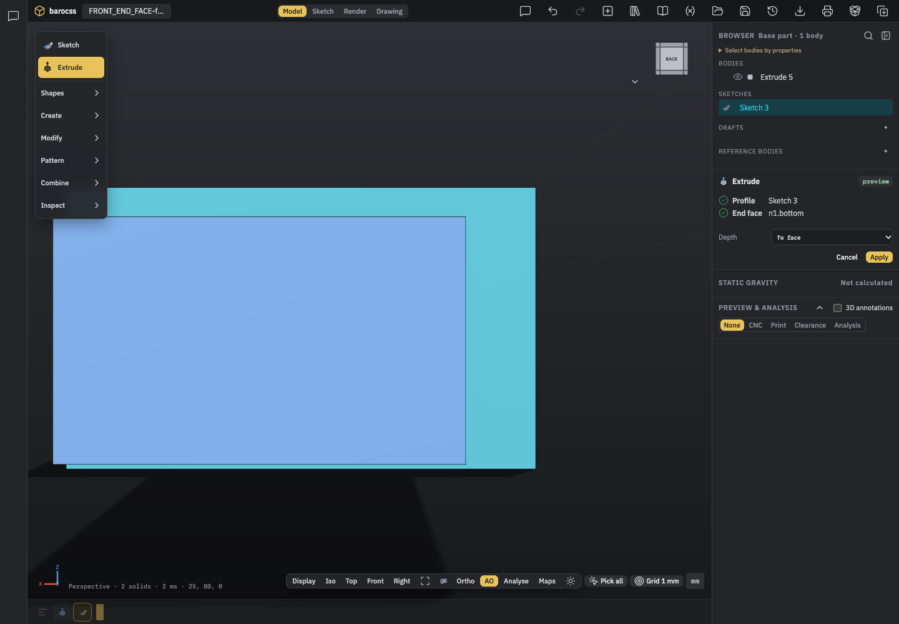
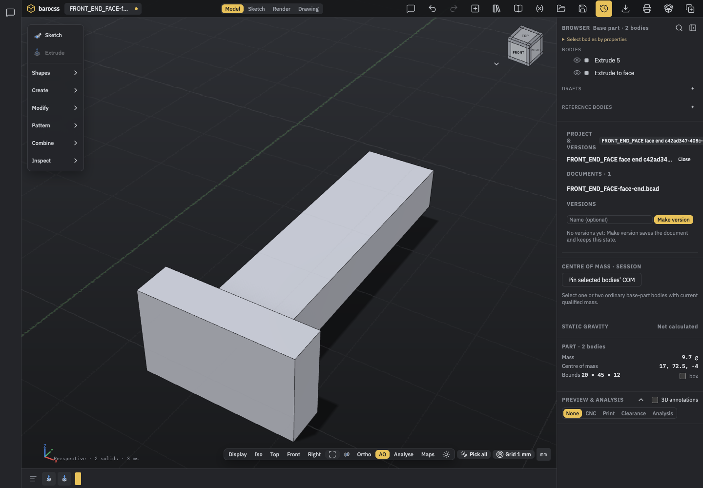

# Front XZ target-face Extrude · #637 · 2026-11-17

## User workflow and supported profile

A support extrusion from the standard Front XZ workplane can now terminate at its original opposed rectangular target face and follow that target's upstream position edits. This completes the third standard sketch frame for the existing bounded To face recipe, not arbitrary-plane or general-surface termination.

The accepted Front frame is exactly normal=[0,-1,0], xAxis=[1,0,0], with a finite in-range origin. `EndFrame` carries axes [X,Z,Y] and sign=-1: opposing target normal is +Y, height=originY−targetY, and endY=originY−height. Existing XY and +X-normal YZ use sign=+1 unchanged. Both input trim axes remain positive, so rectangular containment keeps its existing meaning.

Only the existing independent literal rectangle, preceding current exact solid, opposing one-loop rectangular planar face, complete footprint containment and positive local travel are admitted. Wrong/reversed/scaled/tilted axes, zero/reverse travel, wrong caps, holes and out-of-range results remain refused. Native positive-local-height start-cap identity, source signatures, downstream failure ownership and schema/recipe are unchanged. Older implementations refuse this frame rather than silently using a numeric fallback. No kernel widening or HOLD change.

## Verification and findings

- Pre-extension actual Chrome: no To face option; opening the unsupported Front recipe retains the document but reports non-current failed geometry. Undo restores the seed. That baseline used a square footprint; the final fixture was strengthened to an asymmetric 10×6 footprint.
- Initial unit test setup also exposed canonical output-key normalization (`stock/end` becomes `b1/b3`). Fixture keys were corrected; product serialization was not changed.
- Final Model focused `face-end-front face-end-extrude`: **21/21 PASS**, including translated asymmetric native corners, six faces, volume, centroid, cap normals, source immutability, reader, narrow-Z target, wrong cap, travel, axis and range refusals. Studio end-face-pick **1/1 PASS**.
- Model and Studio tsc PASS; scoped ESLint and diff check PASS; production build **7.00 s**.
- Independent static review caught a fixture camera error before fixed runtime: the Front sketch's opposed +Y cap must be picked from **Back**, not Front. Corrected fixture, no product camera change.
- Final actual Front and existing YZ browser flows both PASS on their first fixed executions, source capsules unchanged, no runtime/console errors and clean shutdown.
- **4/4 signed-axis mutations killed**: target normal, height, reconstructed end and Front admission sign. Baselines 21/21 before/after; original product hash unchanged.

## Actual Front fixture and oracles

Origin=(12,100,-7), local source rectangle=(0,0)..(10,6), target rectangle=(-5,-3)..(15,9), target thickness 5. Independent world mapping is (12+u,100−travel,-7+v). Target lower/start cap is `n1.bottom` (+Y), and source upper/end cap is `n3.top` (−Y).

The browser picks the target in Back view and authors the persistent To face recipe. It verifies two current bodies, all 16 native corners, cap normals/levels, volume and centroid against independent formulas at travel 20, 30, 40. Source volume is 60×travel; target volume 1200. Zero/reverse upstream travel is refused with accepted document, selection, history and dirty state unchanged. Upstream edit and Undo/Redo preserve the relation. A real browser-project Save is read back as bytes, page reload and project Open restore the full document, and another target edit to 40 recomputes the extrusion. This is OPFS Save/reload/Open, not a claimed external download or separate browser process.

The final post-Open edit to 40 is not saved again. External STEP-reader interoperability, arbitrary frames/surfaces, Join/Cut termination, and larger modeling workloads are NOT_RUN/outside scope. Existing YZ actual flow is separate regression evidence; XY is covered by the focused model suite, not a new actual XY run here.

## Reproduce

```sh
cd packages/barocss-cad-model && node scripts/test.mjs face-end-front face-end-extrude
cd ../../apps/cad-studio
FRONT_END_FACE_SOURCE_FROZEN=1 PW_DIR="$HOME/.cache/barocss-playwright" CHROME='/Applications/Google Chrome.app/Contents/MacOS/Google Chrome' node test/translated-extrude-end-face-browser.mjs /tmp/front --front
D844_SOURCE_FROZEN=1 PW_DIR="$HOME/.cache/barocss-playwright" CHROME='/Applications/Google Chrome.app/Contents/MacOS/Google Chrome' node test/translated-extrude-end-face-browser.mjs /tmp/yz --rotated
```

Actual pixels reviewed at 1440×1000: named target and To face preview, then reopened/re-edited two-body support geometry.



