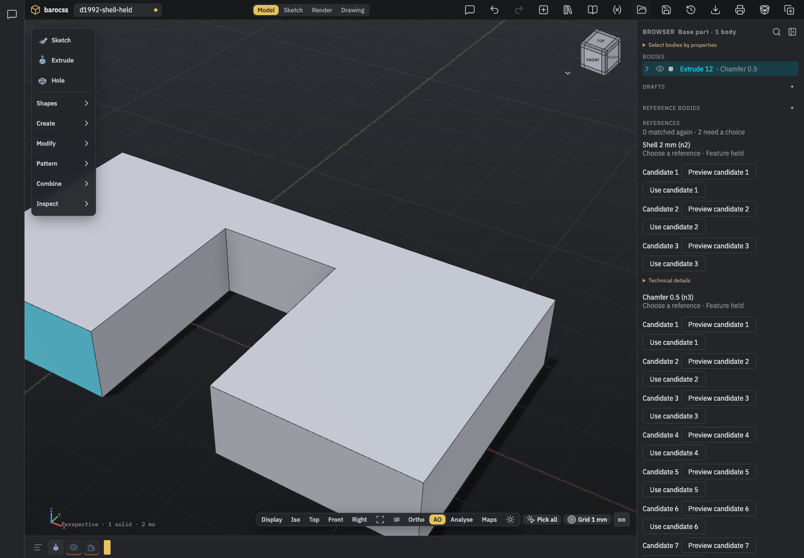

# D2000 — Preview a held Shell opening on its current source solid (#20)

Parent: `110ce366e489d563e02e3f386df6a9c6cb7c0e55`. Issue: [#20](https://github.com/barocss/cad/issues/20).

Previously **Preview candidate** looked for an edge even on Shell's opening-face row. Selecting the parent face for review now uses the current Problems row, reference slot, and visible owner; no name-only lookup in another body. The bounded lane admits a single planar opening on one visible solid carried through the held Shell and optionally downstream held Fillet/Chamfer passthroughs. It does not widen confirmation, shell geometry, or auto-retarget. Multiple outputs, non-unique names, hidden/competing view results, unsupported lineage and stale ownership refuse preview. **Use candidate** remains separately explicit.

Desktop Chrome took D1992's signed U-block fixture through preview, proposed Shell confirmation, downstream Chamfer preview and confirmation, two-step Undo/Redo and native Save/fresh Open. Before confirmation the existing Shell and Chamfer remained held, history state unchanged, and volume 31,200 mm³. Current viewport highlighted only `b3` face 0, independently matched to planar `n1.side[s1]` at 360 mm². Confirmed Shell volume 14,642.265482457435 mm³; confirmed Chamfer 14,638.615482457455 mm³; strict single-shell native validation each time and after reopen.

56 focused Studio tests pass. Tests cover exact face identity and refusal for wrong slot, hidden or foreign output, duplicate face names, and active or wrong downstream ownership. Studio types, production build, changed-path lint and diff check pass. Previous behavior was read from the old source, not rerun in older Chrome. No general direct-pick replacement, multi-opening Shell or broad topology recovery qualification. #20 remains open.

`D1992_SOURCE_FROZEN=1 node apps/cad-studio/test/dependent-shell-chamfer-reverify-browser.mjs <output> --shell-preview`

