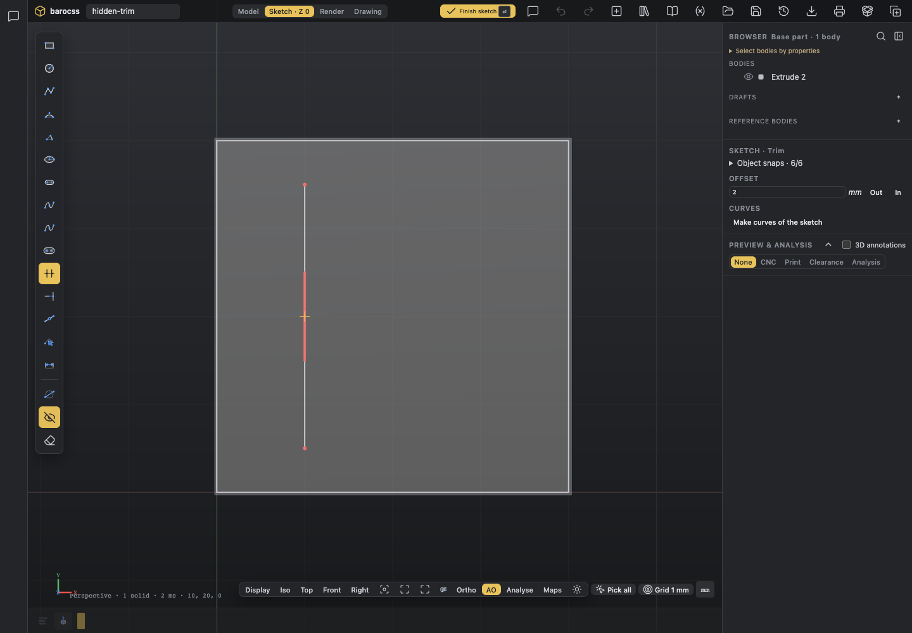
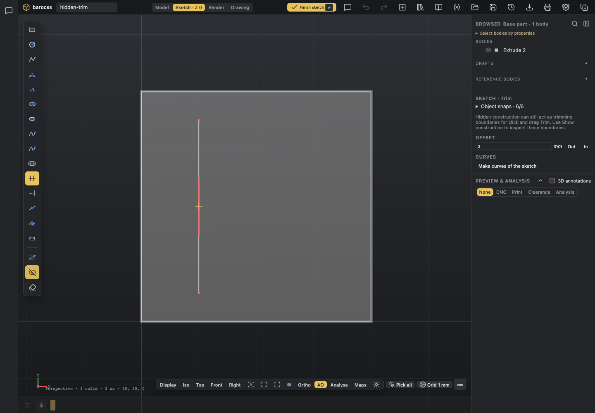

# Hidden construction remains a Trim boundary: disclose the current policy

Parent: `44278af96581b18f567c913c29a926e48a7b3e20`. Final owned files: SketchPanel, TrimBoundaryGuidance, the focused test and browser driver listed below.

#233 remains OPEN. This is an explanation of the existing policy, **not** implementation of the proposal to exclude hidden construction from cutting boundaries. No Model geometry, selection, history, solver, tolerance or saved schema changes.

`TrimBoundaryGuidance` reads the current `sketchCutInputs(...).protectedShapes` only while Trim is active. It excludes Bézier (no trim pieces) and polygons with fewer than two points. The active construction shape exemption remains the existing input policy. The notice says hidden construction **can** still act as click/drag trimming boundaries and names the existing **Show construction** action. It performs no crossing evaluation and has no mutation callbacks or retained state.

## Actual evidence

The existing D877 fixture supplies a 40×40×2 mm accepted box, two construction bounds at y=15/25, and a public-UI ordinary line from (10,5) to (10,35).

- Before: construction hidden, no explanatory notice; actual drag cuts exactly (10,15)→(10,25), despite the boundaries being invisible. Click Trim and Undo also work.
- After: same exact drag endpoints (independent projected literal endpoint check, <0.02 CSS px) and click/Undo behavior; explanatory text is visible. Show construction reveals the existing bounds and removes the notice; Select also has no notice.
- Three matching before/after snapshots have exact-equal accepted Doc, body snapshot, selection, history, dirty state and Undo/Redo button state. This is not a new native geometry qualification. No native subprocess was run.
- Both actual flows PASS, no page/console errors, watched source changes or downloads; context/browser/server cleanup completed. Before/after screenshots were directly reviewed, including panel text fit.

## Checks

From `apps/cad-studio`, Node 22.19.0, heavy gate serialized:
- `node scripts/test.mjs trim-boundary-guidance`: 3/3 PASS. SSR covers immutable inputs, current source/tool/visibility transitions, exact active-source exemption, Bézier/empty polygon exclusion and supported primitive categories. This is not a real React event/effect test.
- `../../node_modules/.bin/tsc --noEmit`: PASS, `/tmp/cad-trim-boundary-tsc02.log`.
- Target ESLint PASS for `src/ui/SketchPanel.tsx`, `src/ui/TrimBoundaryGuidance.tsx`, `test/trim-boundary-guidance.test.ts`, `test/hidden-trim-boundary-browser.mjs`; `/tmp/cad-trim-boundary-lint02.log`.
- Driver `node --check`: PASS.
- `../../node_modules/.bin/vite build`: PASS, 4.90s, `/tmp/cad-hidden-trim-build.log` (existing dynamic-import warnings retained).
- Actual driver: `HIDDEN_TRIM_FROZEN=1 node test/hidden-trim-boundary-browser.mjs /tmp/cad-hidden-trim-before01 --baseline`, then `/tmp/cad-hidden-trim-after01` without `--baseline`. Compact receipts/hashes in [qualification.json](qualification.json).

Initial setup failures retained: missing frozen environment variable stopped before browser launch; SSR used node server instead of this runner's `server.edge`; the first tsc command used a nonexistent local binary path; initial lint found two unused driver declarations. These were harness/setup corrections, not product failures. Final checks above ran after correction. The baseline driver initially inherited D877's broader qualification string; its assertions and recorded observations cover only the narrow flow described here, not D877's native/Save/Open claims.

No fresh Save/Open, tab switching, all curved/multi-target Trim cases, mobile or physical-DPI matrix was run. #233's hidden-boundary policy difference and previously unqualified actual tab transition remain unresolved. Existing eight WIP files, DirectPanel and all HOLD scopes were untouched.

The parent directly inspected before/after/Show-construction PNGs: synthetic fixture only, no personal or authentication information. [Final check logs](checks.txt) preserve original log hashes. Before/after frozen source counts were 531/532; no changes occurred within either run.
