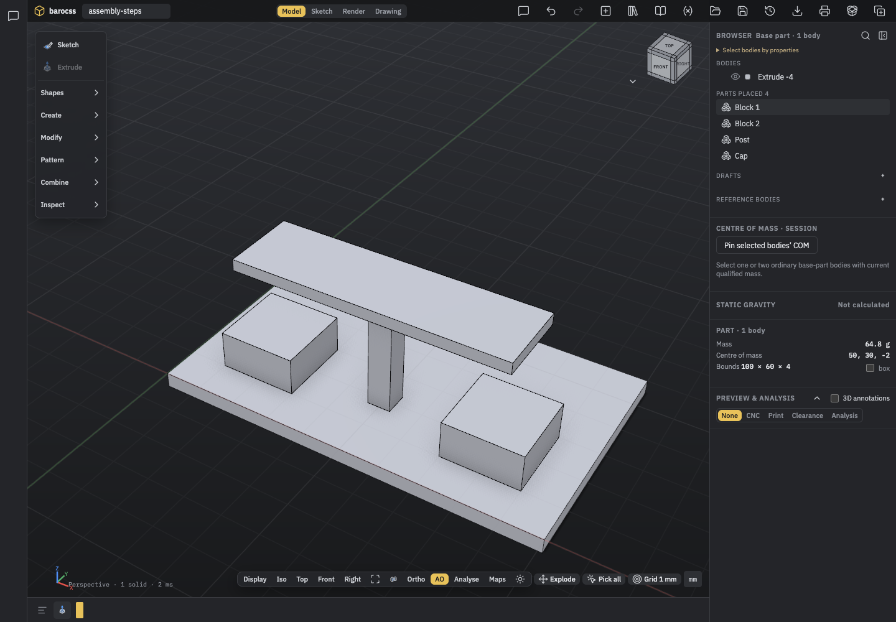
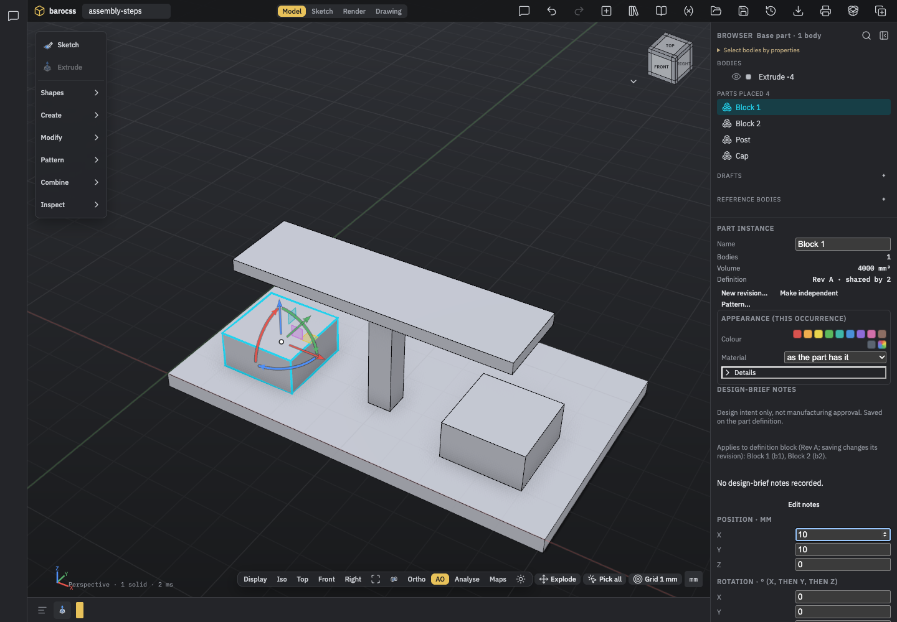

# Instance field Escape cancellation

Escape in an instance name/placement input now cancels its pending text locally, restores the saved value and retains focus/selection. It does not bubble to the global selection-clear command. Enter and blur still commit valid edits as before.

## Verification

- Actual Chrome baseline: Escape cleared instance selection and removed the inspector; next field read timed out. The model itself remained unchanged, so this is a field-local cancellation UX improvement, **not** an accidental-model-commit fix.
- Fixed actual Chrome PASS: nine dirty input cases (position XYZ, rotation XYZ, name, empty numeric and empty name) all restore their prior value, retain focused input/selection and remain no-ops on subsequent Tab.
- Enter commits X=25; cancellation after that restores the newly saved 25. Undo/Redo return the correct documents. Blur commits rotation Z=30. Other instances and source nodes preserved.
- Actual native Save download/fresh Open preserves X=25 and Z rotation30.
- Before/fixed Escape screenshots inspected. Source-frozen browser and cleanup passed.

Driver: `INSTANCE_FIELD_CANCEL_FROZEN=1 node apps/cad-studio/test/instance-field-cancel-browser.mjs <output>` with harness Chrome/PW_DIR.

## Limits

Top-level instance inputs only. No nested assembly, mate-driven transforms, pattern occurrences or neutral exports. Existing Enter/blur semantics, numeric validation and model/history contracts remain unchanged.

