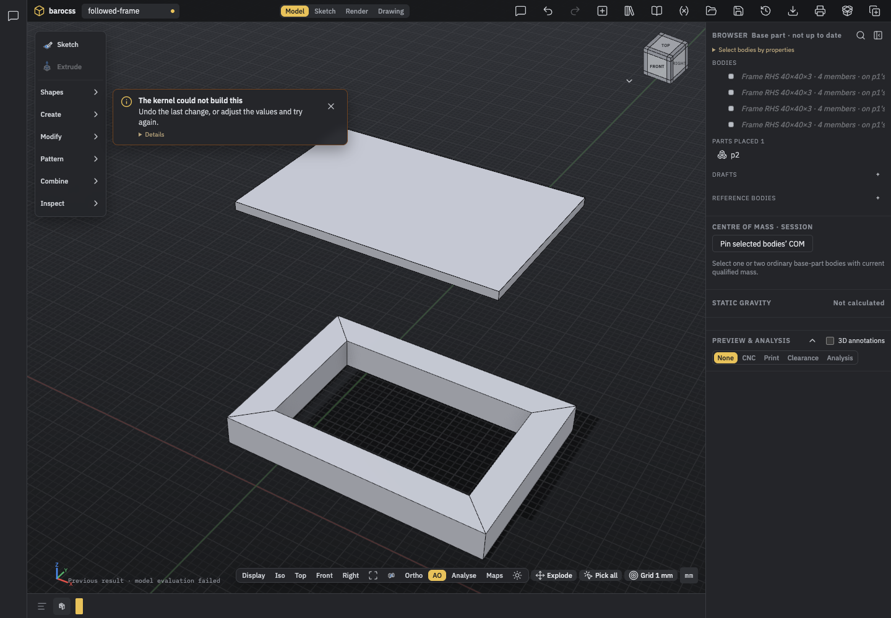
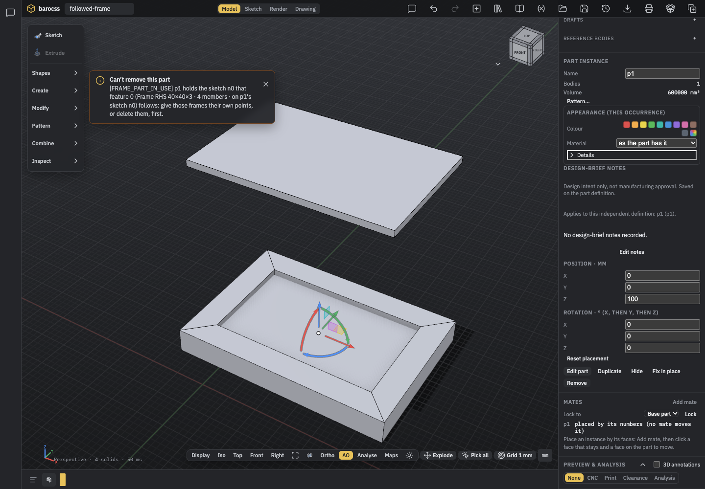
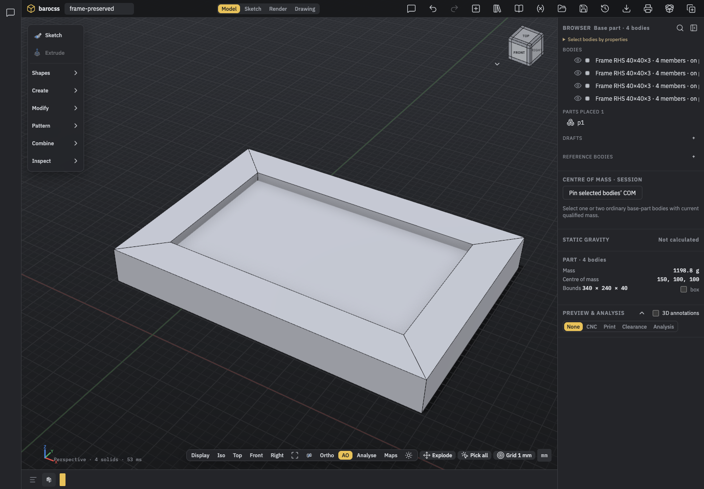

# Inspector frame-reference deletion protection (#663)

Baseline on e97f0c01e: open the existing FRf2 document (p1 holds a 300×200 sketch; a base RHS frame follows it). Inspector Remove deletes p1 and leaves the application at “Previous result · model evaluation failed”. The grouped delete_part command already refuses the same document with FRAME_PART_IN_USE. This is an actual UI path, not an inferred API-only failure.

The Inspector now calls the existing checkPartDelete / firstProblem guard before committing or clearing selection. Existing pattern/cut/step refusal remains first. No new deletion policy or frame schema.

## Verification
- FRf2 core regression **3/3 PASS**.
- Studio TypeScript and changed-file ESLint PASS.
- Read-only code review: no blocker.
- Actual Chrome baseline FAIL on preserved-document assertion; after fix PASS: p1 deletion is refused with the original full document, selected Inspector and Undo-enabled state unchanged. Unrelated p2 removes normally. Undo restores the original; Redo reapplies only p2 removal. Native Save / fresh Open keeps the frame and p1, four frame bodies shown.
- Frozen source unchanged; native roundtrip semantic equality; browser/server closed. No unrelated WIP or HOLD changes; doc-sync remains stopped.

